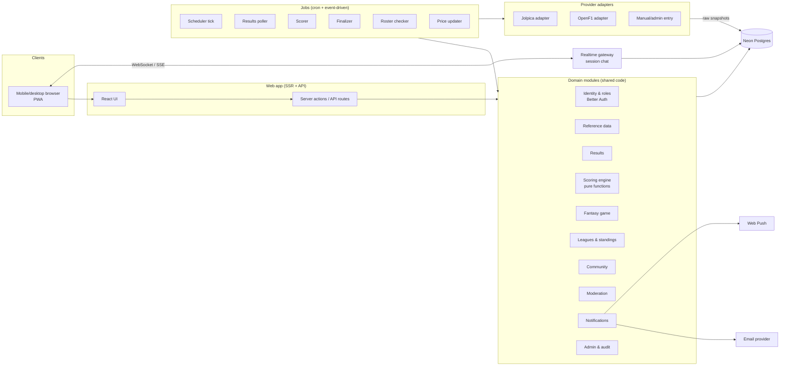

# Gridlocked — High-Level Design

**Status:** Approved 2026-10-27 (phase 1 of 5 complete)
**Date:** 2026-10-26 (updated 2026-10-27: working name changed from "Paddock Club" to "Gridlocked"; hosting moved to Vercel Hobby, free-tier plan added in §11.4, monetization plan added in §16; updated 2026-10-31: framework changed to TanStack Start after the framework and hosting spike, §11.5)
**Next phases:** 2. Data model → 3. UI/UX in Claude Design → 4. Implementation plan → 5. Build

This document describes what we're building, how the major pieces fit together, and the decisions still open. It is not a schema or an implementation plan; those are phases 2 and 4. Each choice in it is labelled as one of:

- **Decided:** you stated it in the brief or in your answers.
- **Verified:** I checked it against a source; the source is linked.
- **Proposed:** my recommendation, waiting for your review.
- **Decided 2026-10-27:** settled in the phase-1 decision round (see the log in §14). Earlier "Proposed" items not listed there are still open for your review.

---

## 1. Intent

Gridlocked (working name, §13.1) is an unofficial home for F1 fans that does two things well:

1. **A community built around race weekends.** The forum knows the calendar. Each session gets its own thread automatically, that thread becomes a live chat while the session runs, then turns into a threaded discussion. Results are posted after each session, and people who haven't watched yet can hide anything that would spoil it.
2. **A fantasy game that plays like the official one.** Same team structure, budget cap, boosts, chips, transfers and scoring, minus the three things free data can't support: overtakes, pit stop times, and Driver of the Day.

The two halves strengthen each other. Fantasy gives people a reason to come back every weekend, and the forum gives fantasy players a place to talk. Private leagues get their own discussion threads, and league picks are revealed in race threads after lock.

### Success looks like (proposed)
- Fantasy scores that players trust: every point can be explained line by line, and corrections are applied automatically and visibly.
- Race weekends that run themselves. Threads open, chat runs, results appear and scores update with no admin action on a normal weekend.
- A forum that stays clean with little moderator time.
- Running free at launch (§11.4). When usage outgrows the free tiers, costs grow with it: about $20–40/month for a busy community.

### Non-goals
- Live timing, live positions or live telemetry. Live data requires paid access.
- Overtake, pit stop and Driver of the Day scoring.
- Head-to-head leagues.
- Native mobile apps for now. The web app is built mobile-first and can be installed as a PWA.
- Any feature that needs paid data.

### Anti-goals (it fails even if it technically works)
- Scores silently wrong after a stewards' decision or a mid-season driver swap.
- Spoilers leaking to someone who asked not to see them, through a title, a notification, a fantasy score or the home feed.
- Looking or sounding like an official F1 product.
- Moderation that depends on someone being online every race weekend.

---

## 2. Constraints

| Constraint | Source |
|---|---|
| Better Auth with the admin plugin for auth and user management | Decided |
| Neon Postgres for the database | Decided |
| Hosting: Vercel (Hobby, free) + Neon (§11.2) | Decided 2026-10-27 (my recommendation after the free-tier comparison, §11.3) |
| Run on free tiers at launch (§11.4) | Decided 2026-10-27 (your goal) |
| Money comes from advertising, not paid memberships, and only once the data licensing allows commercial use. Gridlocked launches non-commercial (§16) | Decided 2026-10-27 (yours) |
| React + TypeScript | Decided (your answer) |
| Free data only: Jolpica-F1 and OpenF1 (historical/completed sessions only) | Decided |
| Clients never call data providers. The provider layer is swappable (e.g. Sportradar later) | Decided |
| No "F1"/"Formula 1" in the product name or design, no F1 logos, plus an "unofficial, not affiliated" disclaimer | Decided |
| Mobile-first web app | Decided |
| Launch at the start of the 2027 season (~March 2027), building and testing fantasy first with 2026 data | Decided (your answer) |
| Player prices come from our own published formula, not copied from the official game | Decided (your answer) |
| Grid size is never hard-coded (2026: 22 drivers / 11 teams) | Decided |

### Facts verified for this design
- **Official rules:** I read the 2026 scoring, chips, transfers, prices and leagues from the [official game rules](https://fantasy.formula1.com/en/game-rules) and [FAQ](https://fantasy.formula1.com/en/faqs) on 2026-10-26. The scoring tables in your brief match the official ones exactly. Details are in §6.
- **Jolpica:** 4 requests/second burst and 500/hour sustained, unauthenticated. The terms say these limits will *decrease* when tokens arrive ([rate limits](https://github.com/jolpica/jolpica-f1/blob/main/docs/rate_limits.md)).
- **OpenF1:** the free tier covers all historical sessions since 2023, at 3 requests/second and 30/minute. Live data is paid ([openf1.org](https://openf1.org)).
- **Licensing:** both Jolpica and OpenF1 license their data as **CC BY-NC-SA 4.0**, which means non-commercial use, attribution required, and share-alike ([Jolpica terms](https://github.com/jolpica/jolpica-f1/blob/main/TERMS.md); openf1.org footer and FAQ). See §13.
- **2026 data has what we need.** Samples pulled from Jolpica:
  - 23 rounds; sprints at rounds 2, 4, 5, 9 and 12.
  - The Lawson/Hadjar/Tsunoda swap shows up in the results data. Lawson is with `red_bull` in rounds 12–14, Tsunoda is with `rb` in rounds 12–14, and Hadjar has no rows in 12–14. That makes it a ready-made test case.
  - Race `positionText` values seen: numbers, `R` (retired) and `W` (withdrawn).
  - No pit-lane starts (`grid = 0`) in 2026 yet, so that case needs synthetic tests.
  - In round 18 qualifying (US GP), 16 drivers have a Q2 time but only 9 have a Q3 time, even though 10 reached Q3. **"Reached Q3" can't be read from whether a Q3 time exists.** It has to come from classified position plus per-season knockout cut-offs.
  - **Jolpica has no 2027 data yet** (0 races, 0 drivers). The 2027 calendar and entry list will need admin seeding or editing before the season.

---

## 3. Architecture overview

### 3.1 Shape: a modular monolith (proposed)
One TypeScript codebase, one database, with clear module boundaries. A single small team gets the most out of this shape: one deploy, one set of types, transactions across modules. The boundaries let us split out a service later if one part ever needs it. Two pieces run outside the web app's request/response path:

- **Jobs:** the scheduler, poller, scorer and finalizer. They are triggered by cron or by events and must be idempotent.
- **Realtime gateway (later, not at launch):** would keep live chat connections open during sessions. At launch, chat-mode threads refresh every few seconds instead (§11.2).

Both import the same domain modules as the web app; they are entry points, not separate apps.



### 3.2 Modules and what each owns

| Module | Owns | Notes |
|---|---|---|
| Identity & roles | users, sessions, roles, bans | Better Auth with the admin plugin. App roles: `admin`, `moderator`, `user`; trust level is separate (§7.4) |
| Reference data | seasons, events, sessions, drivers, constructors, per-event entries, per-event driver availability | Read-mostly; changed by sync jobs and admins |
| Ingestion / provider adapters | raw provider snapshots, provider ID mapping | The only code that knows Jolpica or OpenF1 exist |
| Results | per-driver, per-session facts, with source, status (provisional/final) and admin overrides | Never stores points |
| Scoring engine | pure functions: (ruleset, results, entries, availability) → asset score lines | No I/O, so it's easy to test exhaustively |
| Fantasy game | teams, lineups, transfers, chips, boosts, prices, the points ledger | |
| Leagues & standings | leagues, memberships, standings | Standings are derived from the ledger |
| Community | categories, threads, posts, chat, votes, spoiler state, hubs, rumors | |
| Moderation | reports, the review queue, automated filters, trust levels, rate limits, mod actions | |
| Notifications | in-app, email, web push; preferences; spoiler-safe templates | |
| Admin & audit | admin consoles, review queues, the audit log of every override | |

### 3.3 Rules that keep the design honest
1. **The three data layers never mix (decided).** Reference data, results and game data live in separate modules and tables. Results never contain points. Game data never edits results.
2. **Only adapters know providers exist.** Everything else uses our own IDs. Provider IDs (`max_verstappen`, OpenF1 driver numbers) live in a mapping table. Switching to Sportradar means writing a new adapter, not a migration.
3. **Correctness never depends on a job running on time.** A late cron run must not let anyone change a lineup after lock, and must not score the wrong lineup (§5.2).
4. **Every job is idempotent and safe to re-run.** Scoring a session twice gives the same ledger.
5. **Everything an admin changes is audited.** Who, what, when, why, and the before/after values.
6. **One clock abstraction.** All "now" checks go through an injectable clock, so the 2026 replay harness can simulate a whole season (§12). **How the app and the database agree (decided 2026-10-28, decision 20):**
   - Each entry point settles "now" **once**, and everything below it uses that instant through `fixedClock`. An entry point is a page request, an API call, a cron tick or a job run.
   - SQL that needs the time takes it as a `$now` parameter, never `now()`.
   - In production, the entry point uses real time, or the trigger's `scheduled_at` for a cron tick, with no extra query.
   - Only a replay deployment, flagged by `CLOCK_MODE=replay`, reads `app_now()` once at the entry point. The replay harness moves time by updating `settings.simulated_clock`.
   - Database triggers, such as the lock check, keep `app_now()` as the enforcement backstop.
   - A production deployment refuses to run if a `simulated_clock` row exists, so a stray row can't freeze the real clock.

---

## 4. Data ingestion and the results pipeline

### 4.1 Providers
| Provider | Used for | Not used for |
|---|---|---|
| **Jolpica** (primary) | schedule and session times; qualifying (Q1/Q2/Q3 times, position); sprint and race results (grid, position, positionText, status, fastest lap rank); constructor per result row; history back to 1950 for hub pages | live anything |
| **OpenF1** (secondary) | who took part in completed practice sessions (roster signal); cross-checking results where its endpoints cover them | live data (paid) |
| **Manual / admin** | the 2027 pre-season calendar and entry list; corrections; emergency results entry when providers are late or wrong | |

All provider calls are server-side and go through a shared HTTP client. That client applies the rate limits (configured below Jolpica's 4/s and 500/h, and OpenF1's 3/s and 30/min), caches responses, backs off on 429s, and records each call.

### 4.2 Raw snapshots, then normalized results (proposed)
Each provider response we use is stored unchanged as a **raw snapshot**: provider, endpoint, parameters, fetched-at, content hash and JSON body. A normalizer turns snapshots into canonical result rows. This gives us:
- **Change detection for free.** A new snapshot hash for a session we already had means something changed, such as a stewards' penalty.
- **A perfect audit trail.** "Why did my score change?" can be traced to an exact provider response.
- **Replay testing.** The 2026 season can be re-run from stored snapshots without calling the API again.

### 4.3 Result rows: status and overrides
Each result row records its source and a status: `provisional`, `under_review` or `final`. **Admin overrides are stored as a separate layer, not edits to provider rows.** The effective result is the override if one exists, otherwise the provider value. That way a later re-ingest can't silently overwrite a correction an admin made, and removing an override cleanly reverts to provider data.

### 4.4 Pipeline stages
```mermaid
sequenceDiagram
  autonumber
  participant S as Scheduler tick (every minute)
  participant P as Poller
  participant N as Normalizer
  participant V as Validator
  participant SC as Scorer
  participant F as Finalizer
  participant A as Admin queue

  S->>S: Open session threads, flip chat/discussion modes,<br/>send pre-lock reminders
  S->>P: Session ended → start polling
  loop until results appear (backoff: 5m → 15m → 60m)
    P->>P: Fetch from provider (rate-limited)
  end
  P->>N: Raw snapshot stored
  N->>V: Canonical results (provisional)
  V->>V: Sanity + roster checks
  alt anomalies
    V->>A: Flag (results held as under_review)
  else clean
    V->>SC: Score session
  end
  SC->>SC: Recompute asset scores → team ledger → standings
  SC-->>S: Post results to thread (spoiler-protected)
  loop for ~48h after the race
    F->>P: Re-fetch; compare snapshot hash
    alt changed
      F->>SC: Re-score affected sessions
    end
  end
  F->>F: Mark event final → trigger price update
```

**Validator checks (proposed):**
- Every pool driver is accounted for.
- No unknown driver or constructor IDs.
- Classified positions are contiguous.
- Grid positions are plausible.
- No more than one fastest lap.
- Each constructor has the expected number of cars.
- Driver/constructor pairs match the event's entry list. A mismatch is a roster surprise (§8).

Any failure holds the session as `under_review` and puts it in the admin queue. **The results thread can still post while scoring is held**, because those are separate concerns.

**Late or missing data:**
- The poller gives up after a configurable window (proposed: 24 h) and alerts admins.
- Admins can enter or paste results by hand. Manual results go through the same validator and scorer.
- OpenF1 is tried as a fallback source where its endpoints cover the session.

**Finalizer (proposed):** re-checks at about +2 h, +6 h, +24 h and +48 h after the race, then marks the event `final`. Admins can reopen a final event, which is audited. Rare later corrections, like a DSQ weeks afterwards, are an admin action that re-scores the event.

### 4.5 Scheduling without fragile timing
The scheduler is a **once-a-minute tick** that looks at the calendar and enqueues due work: open threads, flip thread modes, start polling, send reminders. Work goes into a small Postgres-backed job table with uniqueness keys, so a duplicate tick can't double-act. The jobs' code lives in the shared modules, so it runs on whichever host we choose (§11).

**The tick must not wake the database when nothing is due (proposed, 2026-10-27).** On Neon's free plan the database sleeps after 5 minutes idle, and its awake time is the main free-tier budget (§11.4). A tick that queried Postgres every minute would keep it awake all month, using about 180 compute-hours against a free allowance of 100. So:
- The tick first reads a small **published due-times file**: a static JSON note of the next time anything is due, rewritten whenever the calendar, lock times or job queue change. **It lives in Neon Object Storage** (bucket `scheduler`, key `due-times.json`; decided by the M1 spike, 2026-10-29). Reading it never wakes the database and costs nothing per request.
- The tick connects to Postgres only when a due time has passed. Between race weekends that's a few times a day; during a weekend it's around sessions, polling and the finalizer.
- Correctness doesn't depend on this file. Lock is enforced at write time (§5.2), and the job table's uniqueness keys stop double work. The tick republishes the file after every wake, and republishes a missing or malformed file at once (one wake). A safety tick **every 6 hours** also checks the job table directly and republishes it, as a backstop for an enqueue that skipped its republish. At worst such a job runs up to 6 hours late. M1's numbers put an hourly safety tick at about 15 CU-hours a month, the scheduler's largest single cost, which is why it's 6-hourly. A skipped cron minute, which M1 saw once, only delays due work by a minute.
- **From M1 ([docs/spikes/M1-scheduler.md](../spikes/M1-scheduler.md)):** about 5 minutes of database compute per wake (inferred from measured awake time), a burst of 20 due jobs in one wake, and an estimated ~11 CU-hours a month for the whole scheduler with the 6-hourly safety tick.

---

## 5. Fantasy game design

### 5.1 Structure
| Item | Rule | Source |
|---|---|---|
| Team | 5 drivers + 2 constructors, $100M cap | Decided / verified |
| Teams per user | up to 3 | Decided / verified |
| Leagues per team | unlimited in principle, with a soft cap of 50 to limit abuse | Decided / cap is my call (2026-10-27) |
| Global league | every team is automatically a member | Decided |
| Automatic leagues | every team also joins its owner's favorite-constructor league, favorite-driver league and country league (country is optional and self-declared; no country set means no country league) | Decided 2026-10-27 |
| Mini-leagues | leagues that count only a chosen range of races, e.g. "European summer" | Decided 2026-10-27, at launch |
| Tiebreaker | the team that **reached the tied total first** ranks higher (§5.6) | Decided 2026-10-27 |
| Public and private leagues | joinable by code; the user picks which of their teams to enter | Decided / verified |
| Head-to-head | no | Decided |
| Boost | one driver per race scores x2 (drivers only, not constructors) | Verified |
| Lock | normal weekends: start of Qualifying. Sprint weekends: start of **Sprint Qualifying**, with one lock covering Sprint, Qualifying and Race | Verified for normal weekends; sprint weekends decided 2026-10-27 (check against the official game on the first 2027 sprint weekend; `lock_at` is per-event config) |

### 5.2 Lineups and locking (proposed)
- **Lineups are versioned, never overwritten.** Each save creates a new version with a timestamp. The lineup that counts for an event is the latest version saved before that event's `lock_at`.
- **Lock is enforced at write time.** The API refuses saves when `now ≥ lock_at`, and a database check refuses them too. A late job can't create a window for late edits, and a lineup snapshot can be computed at any time afterwards with the same result.
- **`lock_at` belongs to the event, not the calendar.** It starts as the scheduled start of the locking session. An admin can move it, which is audited, for example when a session is rescheduled before it starts.
- **No late entry (decided 2026-10-27).** A team created after an event's `lock_at` starts scoring at the **next** event. This differs from the official game, which lets late teams score from the race. A team's "first race" is its first locked event, which matters for unlimited transfers and chip unlocks.

### 5.3 Transfers (verified rules; proposed mechanics)
- Unlimited changes before a team's **first** race.
- After that: 2 free transfers per race. At most **one** unused transfer carries over, and carry-overs don't build up beyond that. Each extra transfer costs -10.
- **Transfers are counted as the net difference** between the previous event's locked lineup and this event's locked lineup. Swapping a driver out and back in costs nothing. This is new in 2026 and matches how we version lineups.
- At lock time we record the team's transfer count, free allowance, carry-over and penalty for that event, so later rule or data changes can't rewrite history. Each penalty goes into the ledger as its own line.

### 5.4 Chips (verified rules)
Six chips. Each can be used once per season, only one per race, and can't be cancelled once played.

| Chip | Available | Effect | Design note |
|---|---|---|---|
| Autopilot | from race 1 | After scoring, the 2x Boost moves to the team's highest-scoring driver | Applied as ledger lines after base scoring |
| x3 Boost | from race 1 | One driver scores x3 this weekend; can't be the 2x Boost driver | Can't be stacked with the regular Boost |
| No Negative | from race 1 | Any negative **scoring category** is floored at 0 for each driver/constructor (new in 2026: per category, not per total). Transfer penalties still apply | Ledger lines need a category key so this can be applied and explained |
| Wildcard | after the team's first completed race | Unlimited free transfers until the next lock | |
| Limitless | after the team's first completed race | Unlimited transfers **and** no cap for one race; the team reverts afterwards; no carry-over transfer | Needs a "temporary lineup" that reverts after the race |
| Final Fix | after the team's first completed race | One swap between the end of Qualifying and the start of the race, with no transfer cost. The outgoing driver keeps points already scored; the incoming one scores from the next session; Boost moves with the slot. The team reverts after the race | Lineup versions need an "effective from session" field, not just a lock |

The names above are the official game's and are used here only as reference. **We use our own chip names and rules text, with the same mechanics** (decided 2026-10-27). Names will be proposed in phase 3.

### 5.5 Prices (decided approach; proposed formula outline)
- **Starting prices:** an admin sets them before the season, with a suggested starting point from the previous season's points (proposed). Drivers added mid-season are priced by an admin.
- **Changes:** after each race weekend is final, prices change once and then stay fixed until the next race. This mirrors the official game.
- **Formula (outline; details in phase 2):** each asset's average fantasy points over its **last 3 races** is compared to what its current price "expects". That gives one of four or five tiers of change, such as -0.3, -0.1, +0.1 and +0.3, scaled by price band. Prices are clamped to **$3M–$34M**, the official bounds. All constants live in versioned config, like the scoring rules. We publish the formula on the site.
- **Team value follows prices (decided 2026-10-27, mirroring the official game).** When the prices of a team's assets rise or fall, the team's purchasing power rises or falls with them. The exact mechanics are settled in phase 2: buy and sell prices, a bank balance, and what Limitless does to value.
- **Corrections after a price change:** prices aren't recalculated retroactively (proposed). If a correction lands after prices moved, it changes points, not prices.

### 5.6 Scoring engine (decided principles; proposed structure)
- **Rules are versioned data.** A `ruleset` is attached to a season, and a new version can be attached from a given event onwards. A rule has:
  - a session type, and whether it targets drivers or constructors;
  - a kind: position table, positions-delta with optional cap, flag bonus, status penalty, knockout-stage bonus, per-driver DSQ penalty, or aggregate of drivers;
  - parameters;
  - a **category** key, which No Negative uses.
- **Knockout stages come from position plus per-season cut-offs** (2026: top 16 reach Q2, top 10 reach Q3), never from whether a Q2 or Q3 time exists (see §2).
- **Positions gained or lost** compare the official starting grid with the classification. A pit-lane start counts as last on the grid. Unclassified drivers get only the NC penalty, never positions-lost. The sprint caps positions lost at -10.
- **Driver points follow the person; constructor points follow the car (decided).** A constructor's score is the sum over whoever drove its cars at that event (from `entry` rows), plus constructor-only bonuses.
- **Inactive pool drivers** (injured, replaced, or absent from the grid) still get NC/no-time penalties per the official rules, because every pool driver has a per-event status (§8).
- **Two-tier ledger (proposed; settled in phase 2):**
  1. **Asset score lines:** one row per asset × session × rule. Computed once and shared by every team.
  2. **Team ledger lines:** for each team, session and owned asset, a base-points line that refers to the asset's total, plus separate lines for Boost, x3, Autopilot, No Negative and transfer penalties.

  The breakdown is the same as one big ledger, but with roughly 10× fewer rows. That matters once there are tens of thousands of teams: a single flat ledger could reach about 2M rows per race weekend.
- **Recompute is delete-and-replace per session** inside one transaction. It's tagged with a scoring run ID and the ruleset version used.
- **Standings** are sums of the ledger. Per-team, per-event totals are materialized after each scoring run. League tables and global ranks are computed from those totals with window functions and cached.
- **Tiebreaker: earliest to reach (decided 2026-10-27).**
  - When teams are tied, the team whose running total first reached the tied value ranks higher.
  - For mini-leagues, the running total covers only that league's races.
  - **My calls, to confirm in phase 2:**
    - "First" is measured per scoring event (race weekend), using the per-event totals we already materialize.
    - Teams that reached the total at the same event share the rank.
    - The order is recomputed from the ledger after every re-score, so corrections can change it.
  - This rule is harder to explain to users, so the standings page should show it with a short note.

---

## 6. Official rules recap (verified 2026-10-26)
Your scoring tables match the [official rules](https://fantasy.formula1.com/en/game-rules) apart from the excluded items: overtakes in the sprint and race, Driver of the Day, and constructor pit stop points and records. Other confirmed details:
- Qualifying "no time set" (-5) applies to inactive drivers too.
- NC/DSQ penalties in the sprint (-10) and race (-20) apply to all drivers, including inactive ones and those missing from the final grid.
- Unclassified drivers get no positions-lost points.
- Scores are shown as provisional after each session and finalized once the data is validated.

---

## 7. Community design

### 7.1 Structure
- **Categories:** for example Race Weekend, General, Fantasy, Teams & Drivers, Technical, Silly Season, Off-topic. Admins configure them.
- **Threads** have a *kind*: `user`, `session` (auto-created), `results`, `league`, `rumor`. A thread can be linked to a session, which makes it spoiler-scoped.
- **Posts are nested, Reddit-style (decided 2026-10-27).** Replies go about 4 levels deep on mobile, with a "continue thread" link beyond that. Votes sort the best replies to the top.
- **Media is links and embeds only at launch (decided 2026-10-27).** Posts can link to or embed media hosted elsewhere (e.g. YouTube, Imgur, X), from an allow-list of embed providers. There are no uploads, so we have no storage or image moderation to run. Uploads may come later.
- **Votes:** upvote/downvote on threads and posts feed sorting and the author's reputation. Proposed: downvotes require trust level 1+.

### 7.2 Race-weekend lifecycle (decided concept; proposed details)
| When | What happens |
|---|---|
| Event week starts (proposed: Monday) | An event hub page appears, plus a session thread for each session: FP1–3, Sprint Qualifying, Sprint, Qualifying, Race |
| Session start − 15 min → session end + 15 min | The thread shows **live chat mode**: flat, newest at the bottom, short messages, slow mode, stricter rate limits |
| After the session | The thread switches to **discussion mode**. Chat history is archived and can be collapsed above the discussion |
| Results available | The system account posts a results summary in the thread, spoiler-protected |
| After lock | League picks are revealed in the race thread (phase 2+) |

**Chat messages are stored apart from posts (proposed).** They're high-volume, short-lived and moderated differently, so they get their own table and retention policy. Discussion posts stay permanent.

**There is no live timing.** The live view is chat only. We may show session status, such as "Qualifying — live now", from the calendar. Positions can't be shown live without paid data.

### 7.3 Spoiler protection (decided; proposed mechanics)
- Every result-revealing item is tied to a **session**: results posts, session and results threads, fantasy scores, standings changes, notifications, and hub page "last result" widgets.
- Each user has a **watched** state per session. Until a session is marked watched, inside a *spoiler window*:
  - auto-thread titles stay generic, e.g. "Race — Discussion" rather than a headline;
  - results, comments and chat in that thread are hidden behind tap-to-reveal;
  - **fantasy scores and league standings for that event are hidden too.** Fantasy points give away results; this is easy to miss and important to get right;
  - notifications and emails use spoiler-safe wording.

  The spoiler window runs from the session's start until the user marks it watched, or for **7 days** (decided 2026-10-27).
- **User-created threads during a spoiler window:** in the Race Weekend category, new thread titles go through a spoiler-safe check (a soft warning plus a "contains spoilers" flag), and moderators can retitle. This is policy plus tooling, not a guarantee.
- **Logged-out visitors are spoiler-safe by default (decided 2026-10-27).** A reveal-all toggle is saved in their browser.
- Pages are rendered spoiler-safe by default and revealed per user. That keeps public pages cacheable.

### 7.4 Trust levels, rate limits, filtering (proposed; modeled on Discourse)
| Level | How it's reached | Can |
|---|---|---|
| TL0 new | signs up with a verified email | reply and chat; no links or images; slow rate limits; can't start threads |
| TL1 basic | e.g. 3 days and 10 posts with no upheld flags | start threads, downvote, post one link per post |
| TL2 member | sustained positive activity | full links; higher limits; their flags carry more weight |
| TL3 regular | long-term, well-voted | flags can auto-hide content pending review; can retitle spoiler threads |
| Moderator / Admin | assigned | full tools |

All thresholds are config.

**Filtering pipeline (each step cheap first):**
1. Rate limits by trust level and action.
2. Hard rules: link and mention limits, duplicate-content detection, a blocklist, new-account heuristics.
3. *(Later, not at launch; decided 2026-10-27.)* An AI classifier for abuse and spam, added only if spam gets past steps 1, 2, 4 and 5. Launch relies on rules plus trust levels.
4. Community flags. Weighted flags auto-hide content.
5. Human review queue.

Sign-up uses a free bot check (e.g. Cloudflare Turnstile, which Better Auth supports via its captcha plugin). Email verification is required before posting.

**Moderator tools:** the review queue (flags, auto-hidden items, filter hits), remove/restore, lock/pin/move/retitle thread, warn, mute for a set time, ban via the Better Auth admin plugin, and per-user moderation history. All of it is audited.

### 7.5 Later community features (proposed phasing)
- **Team and driver hub pages:** bio data, season results, history from Jolpica, fantasy price and points, linked threads. *Phase 2 of build.*
- **Private league threads and pick reveal after lock.** *Phase 2.*
- **Silly-season rumor tracker:** rumor cards (who, where, season, source link), credibility voting, resolution when confirmed or denied, with reputation for good calls. *Phase 3.*

---

## 8. Roster changes and substitutes

### 8.1 The model (decided principles)
- **`entry`** links (event, driver, constructor). It records who actually drove which car at that event, including subs.
- **Pool driver availability** is a per-event status for every fantasy-pool driver: `available`, `doubtful`, `unavailable` (injured or replaced), or `reserve`. It drives builder warnings and NC penalties.
- **The pool** is a set of drivers with prices. A substitute isn't a pool asset unless an admin adds one with a price. Constructors still score that substitute's results either way, because the constructor follows the car.

**The 2026 case worked through (rounds 12–14):**
- **Hadjar:** pool driver, `unavailable`. He receives the qualifying -5, the race -20 and, on sprint weekends, the sprint -10.
- **Lawson:** entry Red Bull. His driver points still go to Lawson owners, and his results now count toward the Red Bull constructor.
- **Tsunoda:** entry Racing Bulls. His results count toward the Racing Bulls constructor. If an admin adds him to the pool with a price, he becomes pickable too.

### 8.2 Detection (proposed)
The roster checker runs on a schedule and can also be triggered by an admin:

- **Before lock,** to catch changes while users can still react:
  - OpenF1 participants from **FP2 and FP3 only**. FP1 rookie and young-driver runs would be false positives, so FP1 is used only as a weak signal.
  - Admin-entered announcements. Team announcements have no free data feed, so an admin is the main source here.
  - **Until the staff screens (M8),** staff record an announcement with `pnpm staff` (on staging, the manual **Staff action** workflow). There are two actions:
    - **A substitution for one event:** the substitute gets an `admin` entry, and the replaced driver is `unavailable`.
    - **A seat change from an event onward:** race seats close and open.

    Each action is audited with a reason, then the event is checked again at once. Recording a swap before the cars run lets the checks expect the substitute. Afterwards, it clears the hold its surprise caused. (Added 2026-10-31, from Mexico City 2026, where Hirakawa replaced Ocon from FP3.)
- **After each session,** compare the result rows (driver, constructor) with the expected entry list.

| Signal | Action |
|---|---|
| A driver ID we've never seen | Queue: "new driver" (add to pool? set price?) |
| A known driver with a different constructor | Queue: "team change" (update entry for this event and onward?) |
| A pool driver missing from a session | Queue: "missing driver" (set unavailable? scoring proceeds with the NC penalty) |

**Missing means missing from the latest practice session.** A driver absent from FP3 after running FP2 is flagged, unless his team's cars are all accounted for: a recorded substitute fills the car.

**No silent guesses.** Any surprise holds the affected sessions' scoring as `under_review` until an admin resolves the queue item. The poller and the results thread aren't blocked.

### 8.3 Communicating changes
When a pool driver becomes `doubtful` or `unavailable` before lock:
- show a warning in the team builder;
- send an in-app and push notification to owners of affected teams, respecting their preferences (email too, once we're on a paid email plan; §10);
- optionally have the system account post in the news thread, with admin approval.

---

## 9. Identity and roles
- **Better Auth with the admin plugin (decided).** **Self-hosted inside our app** (decided 2026-10-27), with its tables in our Neon database. Neon's "Managed Better Auth" was considered and passed over: admin plugin customization is still "coming soon" and the plugin choice is limited. Self-hosting keeps us free to add plugins: username, captcha, rate limiting, passkeys later.
- **Sign-in methods at launch (decided 2026-10-27):** email + password, magic link and **Discord**. Google and Apple are not included at launch; they can be added later without changing the data model.
- **Profile:** username, avatar (initials or a generated pattern by default), favorite team and driver (cosmetic flair; may also feed auto-leagues later), timezone, spoiler preferences, notification preferences.
- **Minimum age 16 (decided 2026-10-27).** This avoids parental-consent rules in most EU countries (GDPR's default age is 16) and COPPA in the US. Sign-up includes an age confirmation.
- **Profile country** is optional and self-declared. It drives country leagues only.

---

## 10. Notifications
- **Channels:** in-app (bell and feed), Web Push via the PWA, and email (Resend). Web Push is free, and iOS supports it for installed PWAs.
- **Email is for account messages only at launch (decided 2026-10-27, for the free tier):** sign-up verification, magic links and password resets. Resend's free plan allows 100 emails/day and 3,000/month, which leaves no room for notification email. Lock reminders, roster changes, scores and replies go **in-app and by Web Push**, which is why Web Push moved into launch scope (§15). Email notifications come back once we're on a paid email plan (Resend Pro is $20/month).
- **Coping with the daily email cap (proposed):** account emails go through a queue that retries when the next day's allowance opens. Admins get an alert at about 80% of the daily cap. A launch-day sign-up rush beyond 100 people will see delayed verification emails, so sign-up nudges people toward Discord sign-in, which needs no email from us. If a launch push is planned, switch to Resend Pro for that month.
- **Types:** lock reminders, roster changes affecting your team, scores final, league activity, replies and mentions, moderation notices.
- Every template has a spoiler-safe variant.

---

## 11. Hosting and stack options

These are the hosting options that were compared. The architecture of Option A was chosen, with **Vercel in place of Netlify** after the free-tier comparison (§11.2, §11.3). The parts that mattered most:
1. **Live chat** during sessions needs connections held open. Neither Netlify's nor Vercel's functions can hold them.
2. **Reliable scheduled jobs:** a once-a-minute tick plus longer jobs like scoring a whole race weekend.
3. **Race-day spikes:** traffic is quiet all week and then everyone shows up at once.
4. **Free at launch (decided 2026-10-27)**, and a low, predictable cost after that.

### 11.1 Options (architecture)
This table was written before the free-tier review. Its Netlify column is now Vercel (§11.2).

| | A. Netlify + Neon platform | B. Netlify + Neon + hosted realtime | C. Always-on Node server + Neon | D. Cloudflare + Neon |
|---|---|---|---|---|
| Web app | Netlify (SSR) | Netlify (SSR) | Fly.io / Railway / Render | Cloudflare Workers |
| Live chat | **Neon Functions** (WebSocket/SSE, next to the DB) | Ably or Pusher | same server (WebSocket) | Durable Objects (one per session room) |
| Jobs and cron | Neon Function cron triggers, or Netlify scheduled/background functions | Netlify scheduled/background functions | in-process scheduler + Postgres job queue | Cron Triggers + Queues |
| Vendors | 2 (+ email) | 3 (+ email) | 2 (+ email) | 2 (+ email) |
| Cost profile | free tiers to start; scales to zero | realtime billed by connections/messages, so race-day peaks cost money | fixed monthly; no scale-to-zero | very cheap at scale |
| Maturity / risk | Neon Functions and Realtime are new (Realtime is beta); limited regions (us-east-1/2, eu-central-1, ap-southeast-1) | most proven | proven, simple; you size and patch the box | proven, but platform-specific code; Next.js on Workers via an adapter has rough edges |
| Fit with decided tech | best: keeps Netlify and Neon | good | good | OK (Better Auth works there) |

### 11.2 Chosen: Vercel Hobby + Neon platform, with realtime behind an interface
*Decided 2026-10-27. Option A was my call when you had no hosting preference. After the free-tier comparison (§11.3) I recommended swapping Netlify for Vercel Hobby, and you asked for it to be recorded. Revisit if the spike below disappoints. Rechecked on 2026-10-31 by the [framework and hosting spike](../spikes/framework-hosting.md), which deployed the same app to Vercel, Netlify, Cloudflare Workers and Neon Functions: Vercel stays.*

- **Vercel (Hobby plan, free)** hosts the TanStack Start app (Nitro's `vercel` preset, deployed prebuilt from CI): SSR pages, API routes and the CDN.
- **Neon** hosts:
  - Postgres;
  - **Neon cron triggers** for the scheduler tick and long jobs. Neon Functions can run long and sit next to the data, which keeps scoring off Vercel's function time limits. This also means Vercel's cron limits don't matter to us.
- **Live chat over WebSockets is out of launch (decided 2026-10-28).** Neon allows **100 concurrent function invocations per account** by default, shared across all projects, and each open WebSocket or SSE stream is one invocation for as long as it stays open. A race start would hit `429`s at about 100 people. Instead, a session thread in chat mode **refreshes every few seconds over plain HTTP**. Everyone in a thread fetches the same URL for the current 3-second window (the thread's latest messages), and the client keeps only the ones it hasn't shown yet. Because the URL is shared, Vercel's CDN can cache it for those few seconds, so a crowd shares one database read instead of each person costing one. The chat-mode screens, `chat_messages` table and 30-day archive don't change.
- The chat client still talks through a small `RealtimeChannel` interface, with "refresh" as its first implementation. Neon Functions (if the limit is raised or the audience grows) or Ably (free up to 200 connections) can be swapped in later without touching features.
- **Vercel Hobby is for non-commercial, personal use only.** That fits launch, since Gridlocked launches non-commercial (§16). **Before the first ad goes live, the app must move to Vercel Pro** ($20/month per developer seat), or to another host that allows commercial use.
- **First implementation step (approved 2026-10-28):** a throwaway spike in a staging Neon project. It runs the scheduler tick as a cron-triggered Neon Function reading the due-times file (§4.5), and measures the Function, storage and database usage it consumes against the free allowances (§11.4). It no longer tests live chat.

If you'd rather avoid newer services entirely, **Option C** is the simplest proven alternative: one Node server at a fixed few dollars a month.

### 11.3 Free-tier hosting comparison (checked 2026-10-27)
Neon stays the database in every option except Oracle, so Neon's limits (§11.4) apply on top of each host's.

| Host | Free allowance | Next.js | Live chat | When you go over |
|---|---|---|---|---|
| **Netlify** (previous choice) | 300 credits/month, shared by everything: a production deploy costs 15, 1 GB of bandwidth 20, 10k requests 2, a GB-hour of compute 10. Preview and branch deploys are free | native | can't hold connections | the **site pauses until next month**; forum reports say some stay paused after the reset |
| **Vercel Hobby** (chosen) | per month: 1M function invocations, 4 active CPU-hours, 360 GB-hours of memory, 100 GB transfer, 1M CDN requests; 100 deploys/day; **non-commercial only** | best fit (Vercel makes Next.js) | can't hold connections; Neon Functions as planned | the affected feature pauses for 30 days; no bills |
| **Cloudflare Workers** | 100k requests **per day**; static assets free and unlimited; Durable Objects included (100k requests/day, WebSocket messages counted 20:1); 5 cron triggers | runs through the OpenNext adapter, but only **10 ms CPU per request**, and the adapter's docs list a 3 MiB compressed size limit on free | excellent: a Durable Object per chat room, and idle connections cost almost nothing | requests fail until 00:00 UTC, so a spike costs at most a day |
| **Google Cloud Run** | per month: 2M requests, 180k vCPU-seconds, 360k GiB-seconds | ordinary Node server in a container | WebSockets supported | **it bills**: a card is required and budget alerts don't stop spending |
| **Render free** | 750 instance-hours/month | ordinary Node server | supported | disqualified: sleeps after 15 min idle and takes about a minute to wake |
| **Oracle Always Free VM** | an always-on 2-CPU, 12 GB Arm server with 200 GB disk and 10 TB/month transfer | ordinary Node server | supported | no metering. But we'd run and patch the server, there's no redundancy, and Oracle reclaims servers it judges idle over 7 days |

From memory, not rechecked: Fly.io and Railway no longer offer ongoing free tiers.

**Why Vercel Hobby.** It's the smallest change from Option A and the best Next.js fit. It has several times Netlify's free headroom. Deploys don't use the allowance. Going over pauses a feature rather than sending a bill. Its non-commercial rule matches where we already are because of the data licenses.

**Runners-up:**
- **Cloudflare** has the most generous free tier and the best chat story. But rendering Next.js pages and hashing Better Auth passwords can exceed 10 ms of CPU, and at least one developer had to move hashing into a separate service. It's only worth adopting after a throwaway test shows our pages fit.
- **Oracle** has by far the most capacity and could host Postgres too, which removes Neon's limits. That only makes sense if you're happy to run a server yourself.

**Measured on 2026-10-31** (the [framework and hosting spike](../spikes/framework-hosting.md); the "Next.js" column above predates the move to TanStack Start). The same TanStack Start app, with Better Auth and the chat refresh endpoint, deployed to four hosts against a Neon branch in US East 1:

| | Vercel Hobby | Netlify Free | Cloudflare Workers Free | Neon Functions |
|---|---|---|---|---|
| Warm page p50 / p95 (target p50 < 300 ms) | ~145 / ~250 ms | ~200 / ~290 ms | ~380 / ~750 ms | ~137 / ~225 ms |
| First request after 16 idle minutes (one sample) | 2.08 s, probably including the database waking | 1.79 s | 0.65 s | 1.26 s |
| Chat refreshes reaching the app, 30 spread over 3 s | **3** | 20 | 30 (no cache in front of workers.dev) | 30 (no CDN) |
| Chat refreshes reaching the app, 30 at once | 29 | 20–24 | 30 | 30 |
| Sign-in CPU | not metered | not metered | 106–160 ms against a 10 ms limit (not enforced, not to be relied on) | not metered |
| Over the free limit | the feature pauses for 30 days | **every site on the Netlify team pauses**, including unrelated sites on the same account | error 1027 until the next UTC day | not stated |

Netlify is ruled out by the team-wide pause and its leaky cache, Neon Functions by having no CDN (it stays the scheduler's host), and Cloudflare Workers by latency and sign-in CPU. Workers Paid ($5/month) with Hyperdrive or Smart Placement is worth one retest only if cost matters once ads are near.

Sources: [Vercel Hobby](https://vercel.com/docs/plans/hobby), [Netlify pricing](https://www.netlify.com/pricing/), [Netlify free plan limits (third-party)](https://netli.fyi/blog/netlify-free-plan-limits-2026), [Cloudflare Workers pricing](https://developers.cloudflare.com/workers/platform/pricing/) and [limits](https://developers.cloudflare.com/workers/platform/limits/), [Durable Objects pricing](https://developers.cloudflare.com/durable-objects/platform/pricing/), [OpenNext for Cloudflare](https://opennext.js.org/cloudflare), [Cloud Run pricing](https://cloud.google.com/run/pricing), [Render free](https://render.com/docs/free), [Oracle Always Free](https://docs.oracle.com/en-us/iaas/Content/FreeTier/freetier_topic-Always_Free_Resources.htm), [Ably free](https://ably.com/docs/pricing/free).

### 11.4 Running on free tiers (decided goal; proposed mechanics, 2026-10-27)
**What fits.** A small community (friends, a Discord server or two, a few hundred people) can run free with every launch feature, as long as the changes below are made. A busy community can't stay free at any feature level, because steady traffic keeps the database awake. That isn't a reason to cut features. It's the point where we start paying, about **$20–40/month**:
- Neon: an always-awake smallest compute is about $19/month at $0.106 per compute-hour, plus a little storage. There's no monthly minimum.
- Vercel Pro: $20/month, needed if a busy community outgrows Hobby's allowances, and required anyway once ads arrive. Until then, Hobby may last longer than Neon's free tier, so the first bill is likely Neon alone (about $20). The earlier estimate of about $30 assumed Netlify Personal at $9/month.

**Free limits that bind us:**

| Service | Free limit | What happens when exceeded |
|---|---|---|
| Neon | 100 compute-hours per project per month, about 400 awake hours at the smallest size (0.25 CU); 1 GB storage (the staging project reports a 512 MB branch limit, observed 2026-10-28); 5 GB/month data transfer; sleeps after 5 min idle. Functions: 1M invocations plus a monthly compute allowance. Realtime is free during its beta | the database stops until next month (storage over 1 GB blocks writes) |
| Vercel Hobby | see §11.3 | the feature pauses for 30 days |
| Resend | 100 emails/day, 3,000/month | sends fail; we queue and retry (§10) |
| Ably (fallback only) | 200 simultaneous connections, 6M messages/month | connections refused |

Going over a free limit never sends a bill; the service stops instead. The failure we care most about is **a race weekend using up the month's allowance and taking the site down mid-race**, so the changes below aim at that.

**The changes:**
1. **The scheduler doesn't wake the database when nothing is due** (§4.5). Estimated by the M1 spike: ~11 of the 100 free CU-hours a month.
2. **Email for account messages only;** notifications go in-app and by Web Push (§10). Web Push moves into launch scope (§15).
3. **Cache aggressively.** Results, standings, leaderboards, hub pages and thread pages for logged-out visitors are served from Vercel's CDN with revalidation, so most visits never touch a function or the database. Signed-in views and writes still hit the database.
4. **Ration production deploys.** Batch releases, with testing on free preview deploys. On Vercel this protects stability more than cost, since deploys don't use the allowance.
5. **Staging on its own free Neon project.** Each project gets its own 100 compute-hours, so testing never uses production's allowance.
6. **Cap Neon's autoscaling at the smallest size (0.25 CU)** on the free plan. Otherwise a spike scales the compute up and burns the allowance several times faster.
7. **Watch usage.** An admin dashboard and alerts show Neon compute-hours, transfer, Vercel usage and email count against their limits, with a warning at about 70% of each. That gives a few days' notice to upgrade before anything stops.

**Live chat was the feature most at risk, and it's now the fallback (decided 2026-10-28).** Session threads in chat mode refresh every few seconds instead of holding a WebSocket open (§11.2). The refresh still costs Vercel invocations, so it must be cached per thread on the CDN: about 500 people refreshing every 3 seconds for a 2-hour race is about 1.2M uncached requests, more than Hobby's 1M a month, but only about 2,400 if every refresh in a 3-second window shares one cached response. M7 measures this on staging.

**Correction (framework and hosting spike, 2026-10-31):**
- **Every refresh is still a Vercel CDN request, even when it's served from cache.** One person in chat for a 2-hour race makes 2,400 requests, so a month with chat on 5 sessions costs 12,000 per person against Hobby's 1M CDN requests. **Chat mode on Hobby fits about 50 people, not 500.** Past that, the options are Vercel Pro, or Cloudflare's free CDN in front of Vercel with our own domain.
- The ~2,400 invocations hold only for refreshes spread across the window: 3 of 30 staggered refreshes reached the app. Requests that arrive at the same moment are not collapsed (29 of 30 reached it).

**Response rules the spike showed we need:**
- error responses and every `/api/auth/*` response send `Cache-Control: private, no-store` (route cache headers also apply to errors, and a 500 went out as `public, s-maxage=60`);
- Better Auth runs with `advanced.useSecureCookies: true` (with a base URL taken from the request, it otherwise drops `Secure` from the session cookie);
- server-rendered controls stay disabled until the page has hydrated (on slower hosts an early click did nothing).

Sources: [Neon pricing](https://neon.com/pricing), [Neon plans](https://neon.com/docs/introduction/plans), [Neon Realtime FAQ](https://neon.com/docs/realtime/overview), [Resend pricing](https://resend.com/pricing).

### 11.5 Application stack (proposed)
| Concern | Recommendation | Alternative | Why |
|---|---|---|---|
| Framework | **TanStack Start** (Vite + Nitro), decided 2026-10-31, replacing Next.js (App Router, decided 2026-10-27) | Next.js | The [framework and hosting spike](../spikes/framework-hosting.md) converted the app in 16 files, and every feature the design needs worked: SSR with per-route metadata, server functions, API routes, per-route cache headers, TanStack Query, Better Auth with the admin plugin. The same build ran on four hosts with only a preset change, which removes the Next-on-Vercel coupling. Versions are pinned. **Risk:** Nitro v3 is still pre-release; going back to Next is about a day's work while the app is small |
| Language | TypeScript (strict) end to end | — | Decided (React/TS) |
| DB access | **Drizzle ORM** + SQL migrations | Kysely, Prisma | SQL-first, supported by Better Auth and Neon; clear migrations |
| Validation | Zod | Valibot | Shared schemas for client and server |
| UI | Tailwind CSS + shadcn/ui on **Base UI** primitives (shadcn's default; changed from Radix on 2026-10-31) | Radix | Accessible primitives; design tokens come from Claude Design (phase 3) |
| Lint and format | ESLint with typescript-eslint, react-hooks, eslint-plugin-react and jsx-a11y; Prettier | — | Replaces `eslint-config-next`'s rules after the move to TanStack Start |
| Client data | TanStack Query | SWR | Caching and optimistic updates for votes and lineups |
| Jobs | Postgres-backed job table + cron tick | Inngest, Upstash QStash | No extra vendor; idempotency via unique keys |
| Email | Resend | Postmark | Free tier (100/day, 3,000/month), used for account emails only at launch (§10); React email templates; sends magic links |
| Bot check | Cloudflare Turnstile | hCaptcha | Free; Better Auth captcha plugin |
| Errors / monitoring | Sentry (free tier) + a `job_runs` table + admin alerts (email or Discord webhook) | — | Know when the poller is stuck before users do |
| Testing | Vitest, Playwright, a replay harness | — | §12 |

---

## 12. Testing strategy (outline; detailed in phase 4)
1. **Scoring engine unit tests (most important).**
   - Every rule, with hand-computed golden cases.
   - Edge cases: DSQ vs. NC vs. `W`; pit-lane start (synthetic, since 2026 had none); the sprint positions-lost cap; a no-time-set Q1; a Q3 driver with no Q3 time; inactive pool drivers; a constructor with a substitute driver.
   - Every chip and how chips interact with Boost.
2. **Property tests:**
   - A constructor's score equals the sum of its drivers' scores plus its constructor bonuses.
   - Re-scoring is idempotent.
   - Team totals equal the sum of their ledger lines.
3. **2026 replay harness:**
   - A simulated clock plus stored provider snapshots replay the whole 2026 season: locks, transfers, chips, polling, provisional → final, and price changes.
   - Scripted scenarios: the rounds 12–14 substitution, all sprint weekends, a late stewards' penalty (injected), and a provider outage (injected).
4. **Cross-check against the official game (manual, internal only):** for sampled 2026 races, compare our per-driver points with official per-driver points after subtracting the excluded categories.
5. **E2E (Playwright, mobile viewport):** sign-up, team building, lock, the chip flows, joining a league, the spoiler flow, and posting and reporting.
6. **Load:** a race-end spike (score page reads) and chat-mode refreshes at a few hundred to a few thousand concurrent clients, checking the CDN absorbs them (§11.4).
7. **Free-tier budget:** replay a full race weekend in staging and measure Neon compute-hours, transfer, function usage, Vercel usage and emails against the free limits (§11.4). Do the same for a quiet week, to check that the scheduler leaves the database asleep (§4.5).

**Timeline note:** the 2026 season ends early December. There's no live 2027 data until about mid-March, so the replay harness *is* our integration environment. A closed beta in February can run on replayed 2026 weekends.

---

## 13. Legal and risk flags (for your lawyer)

1. **Product name.** The original name, "Paddock Club", was dropped. It is the name of Formula 1's own official hospitality product (the "F1 Paddock Club"), which is almost certainly a trademark of Formula One Licensing B.V. or a related company. **The working name is now "Gridlocked"** (decided 2026-10-27). The name nods to the grid and to lineups locking before qualifying.

   **What a quick screen on 2026-10-27 found.** This was not a trademark search.
   - No motorsport podcast, app or fantasy game named "Gridlocked" turned up.
   - **Domains free on 2026-10-27:** gridlocked.gg, gridlocked.club, gridlocked.fan and gridlockedclub.com.
   - **Domains already registered:** gridlocked.com and gridlocked.app. Either may be parked and for sale.
   - **Known risks:**
     - "Gridlock" is a common English word, so it's used by unrelated products and is crowded in search results.
     - "Grid" also echoes **GridRival**, an existing unofficial motorsport fantasy app (it also runs real-money games). "Grid" is probably too descriptive in motorsport to block us, but it's worth asking.

   **Checks before locking in the name** (most important first):
   1. **Trademark clearance search** for GRIDLOCKED and close variants (GRIDLOCK, GRID LOCKED, GRIDLOCKD). Search these registers:
      - USPTO ([tmsearch.uspto.gov](https://tmsearch.uspto.gov));
      - EUIPO and the national EU and UK registers via [TMview](https://www.tmdn.org/tmview/);
      - UKIPO;
      - [WIPO Global Brand Database](https://branddb.wipo.int).

      Focus on the classes we'd use:
      - **9:** downloadable apps and software;
      - **41:** online games, fantasy sports, entertainment;
      - **42:** online, non-downloadable software platforms;
      - **45:** online social networking.

      Live marks in those classes matter far more than ones in unrelated goods. Ideally your lawyer runs a full search and gives a clearance opinion.
   2. **Likelihood of confusion with GridRival.** Ask your lawyer whether a shared "Grid" prefix is a concern, given we're both motorsport fantasy games.
   3. **App store names.** Search the App Store, Google Play and Steam for "Gridlock" and "Gridlocked". The App Store requires unique app names, which matters if native apps come later. Several puzzle and traffic games use "Gridlock".
   4. **Domains.**
      - Pick the primary domain (proposed: **gridlocked.gg** or **gridlocked.club**, with gridlockedclub.com as a .com fallback).
      - Find out whether gridlocked.com or gridlocked.app can be bought, and at what price.
      - Register the primary plus a couple of defensive variants.
      - Re-check availability at the moment you buy; this screen is a snapshot.
   5. **Social handles.** Check X, Instagram, TikTok, YouTube, Threads, Bluesky, a Reddit subreddit name and a Discord vanity URL. Make sure one consistent handle is available, e.g. `gridlockedclub` if `gridlocked` is taken.
   6. **Search visibility.** Search the name to see what ranks: songs, films and traffic news all compete for "gridlocked". Decide on a consistent descriptor, e.g. "Gridlocked — the fan paddock for race weekends". Avoid "F1" and "Formula 1" in the brand itself. Ask your lawyer how far descriptive text such as "an unofficial community for Formula 1 fans" can go (nominative use).
   7. **Connotations.** Make sure there's no awkward slang meaning in your target markets' languages. Nothing obvious stands out.
   8. **Protect it once cleared.** Consider filing your own trademark application (in the US, an intent-to-use application can be filed before launch). Also register the business or trade name if you form an entity.

   Until these checks are done, treat "Gridlocked" as a working name. Phase 3 (Claude Design) can start with it, but hold off on final logo work and paid domain purchases beyond the primary until check 1 comes back clean.
2. **Data licenses are non-commercial.** Jolpica and OpenF1 data are CC BY-NC-SA 4.0. OpenF1's free tier is described as for personal and non-commercial fan use. Consequences:
   - **Monetization** (ads, subscriptions, sponsorship, prizes) likely needs permission from the providers (Jolpica says to contact admin@jolpi.ca for commercial use), our own recorded results, or a licensed provider. **The plan is advertising, after launch, once these are cleared: see §16.** Ask your lawyer whether recording results ourselves from the FIA's official classifications is open to us (§16.2).
   - **Attribution** is required: credit both sources visibly, e.g. in the footer and on data pages.
   - **Share-alike:** derived data we publish, such as results tables and possibly fantasy points derived from them, may need to carry the same license. Ask your lawyer whether that covers our points and prices.
3. **Fantasy mechanics and names.** Game mechanics generally aren't protected, but the official game's distinctive names and wording could be. That includes chip names ("Limitless", "Final Fix", "Autopilot", "No Negative"), "DRS Boost", and copied rules text. Proposed: use our own chip names and our own rules text.
4. **Other marks and imagery.** "Formula 1", "F1", "Grand Prix" (in some combinations), "FIA", team names and logos, and driver likenesses. Proposed:
   - no team logos or driver photos;
   - use names only to describe things factually;
   - team colors as simple accents;
   - a clear "unofficial, not affiliated" disclaimer site-wide.
5. **Prizes.** Any prize league, even a free one, raises sweepstakes and contest law questions that vary by country and US state. Proposed: no prizes at launch.
6. **User content.** We need:
   - Terms of Service and a Privacy Policy;
   - a DMCA process, including a registered DMCA agent, because people will post race clips and images;
   - GDPR/UK GDPR and CCPA data export and deletion;
   - a minimum age of 16 (decided; covers COPPA and GDPR's default consent age);
   - basic EU Digital Services Act notice-and-action, which our report flow covers.

---

## 14. Decision log

All phase-1 decisions were made on 2026-10-27. Decisions 17–18 and the change to 2 came from the cost and monetization discussion later that day. Decisions 19–20 and the second change to 2 came from M1 and M2 planning on 2026-10-28. Decision 3 changed on 2026-10-31 after the framework and hosting spike, which also rechecked 2. "Yours" means you chose it; "My call" means you had no preference, or it was a detail you left to me, so check those while reading.

| # | Decision | Outcome | By |
|---|---|---|---|
| 1 | Product name | Working name **"Gridlocked"**, pending the checks in §13.1 | Yours |
| 2 | Hosting | **Vercel Hobby** (web) + Neon (Postgres, Functions for jobs, cron triggers). Live chat over Neon Functions was dropped from launch on 2026-10-28 (decision 19). This is Option A's architecture with Netlify swapped out after the free-tier comparison (§11.3). Realtime sits behind an interface, with Ably as the fallback; spike first (§11.2). Moves to Vercel Pro before any ads. Rechecked by the framework and hosting spike on 2026-10-31: Vercel stays | My call (Option A); Vercel swap recommended by me and recorded at your request; kept after the spike (yours, 2026-10-31) |
| 3 | Framework | **TanStack Start** (Vite + Nitro), replacing Next.js on 2026-10-31 after the framework and hosting spike (§11.5) | Yours (Next.js on 2026-10-27; TanStack Start on 2026-10-31, on my recommendation from the spike) |
| 4 | Better Auth hosting | **Self-hosted** in our app | Yours |
| 5 | Sign-in methods | **Email + password, magic link, Discord**. No Google or Apple at launch | Yours |
| 6 | Lock on sprint weekends | **Start of Sprint Qualifying**; check against the official game on the first 2027 sprint weekend | Yours |
| 7 | Teams created after lock | **Start scoring next event** (no late entry) | Yours |
| 8 | Team value | **Follows asset prices** (mirror official); mechanics in phase 2 | Yours |
| 9 | Chip names | **Our own names**, same mechanics | Yours |
| 10 | Comment structure | **Nested**, ~4 levels on mobile | Yours |
| 11 | Spoiler defaults | **7-day window; logged-out visitors spoiler-safe** | Yours |
| 12 | Automated moderation | **Rules + trust levels** at launch; AI classifier only if needed later | Yours |
| 13a | Extra leagues at launch | **Favorite constructor, favorite driver, country, and mini-leagues** | Yours |
| 13b | Tiebreaker | **Earliest to reach the tied total**; per-event granularity and shared rank on same-event ties | Yours (granularity is my call) |
| 13c | Max leagues per team | Soft cap of **50** | My call |
| 14 | Images in posts | **Links and embeds only** at launch | Yours |
| 15 | Minimum age | **16** | Yours |
| 16 | Launch scope | **As proposed** in §15, with your league choices moved into launch. Updated for the free tier: Web Push moved into launch, email limited to account messages | Yours (free-tier update recorded at your request) |
| 17 | Running cost | **Free tiers at launch**, with the changes in §11.4; about $20–40/month once a busy community outgrows them | Yours (goal); the mechanics are my call |
| 18 | Monetization | **Advertising, not paid memberships.** Launch non-commercial; ads only after the data, legal, hosting and consent gates in §16.3. Provider permission emails on hold | Yours |
| 19 | Live chat at launch | **No WebSockets.** Chat-mode session threads refresh every few seconds over HTTP, cached per thread on the CDN. Reason: Neon's default limit of 100 concurrent function invocations per account, where each open WebSocket counts as one (§11.2). The `RealtimeChannel` interface stays for a later swap | Yours (2026-10-28) |
| 20 | One clock across app and database | **Resolve "now" once per entry point** and pass it down; SQL takes `$now`. Production uses real time; only `CLOCK_MODE=replay` reads `app_now()`. Triggers keep `app_now()` as the backstop, and production refuses to run with a `simulated_clock` row (§3.3 rule 6) | Yours (2026-10-28) |

## 15. Launch scope (for 2027 opener; decided 2026-10-27)
**Must have:**
- accounts, profiles and roles;
- reference data sync plus admin seeding for 2027;
- the full results pipeline with review queues;
- the fantasy game:
  - teams, lock, transfers, all chips, prices, scoring and the ledger breakdown;
  - leagues: global, public and private, plus automatic favorite-constructor, favorite-driver and country leagues, and mini-leagues;
- forum basics (categories, threads, nested posts, votes);
- auto session threads with chat mode (refreshing every few seconds, decision 19) and discussion mode;
- results posts and spoiler protection;
- trust levels, rate limits, filters, reports and the mod queue;
- in-app and **Web Push** notifications, plus email for account messages only (§10);
- legal pages and attribution.

**Soon after launch:** hub pages, league threads and pick reveal. Email notifications once we're on a paid email plan.

**After the monetization gates (§16.3):** advertising.

**Later:** the rumor tracker, an AI moderation classifier, image uploads, Google and Apple sign-in, native apps.

---

## 16. Monetization plan (direction decided 2026-10-27; details proposed)

**Direction (yours):** money comes from **advertising, not paid memberships**. Gridlocked **launches non-commercial, with no ads**. Ads come later, only once every gate below is cleared. Until then, all costs come out of pocket: free at first, then about $20–40/month once busy (§11.4).

### 16.1 Why ads are blocked today
- Both data sources are **CC BY-NC-SA 4.0** (§13.2). That license defines non-commercial use as "not primarily intended for or directed towards commercial advantage or monetary compensation" ([CC interpretation](https://wiki.creativecommons.org/NonCommercial_interpretation)).
- In Creative Commons' own study of how people read that rule, **ad-supported use was generally rated commercial**. Ads that only recover costs are a gray area we shouldn't rely on ([CC study](https://creativecommons.org/2009/09/14/defining-noncommercial-report-published/)).
- Paying OpenF1 doesn't help: its €9.90/month Sponsor tier is still labelled "personal use" ([openf1.org](https://openf1.org)).
- Both providers invite commercial requests. Jolpica says to email admin@jolpi.ca ([terms](https://github.com/jolpica/jolpica-f1/blob/main/TERMS.md)), and OpenF1 says to contact them to discuss licensing.

### 16.2 Paths to commercially usable data (cheapest first)
1. **Permission from Jolpica and OpenF1 (first step).** Ask both, in writing, whether an ad-supported fan site may use their data and on what terms. Jolpica runs on about $45/month of donations, so a small sponsorship may be a fair trade. *The emails are drafted on request and sent by you; on hold as of 2026-10-27. Send them well before the 2027 season.*
2. **Record results ourselves.** Fantasy scoring needs only each session's classification: finishing order, status (DNF/DSQ/NC), grid, fastest lap and qualifying positions. The FIA publishes official classifications after every session. In the US, facts generally aren't copyrightable, but the EU has database rights. **Your lawyer decides whether this path is open.** The design already supports it: the provider layer is swappable (§3.3), and manual entry, the validator and the override layer already exist (§4). The cost is admin time, about 22 rows per session and about 5 sessions a weekend, or building an importer for the FIA documents.
3. **A paid, licensed provider.** Sportmonks lists a full F1 season at €69–79/month, but its commercial terms aren't confirmed ([Sportmonks](https://www.sportmonks.com/formula-one-api)). Sportradar is enterprise pricing. This only makes sense once ads earn more than it costs.

Hub-page history from Jolpica (back to 1950) needs the same clearance as results. If only path 2 is open, hub pages show only seasons we've recorded ourselves.

### 16.3 Gates before the first ad
1. **Data:** one of the paths in §16.2 is cleared, in writing.
2. **Lawyer review:** data, trademarks (including the Gridlocked clearance, §13.1, which matters more once there's money), and ad-related terms and privacy policy updates.
3. **Hosting moves to a commercial plan:** Vercel Pro, $20/month (§11.2).
4. **Consent and privacy:**
   - EU/UK visitors need a consent banner, and Google requires a certified consent platform for ads there (Google offers a free one).
   - US state privacy laws add a "do not sell or share" opt-out.
   - The privacy policy is updated to cover ads.

### 16.4 Ad rules (proposed; designed in phase 3)
- **Placement is designed in phase 3, mobile-first,** with reserved space so ads never shift the layout.
  - **No ads in live chat**: ad networks such as AdSense require moderated user content, and chat moves too fast.
  - **No ads in the lineup editor, at lock, or in moderation and account flows.**
  - Ads go on forum lists, threads, results, standings and hub pages.
- **Blocked ad categories:**
  - **Gambling and betting.** Our minimum age is 16, and several countries restrict gambling ads to adults.
  - **Sports news and media.** Their ads may show results. Third-party ad creative can't be fully spoiler-checked, so this is a mitigation, not a guarantee.
  - **Open question for phase 3:** show only house ads, or no ads, to people whose spoiler shield is on.
- **Architecture:**
  - an `AdSlot` component and a consent module, behind a feature flag that stays off until the gates are cleared;
  - ads load after the page content and never block it.
  - No data model changes are expected beyond consent records.

### 16.5 What to expect (rough guess, not verified)
- A niche sports site might earn roughly **$2–10 per 1,000 page views** from display ads.
- Covering about $40/month of hosting (Neon plus Vercel Pro, which ads require) would take something like 5–20k page views a month.
- Covering hosting plus a paid data feed (about $125/month) would take tens of thousands.
- Early on, ads are likely to cover costs rather than make a profit.

### 16.6 Other non-membership income (not decided)
Donations (e.g. Ko-fi), sponsored leagues and affiliate links are also possible. All of them are commercial or gray under the data licenses, so they go through the same gates.

---

## 17. What's left to later phases
- **Phase 2, data model:** exact tables, keys and constraints; the ledger shape; ruleset and price-config schemas; lineup versioning; the override layer; indexes for standings.
- **Phase 3, UI/UX:** screens and flows in Claude Design (available in this environment as the "Design" type), mobile-first. Uses the working name "Gridlocked"; final logo work waits for trademark clearance (§13.1). Reserve ad slots in layouts (§16.4) even though ads stay off at launch.
- **Phase 4, implementation plan:** milestones, the spike (including free-tier usage measurement, §11.4), where the scheduler's due-times file lives (§4.5), the test plan, and the beta schedule (Dec–Feb build, February closed beta on replayed 2026 data, March launch).
