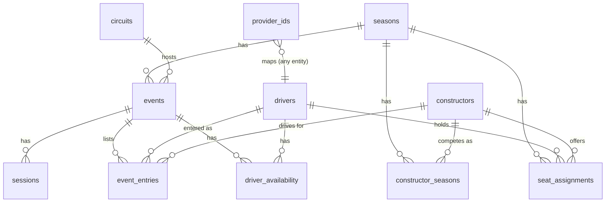
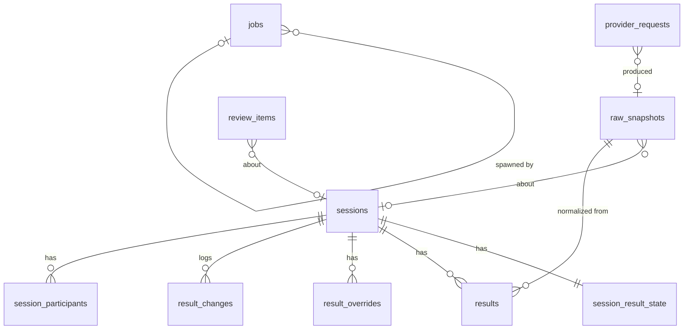
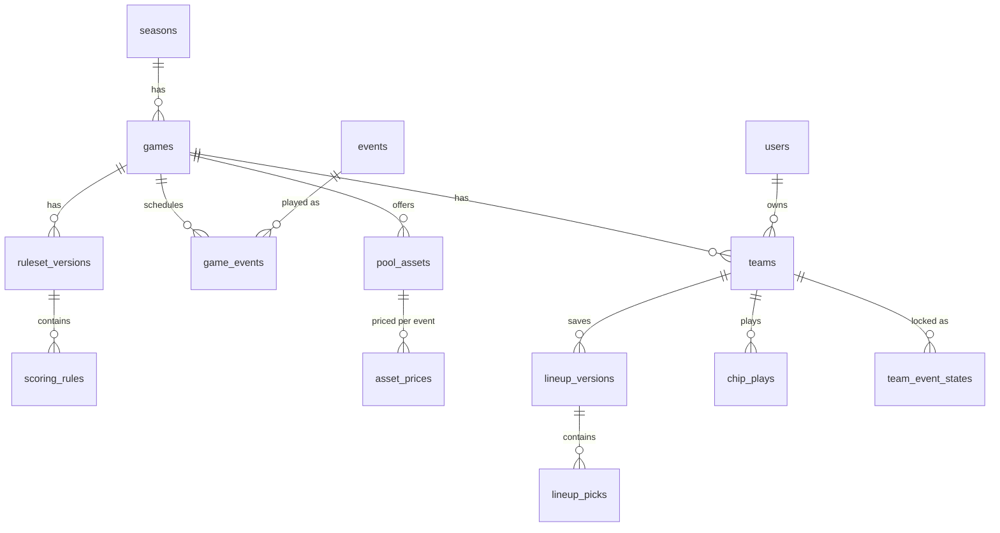
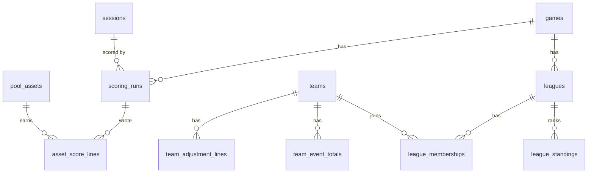
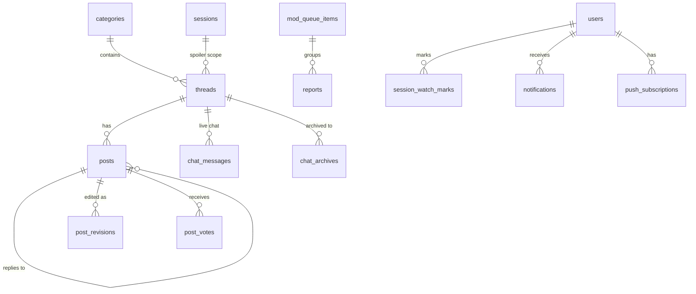
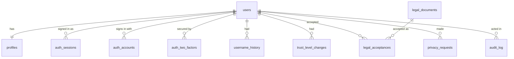

# Gridlocked — Data Model

**Status:** Approved 2026-10-27 (phase 2 of 5 complete). Part 1 was revised during review after a scenario check against the real 2026 calendar.
**Date:** 2026-10-27
**Builds on:** [01-high-level-design.md](01-high-level-design.md), approved 2026-10-27. Section references like "HLD §5.2" point there.

This document defines the tables, keys and constraints. It's still a design, not code: no migrations or Drizzle files are written until phase 5. Labels work as before: **Decided** (in the HLD or your answers), **Verified** (checked against a source), and **Proposed** (my recommendation, waiting for your review).

## How we'll review it

The model is split into parts that follow the HLD's modules. Each part is reviewed before the next one is written, so a change in one part doesn't ripple through drafts you haven't seen.

| Part | Covers | Status |
|---|---|---|
| 0 | Conventions used everywhere | Approved |
| 1 | Reference data: seasons, events, sessions, drivers, constructors, entries, availability, provider IDs | Approved |
| 2 | Ingestion and results: raw snapshots, normalized results, overrides, the review queue, the job table | Approved |
| 3 | Fantasy core: games, rulesets, the pool and prices, teams, lineup versions, transfers, chips, team value | Approved |
| 4 | Scoring and standings: asset score lines, team ledger, per-event totals, leagues, tiebreaks | Approved |
| 5 | Community: categories, threads, posts, chat, votes, spoiler state, moderation, notifications | Approved |
| 6 | Identity, admin and audit: Better Auth tables, profiles, roles, trust levels, the audit log | Approved |

---

## Part 0. Conventions (proposed)

### 0.1 Naming
- **Tables are plural snake_case** (`events`, `sessions`), and columns are snake_case. Foreign keys are named `<thing>_id`.
- **Better Auth's tables are renamed** through its model-name settings, so they don't collide with ours or with Postgres reserved words:
  - `user` → `users`, because `user` is reserved in Postgres;
  - `session` → `auth_sessions`, because `sessions` means race sessions here;
  - `account` → `auth_accounts`;
  - `verification` → `auth_verifications`.

  Phase 4 will confirm this renaming works with the admin plugin.

### 0.2 Keys
- **Primary keys are UUIDv7, generated by the app** (proposed).
  - **Why:**
    - They're safe to show in URLs; a sequential ID would leak counts of users and posts.
    - Seeding and the 2026 replay harness can create rows offline without colliding.
    - UUIDv7 is time-ordered, so indexes stay compact, unlike random UUIDv4.
    - We don't depend on Postgres 18's built-in `uuidv7()`.
  - **Alternative:** `bigint` identity keys. They're smaller and faster to join, but they'd need a separate public ID for URLs.
  - **Better Auth** is set to generate UUIDs too, so `users.id` matches everything else.
- **Natural keys get unique constraints** even though they're not the primary key. Examples: `(season_id, round)` on events and `(event_id, kind)` on sessions.
- **Slugs** (`max-verstappen`, `2027-monaco`) are unique and used in URLs. They're never used as foreign keys, so they can be changed.

### 0.3 Types
| Kind of value | Type | Notes |
|---|---|---|
| Timestamps | `timestamptz`, stored in UTC | Displayed in the user's timezone. Event pages can also show circuit local time |
| Calendar dates (e.g. date of birth) | `date` | |
| Status and kind fields | `text` plus a `CHECK` constraint listing allowed values | Easier to change than Postgres enums. Drizzle's `text({ enum })` gives the TypeScript type |
| Money (prices, budget, bank) | `integer`, in **units of $0.1M** | $23.4M is stored as `234`; the $100M cap is `1000`. Exact arithmetic and no floats. Every official price is a multiple of $0.1M (verify in Part 3) |
| Fantasy points | `integer` | Official scoring has no fractional points; multipliers are stored as integer deltas |
| Flexible parameters | `jsonb`, validated by a Zod schema in the app | Only for versioned config such as rule parameters. Never for data we query by |

### 0.4 Row history and deletes
- **Mutable tables have `created_at` and `updated_at`.**
- **Nothing is soft-deleted with an `is_deleted` flag.** Things that can be withdrawn get a real status instead, such as a post being `removed` or an event being `cancelled`, so queries say what they mean.
- **Hard deletes are only for privacy requests** (GDPR/CCPA, HLD §13.6) and for data with a retention policy, such as chat (Part 5).
- **Versioned things are append-only:** lineup versions, ruleset versions, price history and raw snapshots. A version row is never updated after the moment it takes effect.
- **Admin changes are written to `audit_log`** (Part 6) in the same transaction as the change.

### 0.5 Layers never mix (decided, HLD §3.3)
- Reference (Part 1), results (Part 2) and game data (Parts 3–4) live in separate tables.
- Foreign keys only point **down** the stack: game → results → reference. Results never hold points, and game tables never edit results.
- **Spoiler scoping:** every row that reveals a session's outcome carries a `session_id` or `event_id`, so spoiler filtering is a join, not guesswork (HLD §7.3).

### 0.6 How each part is checked
Every part ends with the same three checks before it comes to you for review:

1. **A scenario table.** Each real situation the part must survive is listed, with how the model handles it. Real cases come from F1 history, plus anything we can verify in the 2026 data. A scenario that *isn't* handled is listed as a known limit with what fixing it later would cost; it isn't left out. Part 1's table is in 1.14.
2. **A scale table.** Row counts at three sizes, plus the hot queries and the indexes that serve them:
   - beta: about 500 users and 1,000 teams;
   - established: about 10k users and 25k teams;
   - big: about 100k users and 250k teams.

   The free tier only has to carry the beta. The larger sizes have to work without a redesign, though they may need paid plans.
3. **A change test.** For the changes we can foresee, the part says what kind of change each would be:
   - **config only:** a row in a versioned config table;
   - **additive migration:** a new column or table, with nothing rewritten;
   - **redesign:** existing data has to be reshaped.

   Redesigns are what the model is built to avoid. Each one that remains is called out with a reason.

### 0.7 Sturdiness rules (apply everywhere)
- **The database enforces the rules that matter, not just the app.** That means foreign keys, `CHECK` constraints, unique and exclusion constraints, and the lock trigger in Part 3. A bug in one API route then can't corrupt the data.
- **Foreign keys default to `ON DELETE RESTRICT`.** Cascades are used only for true children, such as a lineup version's picks. Accidentally deleting a parent fails loudly instead of silently taking history with it.
- **Admin edits use optimistic concurrency.** Editable rows carry a `version` integer, and a save that started from a stale version is rejected. Two admins resolving the same queue item can't overwrite each other.
- **Writes from jobs are idempotent.** They use natural unique keys and `INSERT … ON CONFLICT`, plus a scoring run ID for replace-style writes (HLD §3.3).
- **Migrations are expand-then-contract.** Add the new column or table, backfill, switch reads, and only drop the old one in a later release. No migration needs downtime or a big rewrite under load.
- **Big tables are planned for partitioning from day one.** The team ledger, chat and raw snapshots get keys that let them be partitioned by season or month later without changing queries. Partitioning itself waits until a table is big enough to need it.
- **Derived data can always be rebuilt from source.** Standings, totals and caches are materialized for speed, but each one has a rebuild path from the ledger and results. A bad cache is a re-run, not a data repair.

### 0.8 Deliberately not flexible (so the model stays simple)
Being flexible everywhere makes everything harder. These limits are chosen on purpose, with the cost of changing them later:

| Limit | Why | Cost to change later |
|---|---|---|
| One series (F1). There's no `series` column | Jolpica is F1-only, and the product is F1-only | Additive: add a `series` table, a column on `seasons` and a changed unique key. Everything else hangs off seasons |
| One scoring ruleset per game, shared by every league. **No per-league scoring (decided 2026-10-27, yours)** | Lets asset scores be computed once and shared by all teams (HLD §5.6), which is what keeps scoring cheap at scale | **Redesign** of the ledger; accepted |
| ~~One game~~ **Kept open (decided 2026-10-27, yours).** Teams, leagues and the ledger belong to a `games` row (season + game type + ruleset + budget), not directly to a season. Launch has one game type, `season_fantasy` | A second game, such as a weekly prediction game, becomes new tables for its own mechanics, not a reshape of existing ones | Designed in Part 3 |
| No multi-tenancy (one site) | | Not planned |

### 0.9 Storage budget (free tier)
Neon's free plan allows 1 GB per project (HLD §11.4). The rough sizes below will be checked against measured row sizes in Part 4.
- Reference and results data is tiny: a season is a few thousand rows.
- The big tables will be the team ledger (Part 4), posts and chat (Part 5), and raw snapshots (Part 2).
- Each of those parts states its expected size and its retention rule.

---

## Part 1. Reference data (proposed)

This is the real-world calendar and line-up: facts about the sport, with no game logic in them. Sync jobs and admins write it; everything else reads it.

### 1.1 `seasons`
| Column | Type | Notes |
|---|---|---|
| id | uuid PK | |
| year | integer, unique | 2026, 2027 |
| status | text: `upcoming`, `active`, `completed` | Drives which season the app shows by default |

The fantasy ruleset, budget and pool are attached in Part 3, so this table stays a pure fact table.

### 1.2 `circuits`
| Column | Type | Notes |
|---|---|---|
| id | uuid PK | |
| slug | text, unique | `monaco` |
| name | text | "Circuit de Monaco" |
| locality, country | text | From Jolpica |
| latitude, longitude | numeric(9,6) | From Jolpica |
| timezone | text (IANA), not null | e.g. `Europe/Monaco`. Jolpica doesn't provide it, so it's seeded once per circuit, by an admin or derived from coordinates |

### 1.3 `events` (a race weekend)
| Column | Type | Notes |
|---|---|---|
| id | uuid PK | |
| season_id | uuid FK → seasons | |
| round | integer | Unique with `season_id`, and the constraint is **deferrable** so a whole calendar can be renumbered in one transaction. It's display order only: nothing else references an event by round (see below) |
| slug | text, unique | Built from the season and the event **name**, not the circuit: `2026-bahrain-grand-prix-in-malaysia`. A season can visit one circuit twice (2020 had two races each at the Red Bull Ring, Silverstone and Bahrain) |
| name | text | "Monaco Grand Prix". Facts used descriptively (HLD §13.4) |
| circuit_id | uuid FK → circuits | |
| format | text: `standard`, `sprint` | Sets which sessions are created by default. New formats are a new allowed value plus a session template in config |
| status | text: `scheduled`, `cancelled`, `completed` | `completed` is set by the finalizer (HLD §4.4) |
| lock_session_id | uuid FK → sessions, nullable | The session whose start locks the game: Qualifying, or Sprint Qualifying on sprint weekends. It's stored explicitly rather than inferred from `format`, so a new format can't silently move the lock |
| lock_at | timestamptz, not null | **The fantasy lock** (HLD §5.2). Defaults to `lock_session_id`'s scheduled start and follows it when that session moves, until an admin overrides it (audited) |
| lock_at_source | text: `default`, `admin` | Tells the sync job not to overwrite an admin's change |

Why `lock_at` is here and not in the game tables: it's a time the whole site uses, including thread modes, reminders and the scheduler's due-times file (HLD §4.5). Enforcement still happens in the game layer (Part 3).

**Cancelled, moved and renumbered events (verified with 2026 data).** Jolpica's 2026 calendar now has 23 rounds. The April races in Bahrain and Saudi Arabia are **gone from the feed entirely**. Every later round was **renumbered**: Miami is now round 4. A "Bahrain Grand Prix in Malaysia" runs at **Sepang** in October. So:
- **An event's identity is its row ID.** It isn't the round, the name or the circuit, since all three can change.
- **A cancelled event keeps its row**, with `status = cancelled`. It's never deleted, so threads, notifications and history that point at it stay valid.
- **The sync job never deletes.** An event that disappears from the provider goes to the admin queue as "missing from provider", and an admin marks it cancelled. A new or relocated event is matched by date and name first; when the match is uncertain, an admin confirms it.
- **Round renumbering changes only `round`.** Nothing else stores round numbers (see seats, 1.8).

What a cancellation does in the game (whether transfers are counted and whether chips are refunded) is settled in Part 3.

### 1.4 `sessions`
| Column | Type | Notes |
|---|---|---|
| id | uuid PK | |
| event_id | uuid FK → events | |
| kind | text: `fp1`, `fp2`, `fp3`, `sprint_qualifying`, `sprint`, `qualifying`, `race` | |
| sequence | smallint, default 1 | Unique `(event_id, kind, sequence)`. This allows a format with two sessions of the same kind, such as a two-race weekend, without changing the schema |
| scheduled_start | timestamptz, not null | From Jolpica (verified: Jolpica gives a start time per session) |
| start_confirmed | boolean | False while only a date is known (early calendars). The UI shows "TBC", and the lock isn't announced until it's true |
| scheduled_end | timestamptz, not null | **Jolpica gives no end time** (verified in the samples). It defaults to start + a per-kind duration from config (e.g. race 2 h; proposed values in Part 2), and an admin can edit it |
| time_source | text: `provider`, `admin` | Same rule as `lock_at_source` |
| status | text: `scheduled`, `live`, `suspended`, `completed`, `abandoned`, `cancelled` | `live` and `completed` come from the clock plus results arriving; the rest are admin-set. `suspended` covers a red flag that runs past the scheduled end, so chat stays in live mode. `abandoned` means the session started but didn't finish normally (e.g. Spa 2021: results taken from an early lap). How the game scores an abandoned session is a ruleset question (Part 3). A session moved to another day (e.g. Suzuka 2019 qualifying moved to Sunday) just gets new times |

Whether a session is scored is decided by the ruleset (Part 3), not stored here.

### 1.5 `drivers` (follows the person; decided)
| Column | Type | Notes |
|---|---|---|
| id | uuid PK | |
| slug | text, unique | `max-verstappen`. A suffix is added on a clash, since historical drivers can share names |
| given_name, family_name | text | As the provider gives them |
| display_name | text, nullable | Overrides the shown name where convention differs, e.g. family-name-first names, or a driver known by a middle name (Andrea Kimi Antonelli is shown as "Kimi Antonelli") |
| code | text, nullable | `VER`. **Not unique**, since codes are reused across eras |
| permanent_number | integer, nullable | Not unique across history. A season's race number lives on the seat (1.8) |
| nationality | text | |
| date_of_birth | date, nullable | |

A driver is one row for life, whatever team they're with. That's why driver points follow the person.

### 1.6 `constructors`
| Column | Type | Notes |
|---|---|---|
| id | uuid PK | |
| slug | text, unique | `red-bull` |
| name | text | Base name |
| nationality | text | |

### 1.7 `constructor_seasons` (how a constructor appears in one season)
| Column | Type | Notes |
|---|---|---|
| constructor_id | uuid FK | Composite PK with `season_id` |
| season_id | uuid FK | |
| display_name | text | The season's entry name, which can change with sponsors |
| short_name | text | For tight mobile layouts |
| color | text, `#RRGGBB` | An accent color only; no logos (HLD §13.4) |

**Rebrands:** a rename keeps the same constructor row with a new `display_name`. A genuinely new entrant gets a new constructor row. We follow how Jolpica draws the line by default, and an admin can merge or split rows through the provider ID map (1.11). Linking a team's whole lineage (Toleman → Benetton → Renault → Alpine) is left for later; nothing in the game depends on it.

### 1.8 `seat_assignments` (the expected line-up over a date range)
| Column | Type | Notes |
|---|---|---|
| id | uuid PK | |
| season_id | uuid FK | |
| driver_id | uuid FK | |
| constructor_id | uuid FK | |
| car_number | integer | The number for that season |
| role | text: `race`, `reserve` | |
| valid_from | date | First day this seat applies |
| valid_to | date, nullable | Null means until further notice |

This is the "who drives for whom" list for the season. A mid-season swap **closes one range and opens another**; it never edits history.

**Ranges are dates, not rounds** (changed after checking the 2026 data). Round numbers move when the calendar changes, and in 2026 they did, after the seats were set. A date range keeps meaning the same thing when events are cancelled, added or renumbered. The admin UI still lets you pick "from the Dutch GP onwards" and stores that event's start date.

For the 2026 swap (HLD §8.1), effective from the Dutch GP (round 12, 2026-08-21):
- Lawson's `rb` seat closes, and a `red_bull` seat opens.
- Tsunoda's seat moves to `rb`.
- Hadjar's `race` seat closes.

**The swap was reversed from round 15** (Azerbaijan, first session 2026-09-24; verified in the recorded 2026 results, M2 Task 6). Hadjar returns to `red_bull` (#6), Lawson to `rb` (#30), and Tsunoda has no race seat. So the swap's seats run 2026-08-21 to 2026-09-23. The seat fixture `tests/fixtures/seats-2026.json` follows the data, and a test checks it against every recorded race.

**Constraint:** a driver can't hold two `race` seats in overlapping ranges. This is enforced with an exclusion constraint on `(driver_id, daterange(valid_from, valid_to))` for race seats. That needs the `btree_gist` extension, which Neon supports. A second exclusion constraint stops two race seats from using the same `car_number` at the same time.

### 1.9 `event_entries` (who is expected at this event)
| Column | Type | Notes |
|---|---|---|
| event_id | uuid FK | Composite PK with `driver_id` |
| driver_id | uuid FK | |
| constructor_id | uuid FK | |
| car_number | integer | |
| source | text: `seat`, `admin`, `results` | `seat`: copied from seat assignments when the event is created. `admin`: changed by an admin. `results`: seen in a session's results |

**Refinement of HLD §5.6 (proposed): event entries are the expected line-up, while scoring uses each result row's constructor.** The HLD says a constructor scores "whoever drove its cars at that event (from `entry` rows)". But substitutions can happen **mid-weekend**: a driver can fall ill after the sprint, or a reserve can start from FP3. Each result row from Jolpica already says which constructor the driver drove for **in that session** (verified in the samples). So:
- **Scoring:** a constructor's points come from the result rows that name it, session by session (Part 2).
- **Event entries** drive the team builder's warnings, the roster checker and the validator. A result row whose driver–constructor pair isn't in `event_entries` is a roster surprise, and it holds scoring for admin review (HLD §8.2).
- FP1 young-driver runs don't affect either, because practice isn't scored. The roster checker treats FP1 as a weak signal (HLD §8.2).
- **A mid-weekend substitution** (e.g. Bearman replacing Sainz from FP3 at Jeddah 2024): both drivers have entries for that event with the same constructor. The validator checks car counts **per session** against the results, not per event, so three drivers sharing two cars over a weekend is valid.

### 1.10 `driver_availability` (per-event status of pool drivers; decided, HLD §8.1)
| Column | Type | Notes |
|---|---|---|
| event_id | uuid FK | Composite PK with `driver_id` |
| driver_id | uuid FK | |
| status | text: `available`, `doubtful`, `unavailable`, `reserve` | |
| reason | text, nullable | Shown in the team builder, e.g. "Injured (wrist)" |
| source | text: `default`, `roster_check`, `admin` | |
| updated_at | timestamptz | |

Every pool driver gets a row for every event, created with `available`.

**This status is for people, not for scoring.** It drives the team-builder warning and the notifications. Scoring doesn't read it: a pool driver missing from a scored session's results gets the NC or no-time penalty because they're missing (HLD §6), whatever this table says. That keeps a stale status from ever changing points. "Who is in the pool" is a game fact, so the pool itself is in Part 3. This table holds only the real-world status.

### 1.11 `provider_ids` (only adapters read it; decided, HLD §3.3)
| Column | Type | Notes |
|---|---|---|
| provider | text: `jolpica`, `openf1`, … | |
| entity_type | text: `circuit`, `event`, `session`, `driver`, `constructor` | |
| provider_key | text | `max_verstappen`, `red_bull`, an OpenF1 `session_key`, or for Jolpica events `season/round` |
| entity_id | uuid | Our ID |

- **Constraints:** unique `(provider, entity_type, provider_key)`, and unique `(provider, entity_type, entity_id)`.
- **This is a deliberate exception to "every relationship is a foreign key":** `entity_id` points at a different table depending on `entity_type`. The adapter code checks it, and a nightly integrity job reports orphans.
- **Jolpica event keys aren't stable**, because rounds get renumbered (1.3). The adapter re-matches events on every sync by season, date and name, and updates the key. A key that would move to a different event of ours goes to the admin queue instead of being applied.
- **Switching to another provider** (e.g. Sportradar) means adding rows here, not changing other tables.

### 1.12 What writes reference data
| Writer | Writes |
|---|---|
| Calendar sync (Jolpica) | circuits, events, sessions (times only where `*_source` is still the default), drivers, constructors, provider IDs |
| Admin seeding (2027 pre-season, HLD §2) | Everything above while Jolpica has no 2027 data, plus seat assignments, circuit timezones and constructor colors |
| Roster checker and admins (HLD §8.2) | Event entries and driver availability, through the review queue |
| Finalizer | `events.status = completed` |

### 1.13 Indexes beyond keys
- `sessions (scheduled_start)`: the scheduler and the "what's on now" lookup.
- `events (season_id, lock_at)`: the next lock.
- `seat_assignments (season_id, constructor_id)`: listing a team's drivers.
- Exclusion constraints (1.8) come with their own GiST indexes.

### 1.14 Scenario check
| Scenario | Real example | How it's handled |
|---|---|---|
| Event cancelled before the weekend | Bahrain and Saudi Arabia 2026 (verified: removed from Jolpica) | Row kept as `cancelled`; the sync flags it, never deletes it (1.3) |
| Calendar renumbered mid-season | 2026: Miami is now round 4 (verified). It was round 6 on the original calendar (from memory) | Only `round` changes. Seats use dates, and provider keys are re-matched (1.3, 1.8, 1.11) |
| Event relocated, keeping its name | "Bahrain Grand Prix in Malaysia" at Sepang, 2026 (verified) | Identity is the row; the circuit is just a column. The admin confirms the uncertain match |
| Two events at one circuit in a season | 2020: Red Bull Ring, Silverstone and Bahrain twice each | No unique key on circuit; slugs come from event names (1.3) |
| Session moved to another day | Suzuka 2019: qualifying moved to Sunday | New times; `lock_at` follows its session unless an admin overrode it (1.3, 1.4) |
| Long red flag | Many races; the 2021 Belgian GP never really started | `suspended` keeps live chat open; `abandoned` hands the scoring question to the ruleset (1.4) |
| Calendar published before session times | 2027 seeding | `start_confirmed = false`, shown as TBC (1.4) |
| New weekend format | Sprint formats changed in 2021, 2023 and 2024 | New `format` value plus a session template, and `sequence` allows repeated session kinds. The lock session is explicit (1.3, 1.4) |
| New team joins | Cadillac, 2026 (11 teams) | New constructor and its seats; grid size is never fixed |
| Team renamed | Sauber → Audi; AlphaTauri → RB | New `display_name` per season, or a new constructor if it's a new entrant (1.7) |
| Mid-season driver swap | Lawson/Tsunoda/Hadjar 2026 (verified) | One seat range closes and another opens (1.8) |
| Mid-weekend substitute | Bearman for Sainz, Jeddah 2024 | Both have entries; cars are counted per session; scoring uses result rows (1.9) |
| Injured pool driver | Any | Availability is for warnings only; missing from results means the penalty applies (1.10) |
| Driver known by another name | Kimi Antonelli; family-name-first names | `display_name` (1.5) |
| Car number reused or changed | A champion running #1, then going back to their own number | The number lives on the seat, and two race seats can't share it at once (1.8) |
| Historical seasons for hub pages | 1950 onwards from Jolpica | The same tables work for any year. About 1,100 races × about 25 rows is tiny |
| A third car per team | Proposed in the past, never adopted | Nothing assumes two cars; the validator's car count is config |

**Known limit:** a constructor renamed **during** a season, which hasn't happened in modern F1, would show one name for the whole season. Fixing it would be additive: give `constructor_seasons` date ranges like seats have.

### 1.15 Scale
Reference data is tiny at every size: a season is about 24 events, 150 sessions, 30 drivers, 11 teams and about 600 availability rows. History back to 1950 adds tens of thousands of rows. User numbers don't change any of it, so its indexes are about query shape, not volume (1.13).

---

## Part 2. Ingestion and results (proposed)

This part covers how provider data comes in, becomes trusted per-session facts, and gets corrected. It holds **facts only, never points** (0.5). It also defines the job table that every background task uses, and the admin review queue that the validator and roster checker feed.

**How it flows:**
1. A job calls a provider through the shared HTTP client, and the call is logged (`provider_requests`).
2. A response with new content becomes an immutable `raw_snapshot`.
3. The normalizer turns the newest snapshot for a session into `results` rows, and logs what changed since the previous snapshot (`result_changes`).
4. `effective_results` is a view: provider rows with admin overrides applied. **Scoring, results pages and results posts all read the view.** Nothing reads `results` directly.
5. The validator checks the effective results. A problem opens a `review_item` and holds the session's status at `under_review`.

### 2.1 `provider_requests` (the HTTP call log)
| Column | Type | Notes |
|---|---|---|
| id | uuid PK | |
| provider | text | `jolpica`, `openf1`, … |
| endpoint | text | e.g. `/2026/18/qualifying` |
| params | jsonb | Normalized query parameters |
| requested_at | timestamptz | |
| status_code | integer, nullable | Null on a network error |
| duration_ms | integer | |
| outcome | text: `new_snapshot`, `unchanged`, `error`, `rate_limited` | |
| snapshot_id | uuid FK → raw_snapshots, nullable | The snapshot this call produced or matched |
| error | text, nullable | |
| job_id | uuid FK → jobs, nullable | Which job made the call |

- **What it's for:** monitoring ("is the poller stuck?"), rate-limit accounting, and debugging.
- **Retention:** 30 days, then pruned. It's operational data, not history.

### 2.2 `raw_snapshots` (exactly what a provider said; append-only)
| Column | Type | Notes |
|---|---|---|
| id | uuid PK | |
| provider | text | |
| endpoint | text | |
| params_hash | text | Hash of `(provider, endpoint, params)`: "the same question" |
| content_hash | text | SHA-256 of the response body after canonical JSON formatting, so key order doesn't count as a change |
| body | jsonb | The provider's response, unchanged. Stored with lz4 TOAST compression (confirm Neon supports it in phase 4) |
| body_bytes | integer | For the storage dashboard |
| first_fetched_at | timestamptz | |
| last_seen_at | timestamptz | Updated when the same content is fetched again |
| season_id, event_id, session_id | uuid FKs, nullable | What the snapshot is about, when the adapter knows. Calendar and driver-list snapshots have only `season_id` |

- **Unique `(params_hash, content_hash)`.** The same answer to the same question is stored once. A refetch with unchanged content only bumps `last_seen_at` and logs an `unchanged` request.
- **Change detection comes free:** a new `content_hash` for the same `params_hash` means the provider changed something, such as a stewards' penalty (HLD §4.2).
- **The replay harness** (HLD §12) reads snapshots in `first_fetched_at` order under a simulated clock.
- **Retention:** kept permanently for the current and previous season, since they're the audit trail for points. Snapshots from bulk history imports (hub pages, 1950 onwards) can be dropped once normalized, because nothing scores them.
- **If it grows:** bodies can move to Neon Object Storage (5 GB free), leaving a `body_key` column. That's an additive change (2.11).

### 2.3 `session_result_state` (one row per session: where its results stand)
| Column | Type | Notes |
|---|---|---|
| session_id | uuid PK, FK → sessions | |
| status | text: `awaiting`, `provisional`, `under_review`, `final` | `awaiting`: no results yet. The HLD's per-row status lives here, since rows always share their session's state |
| source | text: `provider`, `manual` | Where the current provider rows came from. `manual` means an admin entered the whole session (2.6) |
| current_snapshot_id | uuid FK, nullable | The snapshot the current `results` rows were normalized from |
| poll_attempts | integer | For backoff |
| next_poll_at | timestamptz, nullable | Also published to the scheduler's due-times file (HLD §4.5) |
| gave_up_at | timestamptz, nullable | Set when the poll window (proposed: 24 h) runs out; it raises an admin alert |
| finalized_at | timestamptz, nullable | |
| reopened_count | integer | Reopening a final session is audited (HLD §4.4) |
| version | integer | Optimistic concurrency (0.7) |

### 2.4 `results` (normalized provider facts; one row per driver per session)
| Column | Type | Notes |
|---|---|---|
| session_id | uuid FK | Composite PK with `driver_id` |
| driver_id | uuid FK | |
| constructor_id | uuid FK | **The car driven in this session.** Constructor points follow this (1.9) |
| snapshot_id | uuid FK → raw_snapshots | Provenance |
| car_number | integer | |
| position | integer, nullable | The classified or finishing order as the provider gives it. In qualifying it's the official qualifying order, **never** derived from lap times (HLD §2) |
| classification | text: `classified`, `not_classified`, `disqualified`, `did_not_start`, `did_not_qualify`, `excluded` | Our canonical outcome (mapping below) |
| provider_status | text | Kept as given: `Finished`, `Lapped`, `Retired`, `Did not start`, … |
| provider_position_text | text | `1`, `R`, `W`, `D`, … |
| grid | integer, nullable | Sprint and race only. Null for a pit-lane start, with the flag below |
| pit_lane_start | boolean | Jolpica reports it as `grid = 0`. Scoring treats it as last on the grid (HLD §5.6) |
| laps | integer, nullable | |
| time_ms | bigint, nullable | Race or sprint time for the winner and classified finishers |
| fastest_lap_rank | integer, nullable | |
| fastest_lap_ms | integer, nullable | |
| q1_ms, q2_ms, q3_ms | integer, nullable | Qualifying and sprint qualifying. **No time is null**, whether the provider sends `""` or leaves the key out (verified: both happen) |
| official_points | numeric(4,1), nullable | Championship points, for hub pages. Never used in fantasy scoring |

**Why one table rather than one per session type:** the scoring engine wants one shape ("give me this session's effective results"), and the fields barely differ. `CHECK` constraints keep session-specific fields where they belong, for example no `grid` on qualifying rows. Those checks need the session kind, so a trigger copies `sessions.kind` into the row on insert.

**Classification mapping (proposed; checked against 2026 data):**

| Provider says | `classification` | Note |
|---|---|---|
| numeric `positionText` (any status, including `Retired`) | `classified` | 7 drivers in the 2026 samples were `Retired` but still classified, because they'd completed enough distance |
| `R` or `N` | `not_classified` | |
| `D` | `disqualified` | |
| `E` | `excluded` | Rare. The ruleset decides whether it scores like a DSQ |
| `W` (status `Did not start`) | `did_not_start` | 7 such rows in the 2026 samples |
| `F` | `did_not_qualify` | Historical (107% rule) |
| Qualifying: driver listed with no times | `classified` with all Q times null | "No time set" is **derived** from `q1_ms is null`, not stored |

An unknown `positionText` value fails normalization and opens a review item. We don't guess.

**On a new snapshot,** the normalizer replaces the session's `results` rows in one transaction: it deletes them, inserts the new set, and updates `current_snapshot_id`. Earlier versions survive as snapshots and as `result_changes` rows.

### 2.5 `result_changes` (what changed between snapshots)
| Column | Type | Notes |
|---|---|---|
| id | uuid PK | |
| session_id | uuid FK | |
| driver_id | uuid FK | |
| field | text | e.g. `position`, `classification`, `time_ms` |
| old_value, new_value | text | |
| from_snapshot_id, to_snapshot_id | uuid FKs | |
| detected_at | timestamptz | |

This powers "Why did my score change?": for example "Stewards: +5 s, P6 → P8". It also powers spoiler-safe correction notices, and lets admins see at a glance what a re-fetch changed. It's written by the normalizer at the same time as the rows, and is small: a few rows per correction.

### 2.6 `result_overrides` (the admin layer; decided, HLD §4.3)
| Column | Type | Notes |
|---|---|---|
| id | uuid PK | |
| session_id | uuid FK | |
| driver_id | uuid FK | |
| kind | text: `patch`, `insert`, `suppress` | `patch`: replace some fields of the provider row. `insert`: a row the provider doesn't have, used for manual entry. `suppress`: ignore a bogus provider row |
| fields | jsonb | For `patch` and `insert`: only the fields being set, using `results`' column names. Validated by a Zod schema |
| reason | text, not null | Shown in the audit log, and in the score explanation when it affects points |
| created_by | uuid FK → users | |
| created_at | timestamptz | |
| revoked_at, revoked_by | nullable | Revoking reverts cleanly to the provider value |
| version | integer | |

- **At most one active override per `(session_id, driver_id)`**, enforced by a partial unique index `WHERE revoked_at IS NULL`. Editing one revokes it and creates the replacement, so history stays readable.
- **Why `jsonb` here, against rule 0.3:** an override sets an arbitrary subset of fields, and we never query by those fields. The Zod schema is generated from the `results` columns, so the two can't drift apart.
- **Manual entry of a whole session** (provider down, HLD §4.4) is a set of `insert` overrides, with `session_result_state.source = manual`. **If provider data arrives later,** the normalizer stores it as normal but **doesn't** remove the manual rows. It opens a review item instead ("provider data arrived; compare and choose"), and the admin either revokes the inserts or keeps them. Nothing changes silently.

### 2.7 `effective_results` (a view; what everything reads)
- Provider rows with any active `patch` applied field by field, plus active `insert` rows, minus rows with an active `suppress`.
- Each row says whether it was overridden, so the UI and score explanations can show "corrected by admin: reason".
- **A plain view, not materialized.** A session is about 22 rows, so the join is trivial. Scoring snapshots what it read into its own run (Part 4), so a later override can't change a past run's explanation without a re-score.

### 2.8 `session_participants` (who took part in practice; the roster signal)
| Column | Type | Notes |
|---|---|---|
| session_id | uuid FK | Composite PK with `driver_id` |
| driver_id | uuid FK | |
| constructor_id | uuid FK | |
| provider | text | OpenF1 by default (HLD §4.1) |
| snapshot_id | uuid FK | |

This is kept apart from `results`, because practice isn't scored and its data comes from a different provider with different coverage. The roster checker compares FP2 and FP3 participants with `event_entries` (HLD §8.2).

### 2.9 `review_items` (the admin queue for every "a human must decide")
| Column | Type | Notes |
|---|---|---|
| id | uuid PK | |
| kind | text | e.g. `validation_failed`, `unknown_driver`, `team_change`, `missing_driver`, `event_missing_from_provider`, `uncertain_event_match`, `provider_after_manual`, `unknown_classification`, `provider_mismatch` |
| severity | text: `blocking`, `warning` | `blocking` holds scoring for the linked session; `warning` doesn't |
| season_id, event_id, session_id, driver_id | uuid FKs, nullable | What it's about. Spoiler-scoped by `session_id` |
| details | jsonb | What was found, shaped per `kind` |
| status | text: `open`, `resolved`, `dismissed` | |
| resolution | text, nullable | What the admin decided |
| resolved_by, resolved_at | nullable | |
| dedupe_key | text | Unique while open, so a repeated check doesn't pile up duplicates |
| version | integer | Two admins can't both resolve it (0.7) |
| created_at | timestamptz | |

**Rule:** a session's status can't become `provisional` or `final` while it has an open `blocking` item. The status change is made in the same transaction as the check.

### 2.10 `jobs` (one table for all background work)
| Column | Type | Notes |
|---|---|---|
| id | uuid PK | |
| kind | text | e.g. `poll_session`, `normalize`, `validate`, `score_session`, `finalize_check`, `roster_check`, `open_threads`, `send_notifications`, `price_update`, `sync_calendar` |
| dedupe_key | text | Unique with `kind`. Built so the *same* work can't be queued twice, e.g. `poll:<session_id>:<attempt>` or `open_threads:<event_id>` |
| payload | jsonb | Small; per-kind Zod schema |
| run_at | timestamptz | When it becomes due |
| status | text: `pending`, `running`, `succeeded`, `failed`, `dead` | `failed` is retried with backoff. After `max_attempts` it becomes `dead` and alerts admins |
| attempts, max_attempts | integer | |
| locked_until | timestamptz, nullable | A lease. If a worker dies mid-job, the lease runs out and another worker picks it up |
| last_error | text, nullable | |
| parent_job_id | uuid FK → jobs, nullable | For fan-out (below) |
| created_at, started_at, finished_at | timestamptz | |

- **How a job is claimed:** `UPDATE … WHERE id = (SELECT … WHERE status='pending' AND run_at <= $now ORDER BY run_at FOR UPDATE SKIP LOCKED LIMIT 1)`, with `$now` from the entry point's clock (HLD decision 20). Two workers, or two overlapping ticks, can never take the same job.
- **Calendar-driven work is planned ahead.** When an event is created or its times change, its jobs are written as `pending` rows with future `run_at`: open threads, flip chat modes, lock reminders, start polling, finalizer checks. A time change **updates `run_at`** of the matching pending job through its `dedupe_key`; nothing is deleted and recreated. The scheduler's due-times file is just "the next few `run_at` values" (HLD §4.5).
- **Fan-out is batched.** "Notify everyone in league X" or "score is final for 250k teams" is a parent job that spawns child jobs, each handling about 1,000 users or teams. No single job grows with the user count, and a failed batch retries alone.
- **Retention:** `succeeded` jobs are pruned after 30 days. `dead` jobs are kept until an admin clears them.

### 2.11 Configuration used by this part
These sit in a small `settings` table (key, Zod-validated value, `updated_by`, `updated_at`) and are audited:
- **Session durations** for defaulting `scheduled_end` (1.4). Proposed: practice 60 min, sprint qualifying 45 min, qualifying 60 min, sprint 45 min, race 120 min. An overrun is handled by `suspended` and by polling, not by the default.
- **The poll schedule:** start at scheduled end, then backoff 5 → 15 → 60 min, and give up after 24 h (HLD §4.4).
- **Finalizer checks:** +2 h, +6 h, +24 h and +48 h after the race (HLD §4.4).
- **Provider rate limits,** set below each provider's published limits (HLD §4.1).
- **Validator thresholds,** such as expected cars per constructor.

### 2.12 Indexes beyond keys
- `jobs (run_at) WHERE status = 'pending'`: the claim query and the due-times file.
- `jobs (status, finished_at)`: pruning and the admin "stuck or dead jobs" view.
- `raw_snapshots (params_hash, first_fetched_at DESC)`: "latest snapshot for this question".
- `raw_snapshots (session_id)`.
- `result_overrides (session_id) WHERE revoked_at IS NULL`: the effective view.
- `review_items (status, severity, created_at) WHERE status = 'open'`: the admin queue.
- `review_items (session_id) WHERE status = 'open' AND severity = 'blocking'`: the status-change guard.
- `provider_requests (requested_at)`: pruning and monitoring.

### 2.13 Scenario check
| Scenario | Real example | How it's handled |
|---|---|---|
| Time penalty after the race changes the order | Common; e.g. Alonso, Saudi Arabia 2023: penalised after the race, then reinstated the same night | A finalizer re-fetch gives a new content hash, so new rows and a `result_changes` log, then a re-score. The reversal is just another snapshot |
| Disqualification hours after the race | Hamilton and Leclerc both DSQ, China 2025; Russell, Belgium 2024 | Same path. `classification = disqualified`, and other drivers' positions move up |
| Change after the session is final | Appeals and right-of-review cases, days or weeks later | Admin reopens the session (audited) and triggers a re-fetch, or adds an override. Then a re-score |
| Provider data is wrong | A typo or a missing driver | The validator opens a `blocking` review item, and the admin fixes it with a `patch`/`insert`/`suppress` override with a reason |
| Provider down or late | Any | Poller backoff, give up after 24 h, then an admin alert and manual entry as `insert` overrides (2.6) |
| Provider data arrives after manual entry | Follows from the case above | Stored, but a review item asks the admin to choose. No silent swap (2.6) |
| Results published in stages | Partial classification while uploads finish | The validator treats "fewer drivers than entries" as **not yet complete** and keeps polling. It escalates to review only when the poll window ends |
| Q3 driver with no Q3 time | Round 18 2026: 9 Q3 times, 10 Q3 drivers (verified) | `position` is authoritative and `q3_ms` is null. Stage reached comes from position plus the ruleset's cut-offs (Part 3) |
| No time set in Q1, still allowed to start | Common after a crash in Q1 | Classified with null times; "no time set" is derived (2.4) |
| Excluded from qualifying, starts from the back | Hamilton, Brazil 2021 | Qualifying row is `disqualified`/`excluded`. The race row's `grid` is the real starting slot |
| Grid penalty | Common | `grid` is the actual starting grid, which is what positions gained/lost uses (HLD §5.6) |
| Pit-lane start | None in 2026 yet (verified) | `pit_lane_start = true`, `grid` null; synthetic test case |
| Retired but classified | 7 cases in the 2026 samples (verified) | Numeric `positionText` means `classified`, whatever the status says |
| Did not start | 7 `W` rows in the 2026 samples (verified) | `did_not_start`; the ruleset decides the penalty |
| Race abandoned, results from an early lap | Belgium 2021 | Session `abandoned` (1.4). Results stored normally; whether and how it scores is a ruleset rule (Part 3) |
| Substitute in the results | Bearman 2024 | Constructor taken from the row. A pair missing from `event_entries` opens an `unknown_driver` or `team_change` review item (HLD §8.2) |
| Provider renames an ID | Possible on any provider update | An unknown ID opens a review item; the admin maps it in `provider_ids` |
| Jolpica and OpenF1 disagree | Possible | Jolpica is primary. A disagreement opens a `provider_mismatch` warning, not a block |
| Same data fetched again | Every finalizer check | No new snapshot; `last_seen_at` and the request log only |
| Duplicate ticks or two workers | Any cron platform can double-fire | `SKIP LOCKED` claim plus unique `dedupe_key` (2.10) |
| Worker dies mid-job | Function timeout or deploy | The lease runs out and the job is retried. Normalizing and scoring are replace-style, so re-running is safe |
| Session times change after jobs were planned | Delays and rescheduling | Pending jobs' `run_at` is updated through `dedupe_key` (2.10) |
| Switching provider mid-season | e.g. Sportradar | A new adapter writes snapshots under its own `provider`. `results` doesn't care where facts came from; `snapshot_id` records it |
| Replaying 2026 for tests | HLD §12 | Snapshots in fetch order plus the simulated clock drive the same pipeline |

**Known limits:**
- If a provider silently changes its JSON shape, the normalizer fails, and the failure is surfaced as a review item and an alert. Only the adapter changes.
- `official_points` is display-only. A rare half-points race comes from the provider as given and doesn't affect fantasy.

### 2.14 Scale
This part barely grows with users, which is the point: provider data is the same whether 50 or 250k people play.

| Table | Beta | Established | Big | Notes |
|---|---|---|---|---|
| results | ~1.5k rows/season | same | same | Plus about 40k rows of history back to 1950, if hub pages import it |
| raw_snapshots | ~3–5 MB/season | same | same | About 13 KB per race result body (measured); a few versions per session |
| result_changes / overrides | tens to hundreds of rows/season | same | same | |
| provider_requests | a few thousand rows over the 30-day window | same | same | Capped by the providers' rate limits, not by users |
| jobs | ~hundreds per weekend | ~low thousands | ~tens of thousands | Fan-out children grow with users: 250k teams in batches of 1,000 is about 250 children per fan-out. Pruned after 30 days |
| review_items | a handful per weekend | same | same | |

**Hot queries:** the job claim (partial index), effective results per session (about 22 rows), and latest snapshot per question. None of them scans more than a few hundred rows at any size.

### 2.15 Change test
| Foreseeable change | Kind of change |
|---|---|
| A new provider (e.g. Sportradar) | Code only: a new adapter plus `provider_ids` rows |
| A new result fact we'd score later (e.g. pit stop times or overtakes, if paid data arrives) | Additive: a new table such as `pit_stops (session_id, driver_id, …)`, with its own override support. `results` doesn't change |
| Lap-by-lap data (OpenF1 laps) | Additive: a `laps` table, about 32k rows/season |
| A new classification value from a provider | Config and code: a mapping row; the `CHECK` list grows |
| Move snapshot bodies to object storage | Additive: a `body_key` column, a backfill, then drop the old `body` (expand-then-contract, 0.7) |
| Partition snapshots or jobs | Additive; keys already allow it (0.7) |
| New validation rule | Code only |
| New job kind | Code only: a new `kind` value and payload schema |

No foreseeable change here is a redesign.

---

## Part 3. Fantasy core (proposed)

This part covers the game itself: which rules apply, what can be picked and at what price, and what each team picked and when. Points and standings are Part 4. Everything here is **game data**: it points down at reference data and results, never the other way (0.5).

### 3.0 Official rules this part relies on (re-checked 2026-10-27)
Checked against the official [FAQ](https://fantasy.formula1.com/en/faqs) and [game rules](https://fantasy.formula1.com/en/game-rules). All of this matches HLD §5–6:
- Prices update after each race and stay fixed until the next. They're based on average fantasy performance over the last three Grands Prix, bounded at $3M–$34M.
- Transfers are counted as the net difference from the previous race's lineup, so reverting a change gets the transfer back. One unused transfer carries over, "but must be used then".
- Limitless restores the original team after the race, and a Limitless week carries no free transfer forward.
- **Final Fix:** the outgoing driver keeps points already earned, and the incoming one scores only from the race. If the outgoing driver had Boost, the incoming one gets the 2x. The original team is restored after the race.
- The Wildcard stays active until the next lock.
- **Chip unlocks:** three chips unlock "for your team's 2nd race", the rest are available from the start, and a played chip can't be cancelled.
- If an inactive driver is swapped for the game's suggested replacement, that swap counts toward the transfer allowance.

**Not published officially:**
- **How team value works when you sell.** A fan guide's worked example shows a team's cost cap rising by exactly the price gain of a driver it owns ([FanAmp](https://www.fanamp.com/articles/f1-fantasy-cost-caps-explained)). That matches "buy and sell at the current price, keep unspent money in a bank", which is what 3.6 models. *My call; it mirrors the official game as far as it can be observed.*
- **What a cancelled race does** to chips and transfers. 3.9 proposes rules for this. *My call; check it.*

### 3.1 `games` (one playable game; kept open for other game types, decided 2026-10-27)
| Column | Type | Notes |
|---|---|---|
| id | uuid PK | |
| season_id | uuid FK → seasons | |
| game_type | text: `season_fantasy` | The only type at launch. A future weekly prediction game would be a new value with its own tables |
| slug, name | text | `2027-fantasy` |
| status | text: `setup`, `open`, `running`, `completed` | `setup`: admins seed the pool and prices. `open`: teams can be created before the first lock |

- Unique `(season_id, game_type)`.
- **Each season is a new game, and teams don't carry over** (proposed; it's how the official game works). Last season's teams, leagues and standings stay readable as history.

### 3.2 `ruleset_versions` and `scoring_rules` (rules as versioned data; decided, HLD §5.6)
**`ruleset_versions`**
| Column | Type | Notes |
|---|---|---|
| id | uuid PK | |
| game_id | uuid FK | |
| version | integer | Unique with `game_id` |
| effective_from_event_id | uuid FK → events | Applies from this event's lock onwards, until a later version takes over |
| params | jsonb (Zod-validated) | Everything about the game that isn't a scoring rule (below) |
| notes | text | What changed and why. Shown on the public rules page |
| published_at | timestamptz | |

**What goes in `params`:** these values are read together, never searched, so `jsonb` fits rule 0.3:
- **Squad:** drivers 5, constructors 2, boosts 1, starting budget `1000` ($100M), teams per user 3.
- **Transfers:** free per event 2, carry-over max 1, penalty -10, unlimited before the team's first event, and how chip weeks treat carry-over (3.8).
- **Chips:** the list of chips. Each has our own name, a stable code (`chip_autopilot`, `chip_triple_boost`, …), an unlock rule (`from_start` or `after_first_event`) and an effect code the engine knows.
- **Knockout cut-offs:** qualifying and sprint qualifying, Q2 from P16 and Q3 from P10 (HLD §5.6).
- **Prices:** the formula's constants (3.5) and the $3M–$34M bounds (`30`–`340`).
- **Abandoned sessions:** the default policy is `score_as_classified` (3.9).

**`scoring_rules`**
| Column | Type | Notes |
|---|---|---|
| id | uuid PK | |
| ruleset_version_id | uuid FK | |
| code | text | Stable key such as `race.finish_position`, unique within the version. Score lines refer to it (Part 4) |
| session_kind | text | Matches `sessions.kind` |
| target | text: `driver`, `constructor` | |
| kind | text: `position_table`, `positions_delta`, `classification_penalty`, `flag_bonus`, `knockout_stage`, `per_driver_penalty`, `aggregate_drivers` | The calculation; HLD §5.6 lists them |
| category | text | The scoring category that No Negative floors at 0 (HLD §5.4) |
| params | jsonb (Zod-validated per `kind`) | e.g. the points table, a cap of -10 on sprint positions lost, which classifications a penalty applies to |
| sort_order | integer | Order on the score explanation |

- **A version is frozen once used.** A trigger refuses updates to a version, and to its rules, once any event using it has locked. A rule change means a new version from a later event, so past scores can always be reproduced exactly. The one exception is a deliberate, audited **correction** that re-points past events to a fixed version (4.9).
- **Rule changes are mostly config.** "Sprint DNF penalty reduced to -10" (an official 2026 change, per the FAQ) is a new version with a different param. Only a genuinely new `kind` of calculation needs code.

### 3.3 `game_events` (an event as the game sees it)
| Column | Type | Notes |
|---|---|---|
| game_id, event_id | composite PK | |
| sequence | integer | The event's order **in this game**, by `lock_at`. Recomputed if the calendar changes before lock; frozen once locked. Mini-league ranges and "the previous event" use it |
| status | text: `upcoming`, `open`, `locked`, `scored`, `final`, `cancelled` | `open`: the current transfer window. `scored`: provisional points exist. `final`: the event is final and the price update has run |
| ruleset_version_id | uuid FK | The version in force for this event. Frozen at lock, except for an audited correction (4.9) |
| prices_ready_at | timestamptz, nullable | When this event's prices were published (3.5) |

**`game_session_exceptions`** handles the rare session the game shouldn't score as normal, such as an abandoned race the admins decide to void (3.9):
- Columns: `game_id`, `session_id`, `policy` (`skip`), `reason`, `decided_by`, `decided_at`.
- It's audited, and changing it triggers a re-score.

### 3.4 `pool_assets` (what can be picked)
| Column | Type | Notes |
|---|---|---|
| id | uuid PK | **The ID the whole game layer uses** for a driver or constructor: in picks, prices and score lines |
| game_id | uuid FK | |
| asset_type | text: `driver`, `constructor` | |
| driver_id | uuid FK, nullable | Exactly one of these is set, matching `asset_type` (`CHECK`) |
| constructor_id | uuid FK, nullable | |
| status | text: `active`, `withdrawn` | `withdrawn`: it can't be bought, but owners can keep it and still take its penalties |
| added_from_event_id | uuid FK | When it became pickable. A mid-season substitute added by an admin starts at the next event (HLD §8.1) |
| withdrawn_from_event_id | uuid FK, nullable | |

- Unique `(game_id, driver_id)` and `(game_id, constructor_id)`.
- One asset ID for both kinds keeps the pick, price and score tables generic, so a squad-size change is config, not schema (3.10).

### 3.5 `asset_prices` and `price_update_runs`
**`asset_prices`:** one row per asset per event.
| Column | Type | Notes |
|---|---|---|
| asset_id | uuid FK → pool_assets | Composite PK with `event_id` |
| event_id | uuid FK | |
| price | integer, units of $0.1M | `CHECK` within 30–340 |
| source | text: `initial`, `formula`, `admin`, `carried` | `carried`: no update ran before this event's lock, so the previous price stands |
| run_id | uuid FK → price_update_runs, nullable | |

- **Why one row per event** rather than "price from event X onward": a price list per event is about 33 rows, so a season is under 1,000 rows. Every lookup becomes a direct key read. Each event's prices are frozen at lock, so what a team paid can always be explained.
- **Publishing:** after event E is `final`, the price job writes the rows for event E+1 and sets `prices_ready_at`. Builders see the new prices from then on.
- **If prices aren't ready by E+1's lock,** for example because E is stuck in review, E+1 uses `carried` prices and admins are alerted. The update is never applied after a lock.

**`price_update_runs`:** `id`, `game_id`, `after_event_id`, `ruleset_version_id`, `inputs` (jsonb: each asset's last-3 average and tier), `ran_at`, `ran_by` (job or admin). Our published formula can then be shown working for every change.

**Formula shape (constants in ruleset params; calibrated on the 2026 replay before launch):**
1. Average our fantasy points for the asset over its last 3 events. Use fewer at the season start or for a newly added asset.
2. Compare that with the points its price "should" earn: `price_in_$M × points_per_million`. This baseline is separate for drivers and constructors.
3. The ratio falls into a tier (e.g. terrible, poor, good, great), and each tier maps to a change scaled by price band. For example, a great week might be +$0.3M for an expensive asset and +$0.6M for a cheap one.
4. Clamp the result to $3M–$34M.

**Calibration target:** the spread of weekly changes over the replayed 2026 season should look like the official game's.

**Corrections after a price update don't change prices** (HLD §5.5). They change points only.

### 3.6 `teams`
| Column | Type | Notes |
|---|---|---|
| id | uuid PK | |
| game_id | uuid FK | |
| user_id | uuid FK → users | |
| slot | smallint | **Unique `(game_id, user_id, slot)`.** On insert, a trigger checks `1 ≤ slot ≤` the ruleset's teams-per-user (3). Two simultaneous creates can't both take slot 3, because the unique key serialises them |
| name | text | User content: filtered and reportable (Part 5) |
| first_event_id | uuid FK, nullable | The team's first **locked** event. Set by the first lock it takes part in, which drives unlimited transfers and chip unlocks (HLD §5.2) |
| status | text: `active`, `retired` | Before its first lock, a team can be deleted outright. After that, deleting a team **retires** it, so league history stays correct |
| created_at | timestamptz | |

### 3.7 `lineup_versions` and `lineup_picks` (versioned, never overwritten; decided, HLD §5.2)
**`lineup_versions`**
| Column | Type | Notes |
|---|---|---|
| id | uuid PK | |
| team_id | uuid FK | |
| for_event_id | uuid FK → events | The event whose window was open when it was saved |
| kind | text: `regular`, `limitless`, `final_fix` | `limitless` and `final_fix` versions are temporary: they apply to one event and are never the base for the next (3.8) |
| effective_from_session_id | uuid FK, nullable | Only for `final_fix`: the race session |
| based_on_version_id | uuid FK, nullable | The version the user was editing. If it isn't the latest, the save still succeeds, but the app shows "your other device saved changes" |
| saved_at | timestamptz | Set by the database from the clock function (below), not by the client |

**`lineup_picks`**
| Column | Type | Notes |
|---|---|---|
| lineup_version_id | uuid FK, `ON DELETE CASCADE` | Composite PK with `asset_id`, so the same asset can't be picked twice |
| asset_id | uuid FK → pool_assets | |
| is_boost | boolean | The 2x Boost. Exactly one per version, and only on a driver |

**What the database checks on every save** (a constraint trigger at commit):
- **Window:** for `regular` and `limitless` versions, `app_now() < lock_at` of `for_event_id`, and `for_event_id` is the game's single `open` event. A `final_fix` version is only allowed after the qualifying session is `completed` and before the race's scheduled start.
- **Composition:** squad counts per type, and one Boost on a driver, all read from ruleset params.
- **Assets:** active, or already owned in the base lineup if withdrawn.
- **Budget:** the cost at this event's prices fits within the team's purchasing power (3.8). A `limitless` version skips this check.
- **Only complete lineups can be saved.** Drafts live in the browser. That removes the "half a team at lock" case entirely.

**The clock function (`app_now()`).** It returns `now()` in production. On a replay branch, where a `simulated_clock` setting exists, it returns the simulated time. This keeps HLD rule 6 (one injectable clock) true inside the database too. A production database never has the setting. **Decided 2026-10-28 (HLD decision 20):** application SQL takes `$now` from the entry point's clock, and `app_now()` is the backstop inside triggers. In replay, the entry point reads `app_now()` once, so both see the same instant.

**The locked lineup for event E** is the latest `regular` or `limitless` version for E with `saved_at < lock_at`. If there's none, it's the team's base lineup carried forward. It's deterministic, so it can be recomputed at any time with the same answer (HLD §3.3 rule 3).

**Pruning:** versions that never became a locked lineup are deleted 7 days after the event is final, keeping the last one before lock. Locked versions are kept forever.

### 3.8 Transfers, team value and the per-event lock record
**`team_event_states`:** one row per team per event it took part in, written by the lock job.
| Column | Type | Notes |
|---|---|---|
| team_id, event_id | composite PK | |
| game_id | uuid FK | |
| base_version_id | uuid FK | The lineup compared against: the previous event's locked `regular` lineup, or the pre-Limitless one |
| locked_version_id | uuid FK | What counts for this event |
| final_fix_version_id | uuid FK, nullable | |
| chip_play_id | uuid FK, nullable | |
| is_first_event | boolean | |
| purchasing_power | integer | Money available at this event's prices |
| spent | integer | Cost of the locked lineup at this event's prices |
| bank | integer | `purchasing_power - spent`, never below 0 (except Limitless) |
| transfers_made | integer | Net count: assets in the locked lineup that aren't in the base |
| free_transfers | integer | Allowance this event, including carry-over in, or "unlimited" (null) |
| carry_over_out | smallint | 0 or 1 |
| transfer_penalty | integer | Copied into the ledger as its own line (Part 4) |
| ruleset_version_id | uuid FK | |

**Team value (my call, mirroring the official game):** every asset is bought and sold at its **current** price, and unspent money stays in the bank.
- First event: `purchasing_power = budget` ($100M).
- After that: `purchasing_power(E) = bank(base event) + the base lineup's assets at E's prices`.

So price rises of owned assets raise a team's value, and falls lower it. **Keeping an unchanged lineup is always affordable**, because that sum is exactly the base lineup's cost plus a bank that's never negative.

**Chip weeks:**
- **Limitless:** budget not checked, transfers unlimited, no carry-over out. The next event's base is the **pre-Limitless** lineup, with that lineup's bank, so the team "reverts" automatically. The next event's purchasing power uses current prices for the restored team.
- **Wildcard:** transfers unlimited and free, but the budget still applies. It stays playable until lock, and the result becomes the new base. Carry-over out in a Wildcard week follows a ruleset param. *Proposed: 0, the same as Limitless.* Official text only says this for Limitless, so it's my call.
- **Final Fix:** one asset swap, checked against this event's purchasing power. It's free. The next event's base is the **locked** (pre-Final-Fix) lineup.

**Carry-over:** `carry_over_out = min(1, free_transfers - transfers_made)`, never below 0. That keeps "one transfer carries over but must be used then": two unused don't become two carried. The exact formula lives with the ruleset and is pinned by tests.

**Lock correctness doesn't depend on the lock job.** If the job is late, the row can be computed afterwards from versions, prices and chip plays with the same result. A team created after lock gets no row for that event and starts at the next one (decided, HLD §5.2).

### 3.9 Chips, cancellations and abandoned sessions
**`chip_plays`**
| Column | Type | Notes |
|---|---|---|
| id | uuid PK | |
| team_id | uuid FK | |
| game_id | uuid FK | |
| chip_code | text | Must exist in the event's ruleset params |
| event_id | uuid FK | |
| target_asset_id | uuid FK, nullable | The x3 Boost driver. It must be a driver in the locked lineup and not the 2x Boost one (checked at lock) |
| played_at | timestamptz | From `app_now()` |
| status | text: `played`, `refunded` | No delete and no undo (verified rule). Only the system refunds, for a cancelled event |

- **Constraints:** unique `(team_id, chip_code) WHERE status = 'played'` gives once per season. Unique `(team_id, event_id) WHERE status = 'played'` gives one chip per race.
- **Timing:** a trigger checks the play window (before lock, or the Final Fix window) and the unlock rule against `teams.first_event_id`.

**Cancelled events (my calls, check these):**
- **Cancelled before lock:** nothing locks. Chips played for it are **refunded**. There's no `team_event_states` row, so the next event's transfers are counted against the last real locked lineup, and no extra free transfers are granted. Prices don't change.
- **Session cancelled after lock** (e.g. a race called off after qualifying): sessions already run stay scored, and the cancelled session simply has no results. Chips stay used, because the lock happened. Prices update as normal from what was scored.

**Abandoned sessions with a classification** (e.g. Belgium 2021): scored as classified by default (ruleset param). Admins can void one through `game_session_exceptions`. That's audited and triggers a re-score.

### 3.10 Indexes beyond keys
- `lineup_versions (team_id, for_event_id, saved_at DESC)`: the locked-lineup lookup and the builder.
- `lineup_picks (asset_id)`: ownership share ("selected by 34%") and "who owns this withdrawn driver".
- `team_event_states (event_id)`: lock and scoring fan-out per event.
- `chip_plays (event_id) WHERE status = 'played'`: scoring loads one event's chips at once.
- `asset_prices (event_id)`: the price list.
- `teams (user_id)`: "my teams".

### 3.11 Scenario check
| Scenario | Real example or source | How it's handled |
|---|---|---|
| Joining after the season starts | Official FAQ | The team starts at the next locked event; unlimited changes until then (3.6, 3.8) |
| Save attempted at the deadline | Every week | The database decides with `app_now() < lock_at`; the API check is only for a friendly message (3.7) |
| Qualifying rescheduled before lock | Suzuka 2019 | `lock_at` follows the session. **An admin can never move `lock_at` to a time already past**, so no saved lineup is retroactively late |
| Session delayed after lock passed | Rain delays | Lock already happened; nothing changes |
| Two devices editing | Common | Both saves are versions; the latest before lock wins; `based_on_version_id` warns the user (3.7) |
| Swapping the Boost only | Common | Not a transfer: the net asset difference is 0 (verified rule) |
| Reverting a transfer | Official FAQ | Net-based counting gives it back for free (3.8) |
| Unused transfer carries over, must be used | Official FAQ | `carry_over_out` formula caps at 1 (3.8) |
| Limitless, then the team restored | Official FAQ | A temporary version; the next base is the pre-Limitless lineup and its bank (3.8) |
| Final Fix after qualifying, Boost moves | Official FAQ | A `final_fix` version from the race session, with Boost on the incoming driver. Earlier sessions are scored from the locked lineup (3.7, Part 4) |
| Final Fix on a sprint weekend | Official rule (after Qualifying) | Window opens when Qualifying completes, after the sprint, and closes at race start |
| x3 Boost on the 2x Boost driver | Official FAQ | Rejected at lock (3.9) |
| Chips unlock for the team's 2nd race | Official FAQ | Unlock rule versus `first_event_id` (3.9) |
| Driver injured or replaced | Hadjar 2026 (verified) | Owners keep him and get the penalties; swapping him out is a normal transfer (verified rule) |
| Substitute becomes pickable | Tsunoda 2026 (HLD §8.1) | A new pool asset with a price from the next event (3.4) |
| Driver or team leaves for good | Rare mid-season | Asset `withdrawn`: can't be bought, can be kept or sold (3.4) |
| Prices not ready by the next lock | A stuck review | `carried` prices, plus an alert. Never applied after a lock (3.5) |
| Correction after prices moved | Late stewards' change | Points re-scored; prices untouched (3.5) |
| Owned asset's price rises or falls | Every week | Purchasing power follows; an unchanged lineup always stays affordable (3.8) |
| Event cancelled before lock | Bahrain and Saudi Arabia 2026 (verified) | Chips refunded, no lock record, transfers compared with the last real lineup (3.9) |
| Race cancelled after qualifying | Possible (weather) | Earlier sessions stand; chips used (3.9) |
| Abandoned race with a classification | Belgium 2021 | Scored as classified by default; admins can void (3.9) |
| Mid-season rule change | Sprint DNF penalty reduced to -10 for 2026 (official) | New ruleset version from an event; old events keep their version (3.2) |
| Squad size or budget changes | Possible in a future season | Ruleset params; picks are generic rows (3.2, 3.4) |
| User deletes a team mid-season | Common | Retired, not deleted, so league history holds (3.6) |
| Season rollover | Every year | A new game; old teams stay as read-only history (3.1) |
| Replaying 2026 with a fake clock | HLD §12 | `app_now()` on a replay branch (3.7) |

**Known limits:**
- **Late entry during a weekend** (the official game lets a late team score from the race) isn't supported, by your decision. If it's ever wanted: lineup versions already support "effective from session" (Final Fix uses it), so it would be additive.
- **Exact official parity on unpublished rules** (selling, cancellations, Wildcard carry-over) can't be guaranteed. Each is a ruleset param or a single function, so changing one is config or a small code change, with no migration.

### 3.12 Scale
| Table | Beta (1k teams) | Established (25k) | Big (250k) | Notes |
|---|---|---|---|---|
| lineup_versions | ~15k/season | ~400k | ~4M | About 0.6 locked versions per team per event, since an unchanged lineup reuses its version; plus unlocked versions held for 7 days |
| lineup_picks | ~100k/season | ~2.8M | ~28M | 7 per version. The biggest table in this part. Partition by `game` (season) if needed (0.7) |
| team_event_states | ~24k/season | ~600k | ~6M | One per team per event |
| chip_plays | ≤6k/season | ≤150k | ≤1.5M | At most 6 per team |
| asset_prices, scoring_rules, game_events | <1k/season | same | same | Don't grow with users |

**Hot paths:**
- **The deadline rush:** many saves in the last minutes before lock. Each save is one version insert plus 7 pick inserts and a price lookup by key. That's cheap, and it's rate-limited per team.
- **The lock fan-out:** writing `team_event_states` for every team. It's batched in jobs of about 1,000 teams (2.10). At 250k teams that's about 250 jobs in minutes, and nothing waits on it (3.8).
- **Ownership percentages** (`lineup_picks` by asset for one event) are computed once at lock and cached, not per page view.

**Storage at the beta size** is a few MB for this part, comfortably inside the free tier.

### 3.13 Change test
| Foreseeable change | Kind of change |
|---|---|
| Points values change, or a penalty changes | Config: a new ruleset version |
| A new kind of scoring rule (e.g. overtakes, if data allows) | Code (a new `kind`) plus config; Part 2 adds the result facts |
| Squad size, budget, teams per user, transfer counts | Config (ruleset params). The `slot` trigger reads the param |
| A new chip | Config plus a small effect function. `chip_plays` is generic |
| A new price formula, or a formula change mid-season | Config: a new ruleset version, with old runs explained by `price_update_runs` |
| Unpublished official rules turn out different (selling, Wildcard carry-over, cancellations) | A param or a single function; no migration |
| Late entry from the race (official behavior) | Additive: allow `regular` versions effective from a session. Not planned |
| A second game type (e.g. weekly predictions) | Additive: a new `game_type` plus its own tables (decided 2026-10-27) |
| Per-league scoring | **Redesign**; excluded by your decision (0.8) |

---

## Part 4. Scoring and standings (proposed)

This part turns effective results (Part 2) and locked lineups (Part 3) into points, totals, ranks and league tables. Every point must be explainable line by line (HLD §1). Every number here can also be **rebuilt from its inputs** (0.7), so a bug or correction is a re-run, never a hand repair.

### 4.0 The ledger's shape (decided principle; storage choice is my call)
The HLD fixed the principle: a two-tier ledger, with asset score lines computed once and shared, plus team lines on top (HLD §5.6). What remained was **how much of the team tier to store**. At the "big" size of 250k teams there are about 30 team lines per team per event, which makes it decisive:

| Option | What's stored per team | Rows per season at 250k teams | Trade-off |
|---|---|---|---|
| A. Store every team line | base points per asset per session, plus boosts, chips and penalties | ~180M | Simplest to read, but the biggest table in the system by far. Every re-score rewrites millions of rows |
| B. Store only totals | totals; the breakdown is recomputed by the engine on demand | ~6M | Smallest, but a breakdown depends on today's engine code matching the code that produced the total. That's harder to trust after a bug fix |
| **C. Store only what's team-specific (chosen)** | Boost, chips and penalties as stored lines. **Base lines are a SQL view**: the locked lineup joined to the shared asset lines | ~30M | Every line is still visible and adds up exactly. Base lines can't drift from asset scores because they *are* asset scores. A re-score rewrites about a sixth of option A's rows |

**Option C** keeps the HLD's promise (boosts and chips as separate lines; every point explainable) at a fraction of the cost, and stays comfortably inside the free tier at beta size. *My call; it settles the open "proposed" item in HLD §5.6.*

### 4.1 `scoring_runs` (every scoring attempt, and which one counts)
| Column | Type | Notes |
|---|---|---|
| id | uuid PK | |
| game_id | uuid FK | |
| session_id | uuid FK | Scoring is per session (delete and replace; decided, HLD §5.6) |
| ruleset_version_id | uuid FK | |
| engine_version | text | The scoring code's version. A bug fix bumps it |
| input_fingerprint | text | Hash of everything read: the effective results, session exceptions, ruleset version and engine version. **If it matches the current run's fingerprint, the run is skipped**, which makes re-triggering free |
| trigger | text: `results`, `override`, `exception`, `ruleset_correction`, `engine_change`, `admin`, `replay` | |
| mode | text: `live`, `dry_run` | `dry_run` computes and reports differences without writing (4.9) |
| status | text: `running`, `succeeded`, `failed`, `superseded` | |
| is_current | boolean | **Partial unique index: at most one current run per `(game_id, session_id)`** |
| inputs | jsonb | The effective results rows exactly as read, about 22 rows. That's what the score explanation cites, even if results change later |
| diff_summary | jsonb, nullable | Counts of assets and teams whose points changed versus the previous current run, with the biggest changes. This feeds admin review and correction notices |
| started_at, finished_at | timestamptz | |

**Concurrency:** if a second run starts while one is in flight for the same session (two corrections a minute apart), the later run wins. Each write step checks that its run is still the newest started one and stops if not, marking itself `superseded`. Two runs never interleave their writes.

### 4.2 `asset_score_lines` (tier 1: shared by every team)
| Column | Type | Notes |
|---|---|---|
| id | uuid PK | |
| game_id, session_id | uuid FKs | |
| run_id | uuid FK → scoring_runs | |
| asset_id | uuid FK → pool_assets | |
| rule_code | text | From `scoring_rules.code` (3.2) |
| category | text | Copied from the rule, for No Negative |
| subject_driver_id | uuid FK → drivers, nullable | For a constructor's aggregate lines: **which driver's points these are**. This can be a driver **who isn't in the pool**, such as a substitute (HLD §8.1) |
| points | integer | |
| detail | jsonb | For the explanation only, e.g. `{ "from": 7, "to": 3 }` or `{ "position": 2 }` |

- **Unique `(game_id, session_id, asset_id, rule_code, coalesce(subject_driver_id, nil))`.**
- **How a constructor's aggregate is built:** the engine scores **every driver in the results**, not only pool drivers. A constructor's aggregate lines then sum the drivers whose result rows name that constructor in that session (1.9).
- **Only pool assets get rows.** A non-pool driver's points exist only inside the constructor aggregate that used them.
- **Inactive pool drivers get their penalty lines** even with no result row. The engine iterates the pool, not the results (HLD §6).
- **Re-scoring a session** deletes its lines and inserts the new set in one transaction, tagged with the new `run_id` (HLD §5.6).

**`asset_session_totals`** is a view: points per asset per session, with per-category subtotals. Team math and the price formula read it.

### 4.3 `team_adjustment_lines` (tier 2: what's specific to a team)
| Column | Type | Notes |
|---|---|---|
| id | uuid PK | |
| game_id, team_id, event_id | uuid FKs | |
| session_id | uuid FK, nullable | Null for event-level lines, such as the transfer penalty or the Autopilot move |
| asset_id | uuid FK, nullable | The asset the line is about |
| line_type | text: `boost`, `triple_boost`, `autopilot_remove`, `autopilot_add`, `no_negative`, `transfer_penalty` | Each is a separate visible line (decided) |
| category | text, nullable | For `no_negative`: which category was floored |
| points | integer | e.g. Boost = +1× the asset's session points, x3 = +2×, No Negative = the amount added back |
| run_id | uuid FK | The scoring run that last wrote it |

**`team_base_lines`** is a view, and needs no storage. For each team, scored session and asset in that session's effective lineup, it gives the asset's session points. The **effective lineup** is the locked version, or for the race session the Final Fix version where one exists (3.7). It's a straight join, so base lines can't disagree with asset scores.

**A team's score explanation** is `team_base_lines` plus `team_adjustment_lines` for that team and event, and the two always add up to the stored total (4.4). A nightly check compares them for a sample of teams, and any mismatch alerts admins and triggers a rebuild.

**How adjustments are calculated (proposed):**
- **Boost:** +1× the boosted driver's session points, per session. After a Final Fix, the incoming driver gets it from the race (verified rule).
- **x3 Boost:** +2× the target's points. The 2x Boost still applies to its own, different driver.
- **Autopilot:** after each scored session, it recomputes which driver has the highest event points so far, and moves the Boost there with a remove/add pair. It's provisional until the event is final. **Ties: the original Boost choice stays if it's among the tied drivers; otherwise the higher-priced driver gets it** (my call; a ruleset param).
- **No Negative:** for each owned asset and each scoring category with a negative subtotal, a line adds back exactly that amount. **Transfer penalties still apply** (verified rule).
- **Transfer penalty:** copied from `team_event_states.transfer_penalty` (3.8), as one event-level line.

### 4.4 `team_event_totals` (totals, running totals and ranks)
| Column | Type | Notes |
|---|---|---|
| game_id, team_id, event_id | composite PK (team, event) | |
| event_sequence | integer | From `game_events.sequence` (3.3) |
| points | integer | This event: base plus adjustments |
| points_by_session | jsonb | `{session_id: points}` for the event's scored sessions. **Spoiler control:** show only the sessions a user has watched (HLD §7.3), without extra rows |
| cumulative_points | integer | The season running total through this event |
| first_reached_sequence | integer | The earliest event sequence at which the running total was **at least** today's `cumulative_points`. **This is the tiebreak** (decided: earliest to reach) |
| global_rank | integer | Rank in the game through this event. Ties on points and `first_reached_sequence` share a rank (decided) |
| status | text: `provisional`, `final` | Follows the event (2.3) |
| computed_at | timestamptz | |

- **One row per team per event it took part in.** A team that joined later has no rows for earlier events. A cancelled event has no rows, and the next event's running total simply carries on.
- **`first_reached_sequence`** is computed with a window over the team's running totals. The running total can go down (negative weeks), so it's "first time at or above", not "first time equal".
- **Indexes:** `(game_id, event_id, global_rank)` for the leaderboard, and `(team_id, event_sequence)` for a team's history.

### 4.5 `leagues`
| Column | Type | Notes |
|---|---|---|
| id | uuid PK | |
| game_id | uuid FK | |
| kind | text: `global`, `public`, `private`, `auto_constructor`, `auto_driver`, `auto_country` | Decided 2026-10-27 |
| name, slug | text | User-named for public and private leagues. Those names are user content (Part 5) |
| owner_user_id | uuid FK, nullable | Public and private only. If the owner deletes their account, a league admin can reassign it (Part 6) |
| join_code | text, unique, nullable | Private and public. Random, at least 8 characters, and rate-limited when entered |
| constructor_id / driver_id / country_code | nullable | Exactly one, matching the `auto_*` kind (`CHECK`) |
| start_sequence | integer, default 1 | **Mini-leagues:** counts events from here… |
| end_sequence | integer, nullable | …to here. Null means to the end of the season |
| max_members | integer, nullable | Optional owner limit |
| status | text: `active`, `archived` | |

- **Unique per auto league:** `(game_id, kind, constructor_id)` and its driver and country equivalents. There's exactly one "Ferrari fans" league per game.
- **Auto leagues are keyed by constructor ID, not name,** so a rebrand doesn't split a league (1.7).
- **A mini-league range uses event sequences, not rounds,** which survive renumbering (1.3, 3.3).

### 4.6 `league_memberships`
| Column | Type | Notes |
|---|---|---|
| id | uuid PK | |
| league_id | uuid FK | |
| team_id | uuid FK | Must belong to the league's game (trigger) |
| joined_at, left_at | timestamptz | Leaving sets `left_at` and rejoining makes a new row, so there's history |
| source | text: `user`, `auto` | `auto` covers the global, constructor, driver and country leagues |

- **A team is in a league at most once at a time:** unique `(league_id, team_id) WHERE left_at IS NULL`.
- **The soft cap of 50 leagues per team** (decided) is a trigger, and it counts `user` memberships only.
- **Auto memberships follow the profile.** If a user changes their favorite team or country, the team leaves the old auto league and joins the new one.
- **A league ranks its members' totals over the league's range, regardless of when they joined.** That's how the official mini-leagues work: only the selected races count.
- **The global league has no membership rows.** Every active team is in it by definition, and its ranks are `team_event_totals.global_rank`. That saves 250k rows per game.

### 4.7 `league_standings` (current table for each league; replaced after each scoring run)
| Column | Type | Notes |
|---|---|---|
| league_id, team_id | composite PK | |
| points | integer | Over the league's range |
| first_reached_sequence | integer | The tiebreak, computed **within the league's range** (decided) |
| rank | integer | Shared on a full tie |
| previous_rank | integer, nullable | For the "up 3" arrows |
| through_event_id | uuid FK | |
| status | text: `provisional`, `final` | |

- **Only the current table is stored.** Rank history for one team in one league is computed on demand from `team_event_totals`. That's cheap for one league, and saves storing every league's table for every event.
- **Retired teams** (3.6) stop scoring and are dropped from league tables. Their past `team_event_totals` stay.
- **Index:** `(league_id, rank)` for paged tables, including a 100k-team public league.

### 4.8 What happens after results change (the scoring pipeline)
Each step is a job (2.10) keyed by the run ID, so a re-run is safe and a superseded run stops early:
1. **Score the session:** replace the asset lines (4.2).
2. **Recompute team adjustments for the event:** done for all teams in batches of about 1,000, in set-based SQL. Boost amounts, Autopilot and No Negative depend on asset points, so all of them are recomputed.
3. **Recompute `team_event_totals`** for that event, then the running totals and ranks for that event **and every later one**, since a correction to an old event moves everything after it.
4. **Recompute `league_standings`** for leagues whose range includes the event.
5. **Notify:** "provisional scores are in", or for a correction, "your score changed by +3 (stewards' decision)". Spoiler-safe wording, batched (2.10).

**Cost at 250k teams:** steps 2–4 are a few set-based queries over about 1.75M lineup rows and about 1.25M memberships. That's seconds to a minute of database time per run, and it doesn't grow with how many people are browsing.

### 4.9 Corrections to the rules or the code
- **A misconfigured rule** (a wrong points value discovered mid-season): ruleset versions are frozen once used (3.2), so nothing can be silently edited. An admin publishes a **correction version** and explicitly re-points the affected past events to it. That's audited, and it re-scores those events. *This adds one admin action to Part 3's freeze rule. It stops silent edits, not deliberate, visible corrections.*
- **A bug in the scoring code:** the fix bumps `engine_version`, which changes every fingerprint. An admin first runs a **dry run** across the season. The diff summary shows how many teams' points would change, and by how much. The live re-score runs only after the admin approves. Players then get a correction notice that names the reason.

### 4.10 Indexes beyond keys
- `asset_score_lines (game_id, session_id)`: the per-session replace and the team view join.
- `team_adjustment_lines (game_id, event_id)` and `(team_id, event_id)`: batch recompute and one team's explanation.
- `team_event_totals (game_id, event_id, global_rank)` and `(team_id, event_sequence)`.
- `league_memberships (team_id) WHERE left_at IS NULL`: "my leagues" and the 50-league cap.
- `league_memberships (league_id) WHERE left_at IS NULL`: standings.
- `league_standings (league_id, rank)`.
- `scoring_runs (game_id, session_id) WHERE is_current`.

### 4.11 Scenario check
| Scenario | Real example or source | How it's handled |
|---|---|---|
| Provisional scores after each session | Official FAQ | Each scored session triggers a run; totals are `provisional` until the event is final (4.4) |
| Stewards' penalty changes the race order | Common (2.13) | New effective results, a new run, then adjustments, totals, ranks and leagues recomputed, then a correction notice (4.8) |
| Correction to an event after later events | Late appeals | Running totals and ranks are recomputed from that event forward (4.8 step 3) |
| Correction after prices moved | HLD §5.5 | Points change; prices don't (3.5) |
| Admin override added or revoked | 2.6 | The fingerprint changes, so a re-score; the same input twice is skipped |
| Two corrections a minute apart | Plausible | The later run supersedes the earlier one; no interleaved writes (4.1) |
| Substitute driver not in the pool | Tsunoda 2026 rounds 12–14, before being priced | Scored inside the constructor's aggregate via `subject_driver_id` (4.2) |
| Pool driver absent | Hadjar 2026 (verified) | Penalty lines with no result row (4.2) |
| Final Fix | Official FAQ | The race's base lines use the Final Fix lineup; earlier sessions use the locked one; Boost moves (4.3) |
| Autopilot with tied top scorers | Plausible | The original Boost stays if tied, otherwise the higher-priced driver (4.3) |
| No Negative per category, penalty still applies | Official FAQ | Add-back lines per category; the transfer penalty isn't floored (4.3) |
| x3 Boost plus regular Boost | Official FAQ | Separate lines on different drivers (4.3) |
| Teams tied on points | Decided | Earliest to reach, then a shared rank (4.4) |
| Running total dips, then recovers | Negative weeks | "First at or above", not "first equal" (4.4) |
| Mini-league from mid-season | Decided | The range is in event sequences; points count only that range, for every member (4.5, 4.6) |
| Team joins a league late | Common | It ranks on the league's range regardless of join date (4.6) |
| Team leaves and rejoins a league | Common | New membership row; history kept (4.6) |
| User changes favorite team | Common | Auto membership moves (4.6) |
| Constructor rebrand | Sauber → Audi | Auto league keyed by constructor ID (4.5) |
| Team retired mid-season | 3.6 | Off league tables; history kept (4.7) |
| Huge public league | A 100k-team league | Materialized table, paged by `(league_id, rank)` (4.7) |
| Join code guessing | Abuse | Long random codes plus a rate limit (4.5) |
| Session voided after scoring | 3.9 | Exception changes the fingerprint; the run writes no lines for that session (4.1) |
| Event cancelled before lock | 2026 Bahrain and Saudi (verified) | No rows; running totals carry on (4.4) |
| A rule was misconfigured | Plausible | Correction version, explicitly re-pointed and audited (4.9) |
| Scoring code bug | Plausible | Dry run, then approve, then live re-score with notices (4.9) |
| Spoilers via scores | HLD §7.3 | `points_by_session` lets the UI show only watched sessions; ranks are gated the same way (4.4) |
| Replay of 2026 | HLD §12 | The same pipeline under the simulated clock |

**Known limits:**
- League rank history isn't stored, only computed on demand (4.7). If a "rank over time" chart becomes a popular page, storing snapshots per event is additive.
- Head-to-head leagues aren't modelled (decided non-goal). If ever wanted, adding them would be additive: a fixtures table reading `team_event_totals`.

### 4.12 Scale
| Table | Beta (1k teams) | Established (25k) | Big (250k) | Notes |
|---|---|---|---|---|
| asset_score_lines | ~20k/season | same | same | About 33 assets × about 5 rules × about 120 scored sessions. Doesn't grow with users |
| team_adjustment_lines | ~120k/season | ~3M | ~30M | About 5 per team per event. Partition by game if needed (0.7) |
| team_event_totals | ~24k/season | ~600k | ~6M | One per team per event |
| league_memberships | ~5k | ~125k | ~1.25M | About 5 user leagues per team; the global league is implicit |
| league_standings | ~5k | ~125k | ~1.25M | Current tables only |
| scoring_runs | ~hundreds/season | same | same | Includes `inputs`, about 5 KB each |

**Storage at beta:** tens of MB for this part, within the free tier's 1 GB with plenty of room.

**Hot reads:**
- **My team's breakdown:** two small indexed lookups plus a join of 7 assets.
- **League page:** a page of `league_standings` by rank.
- **Global top 100 and my rank:** index lookups on `team_event_totals`.

None of these grows with the user count. Public league pages are cached at the CDN and revalidated after each scoring run (HLD §11.4).

### 4.13 Change test
| Foreseeable change | Kind of change |
|---|---|
| New scoring rule or new points values | Config (3.2); re-scored by the pipeline |
| New chip effect | Code: a new `line_type` value plus its calculation; config for the chip |
| New tiebreak rule | Code in one ranking function, plus a ruleset param; standings rebuilt |
| Rank-history charts | Additive: a snapshot table per event |
| Head-to-head leagues | Additive (4.11) |
| Weekly awards ("team of the week") | Additive: computed from `team_event_totals` |
| Moving to stored team lines (option A) if ever needed | Additive: materialize the view into a table |
| Per-league scoring | **Redesign**; excluded by your decision (0.8) |

---

## Part 5. Community (proposed)

This part covers the forum, live session chat, votes, spoiler state, moderation and notifications. It follows HLD §7 and §10. Two decisions shape it, both made 2026-10-27:
- **Deleted accounts are always anonymized.** Posts stay, the author shows as "deleted user", and personal data is removed. Before leaving, a user can still delete individual posts.
- **Chat is archived after 30 days.** A session's chat moves to a compressed, read-only file in object storage. It can still be replayed under its thread, but it's no longer searchable.

### 5.1 How deleted users work (affects every table here)
- **A deleted account becomes a tombstone, not a missing row.** The `users` row stays, so every foreign key still holds (0.7: `ON DELETE RESTRICT`). Its personal data is scrubbed: email, name, avatar, profile fields, sign-in accounts and sessions. Its status becomes `deleted`.
- **Anywhere an author is shown, a deleted author renders as "deleted user".** There's nothing to rewrite in posts, chat or archives, because they store only user IDs and names are looked up when displayed.
- **Teams and leagues follow the same rule:**
  - A deleted user's teams are retired and renamed "Deleted team" (3.6).
  - A league they owned stays active, and admins can reassign the owner (4.5).
  - The mechanics are in Part 6.
- **For your lawyer (HLD §13.6):** after scrubbing, the tombstone is a random ID with no personal data. But a post's text can itself contain personal data. Requests to remove specific posts are handled through support with a moderator `remove` action.

### 5.2 `categories`
| Column | Type | Notes |
|---|---|---|
| id | uuid PK | |
| slug, name, description | text | |
| position | integer | Display order |
| kind | text: `general`, `race_weekend`, `fantasy`, `news` | `race_weekend` turns on the spoiler-title check for new threads (HLD §7.3) |
| min_trust_to_start_thread | smallint | Default TL1 (HLD §7.4) |
| status | text: `active`, `archived` | |

### 5.3 `threads`
| Column | Type | Notes |
|---|---|---|
| id | uuid PK | |
| category_id | uuid FK | |
| kind | text: `user`, `session`, `results`, `league`, `rumor` | HLD §7.1 |
| title | text | The real title |
| spoiler_safe_title | text, nullable | Shown to anyone who hasn't revealed this thread's session. Auto threads get generic ones, e.g. "Race — Discussion". User threads that are flagged get "Spoiler thread" |
| contains_spoilers | boolean | Set by the author or the title check, or by a moderator |
| author_user_id | uuid FK → users, nullable | Null for system-created threads |
| session_id | uuid FK, nullable | **Spoiler scope** (0.5). Set for session and results threads, and for user threads the author ties to a session |
| event_id | uuid FK, nullable | For the event hub's thread list |
| league_id | uuid FK, nullable | League threads. **A private league's thread is visible only to members**, and is never in public listings, search or the CDN cache |
| chat_opens_at, chat_closes_at | timestamptz, nullable | Session threads only. Derived from the session's times (−15 min / +15 min, HLD §7.2) and updated when the session moves. While the session is `suspended`, chat stays open past `chat_closes_at` |
| status | text: `open`, `locked`, `removed`, `archived` | |
| pinned | boolean | |
| reply_count, score | integer | Counters, updated in the same transaction as the post or vote |
| hot_rank | real | For "hot" sorting. Recomputed by a job every few minutes for active threads only |
| last_activity_at | timestamptz | |
| created_at | timestamptz | |

- **Chat mode or discussion mode is never stored.** It's decided from the clock and the session status, so there's nothing to flip and nothing to get stuck.
- **A thread's opening text is its first post** (a `posts` row with no parent and `is_opening = true`). Votes on a thread are votes on that post.
- Auto threads are created by planned jobs (2.10) with dedupe keys like `open_threads:<event_id>`, so they're never duplicated.

### 5.4 `posts` (nested discussion; decided, about 4 levels on mobile)
| Column | Type | Notes |
|---|---|---|
| id | uuid PK | UUIDv7, so IDs sort by time |
| thread_id | uuid FK | |
| parent_post_id | uuid FK → posts, nullable | Null for top-level replies and the opening post |
| path | ltree | Materialized path of ancestor IDs. One indexed query loads a whole thread or one subtree. `ltree` is a standard extension that Neon supports |
| depth | smallint | No cap in the data. The UI shows about 4 levels, then a "continue thread" link |
| is_opening | boolean | |
| author_user_id | uuid FK → users | A tombstone if the account was deleted (5.1) |
| body | text | Markdown source, at most 10k characters. Links and embeds are allowed only from the embed allow-list, and only for trust levels that permit links (HLD §7.1, §7.4) |
| session_id | uuid FK, nullable | Copied from the thread, so spoiler filtering is one column check |
| contains_spoilers | boolean | |
| status | text: `visible`, `pending_review`, `hidden_by_flags`, `removed`, `deleted_by_author` | `pending_review`: held by a filter. `hidden_by_flags`: auto-hidden by weighted flags (HLD §7.4) |
| score, upvotes, downvotes | integer | Counters |
| edit_count | smallint | |
| created_at, edited_at | timestamptz | |

- **An author deleting their own post** keeps the row as a "[deleted]" placeholder with the body cleared, so replies under it stay in place. Earlier text survives only in `post_revisions` for the moderation retention period (5.10).
- **Rendering:** posts are stored as Markdown and rendered with a strict sanitizer. Public thread pages are cached at the CDN, spoiler-safe by default (HLD §7.3, §11.4).

**`post_revisions`** stores each earlier version of an edited post: `post_id`, `body`, `edited_at`, `edited_by`. That lets moderators see what a reported post said before it was edited.

**`post_mentions`** (`post_id`, `user_id`) drives "you were mentioned" notifications.

### 5.5 `chat_messages` and `chat_archives` (live session chat; stored apart from posts, HLD §7.2)
**`chat_messages`**
| Column | Type | Notes |
|---|---|---|
| id | uuid PK | UUIDv7. Chat-mode refreshes read a thread's latest messages, and clients skip IDs they've already shown, so time ordering is the cursor (HLD §11.2, decision 19) |
| thread_id | uuid FK | |
| session_id | uuid FK | Spoiler scope |
| author_user_id | uuid FK → users | |
| body | text, at most 500 characters | Plain text. Links follow trust-level rules |
| status | text: `visible`, `removed` | |
| created_at | timestamptz | |

- **Index:** `(thread_id, id)`, used for the gateway's poll and for loading the history.
- **Partition-ready:** the time-ordered ID lets the table be partitioned by month later without query changes (0.7).
- **Slow mode and rate limits:** the thread's slow-mode setting and per-trust-level limits (HLD §7.4) are enforced by the gateway and checked again on insert.

**`chat_archives`**
| Column | Type | Notes |
|---|---|---|
| thread_id | uuid PK, FK | |
| object_key | text | A gzip JSON-lines file in Neon Object Storage (5 GB free, HLD §11.4) |
| message_count | integer | |
| first_message_at, last_message_at | timestamptz | |
| bytes | integer | |
| archived_at | timestamptz | |

**Archiving (decided: after 30 days):**
1. A job writes the thread's visible messages to the file. Each message keeps only its ID, author ID, time and text.
2. It checks the file's message count against the table.
3. Then it deletes the rows.

The thread page replays the archive under the discussion. Removed messages aren't archived. Any message that was reported is already preserved in its moderation queue item (5.9), so archiving never destroys evidence.

### 5.6 `post_votes`
| Column | Type | Notes |
|---|---|---|
| post_id, user_id | composite PK | One vote per user per post |
| value | smallint: `1`, `-1` | Downvotes need TL1 or above (HLD §7.4, proposed) |
| created_at | timestamptz | |

- Changing or removing a vote updates the post's and thread's counters in the same transaction.
- **Reputation** is recomputed by a daily job from votes cast by TL1+ users only, so brand-new accounts can't farm or bomb it. It's stored on the profile (Part 6).

### 5.7 `session_watch_marks` (spoiler state; decided, HLD §7.3)
| Column | Type | Notes |
|---|---|---|
| user_id, session_id | composite PK | "I've watched this; show me everything" |
| marked_at | timestamptz | |

**A session is revealed for a user if** they've marked it, **or** its spoiler window (session start + 7 days, decided) has ended, **or** they've turned spoiler protection off in their profile (Part 6). It's checked in one batched lookup for every session that appears on a page.

- **Logged-out visitors** keep their reveal choice in the browser (decided).
- **Fantasy scores and standings** use the same check, with `points_by_session` (4.4).

### 5.8 `reports` (flags from anyone)
| Column | Type | Notes |
|---|---|---|
| id | uuid PK | |
| queue_item_id | uuid FK → mod_queue_items | Reports about the same thing are grouped |
| target_type | text: `post`, `thread`, `chat_message`, `user`, `team_name`, `league_name` | |
| target_id | uuid | Polymorphic, like `provider_ids` (1.11). It's checked by code and protected by the content snapshot (5.9) |
| reporter_user_id | uuid FK, nullable | **Null for a logged-out report.** The EU Digital Services Act expects anyone to be able to report illegal content (HLD §13.6). Those reports need a contact email |
| reporter_contact | text, nullable | Only for logged-out reporters. Deleted when the item is resolved |
| reason | text: `spam`, `abuse`, `spoiler`, `off_topic`, `illegal`, `copyright`, `other` | `copyright` covers DMCA notices (HLD §13.6) |
| note | text, nullable | |
| weight | real | From the reporter's trust level (HLD §7.4) |
| created_at | timestamptz | |

A user can report a given target only once.

### 5.9 Moderation: queue, actions, restrictions and filters
**`mod_queue_items`:** one open item per target.
| Column | Type | Notes |
|---|---|---|
| id | uuid PK | |
| target_type, target_id | | Unique while open |
| target_user_id | uuid FK | Whose content it is, for per-user moderation history |
| source | text: `reports`, `filter`, `auto_hide` | |
| report_count, weight_sum | | When `weight_sum` passes the threshold, the content is auto-hidden (`hidden_by_flags`) pending review |
| content_snapshot | jsonb | **A copy of the content when it was first queued**, updated if it's edited. Evidence survives edits, deletion and chat archiving |
| filter_hits | jsonb, nullable | Which rules matched |
| status | text: `open`, `actioned`, `dismissed` | |
| resolved_by, resolved_at, resolution | | |
| version | integer | So two moderators can't both resolve it (0.7) |

**`mod_actions`:** the moderation log. Users can see actions taken against them.
- Columns: `moderator_user_id` (null for the system), `action`, `target_type`, `target_id`, `target_user_id`, `reason`, `until`, `queue_item_id`, `created_at`.
- `action` values: `remove`, `restore`, `lock`, `unlock`, `pin`, `unpin`, `move`, `retitle`, `warn`, `mute`, `unmute`, `chat_ban`, `ban`, `unban`, `set_trust_level`.
- Every action also writes the general `audit_log` (Part 6).

**`user_restrictions`:** active limits on a user.
- Columns: `user_id`, `kind` (`mute`, `chat_ban`, `thread_ban`), `until` (null means until lifted), `reason`, `created_by`, `lifted_at`.
- Posting checks the active restrictions in the same query as the trust level.
- Full bans use Better Auth's admin plugin (HLD §9) and are mirrored as a `mod_actions` row.

**`filter_rules`:** the hard-rule filters (HLD §7.4).
- Columns: `pattern`, `match_type` (`word`, `regex`, `domain`), `effect` (`block`, `hold_for_review`, `flag`), `scope` (`all`, `titles`, `chat`, `usernames`), `created_by`, `active`.
- It's config, editable by admins and audited. Link limits, mention limits and duplicate detection are code, with their thresholds in `settings` (2.11).

**Rate limits** are checked by counting the user's recent rows, e.g. posts by this author in the last 10 minutes. That uses the index `posts (author_user_id, created_at)`, so there's no separate counter table to keep in sync.

### 5.10 Retention (proposed except chat, which you decided)
| Data | Kept |
|---|---|
| Posts, threads, votes | Permanently, unless removed for legal reasons |
| Chat messages | 30 days in the database, then the archive file (decided) |
| Post revisions | 1 year, then only the current text |
| Reports, queue items, mod actions | 2 years, for repeat-offender history and legal requests. Logged-out reporters' contact details are deleted at resolution |
| Notifications | 90 days |
| Push subscriptions | Until they fail permanently (HTTP 410) or the user removes them |
| Email outbox | 30 days |

### 5.11 Notifications (in-app and Web Push at launch; email for account messages only, HLD §10)
**`notifications`:** personal notifications only.
| Column | Type | Notes |
|---|---|---|
| id | uuid PK | |
| user_id | uuid FK | |
| kind | text: `reply`, `mention`, `roster_change`, `lock_reminder`, `league_activity`, `score_correction`, `moderation` | |
| group_key | text, nullable | e.g. `reply:<thread_id>`. **One unread row per group, updated in place** ("5 new replies in …"), so busy threads don't flood the table |
| count | integer | |
| actor_user_id | uuid FK, nullable | |
| thread_id, post_id, event_id, session_id, league_id, team_id | uuid FKs, nullable | What it's about. **`session_id` makes it spoiler-scoped:** the text is rendered spoiler-safe until that session is revealed |
| data | jsonb | Template values. Never pre-rendered text, so spoiler-safe rendering is decided at display time |
| created_at, read_at | timestamptz | |

**Unique `(user_id, group_key) WHERE read_at IS NULL`.**

**`broadcasts`:** messages for everyone.
- Columns: `game_id` or none, `kind`, `session_id`/`event_id`, `data`, `created_at`.
- Examples: "provisional scores are in", "Qualifying thread is live", site announcements.
- **These aren't copied into every user's inbox.** The bell merges a user's notifications with broadcasts newer than their `broadcasts_read_at` (Part 6). Telling 250k users that scores are in writes one row, not 250k.

**`notification_preferences`:** (`user_id`, `kind`, `channel`: `in_app` or `push`, `enabled`). Only overrides are stored; defaults live in config.

**`push_subscriptions`:** `id`, `user_id`, `endpoint` (unique), `p256dh`, `auth`, `user_agent`, `created_at`, `last_success_at`, `failure_count`. It's pruned on HTTP 410, and push fan-out is batched (2.10).

**`email_outbox`:** account emails waiting for the daily cap (HLD §10).
- Columns: `id`, `to_email`, `template` (`verify_email`, `magic_link`, `password_reset`), `payload`, `status` (`queued`, `sent`, `failed`), `attempts`, `send_after`, `provider_message_id`, `created_at`.
- **Magic links and resets go first**, since they expire. Verification emails wait if the cap is near.

### 5.12 Search (proposed; not in the HLD's launch list, so it can wait)
It's cheap enough to include at launch. If it's deferred, adding it later is purely additive.
- Threads and posts get a generated `tsvector` column with a GIN index: Postgres full-text search, with no extra service.
- **Search never returns:** private league threads, removed content, or results inside a spoiler window for users who haven't revealed them.

### 5.13 Indexes beyond keys
- `threads (category_id, last_activity_at DESC) WHERE status IN ('open','locked')` and `threads (category_id, hot_rank DESC)`: category lists.
- `threads (session_id)` and `threads (event_id)`: event hubs and spoiler lookups.
- `posts (thread_id, path)`: loading a thread or subtree.
- `posts (author_user_id, created_at)`: profiles and rate limits.
- `chat_messages (thread_id, id)`: the gateway poll and history.
- `post_votes (user_id)`: "my votes" on a thread page, in one lookup.
- `notifications (user_id, created_at DESC)` and `notifications (user_id) WHERE read_at IS NULL`: the bell and the unread count.
- `mod_queue_items (status, created_at) WHERE status = 'open'`: the mod queue.
- GIN on the `tsvector` columns.

### 5.14 Scenario check
| Scenario | Real example or source | How it's handled |
|---|---|---|
| Event week starts | Every race weekend | Planned jobs create session threads with generic titles (5.3, 2.10) |
| Session delayed or moved | Rain delays; Suzuka 2019 | Chat window recalculated from session times; nothing stored to flip (5.3) |
| Red flag runs long | Common | `suspended` keeps chat open (5.3, 1.4) |
| Chat flood at lights out | Every race start | Slow mode plus per-trust limits on send and on insert; refreshes are cached per thread on the CDN (HLD decision 19). Time-ordered IDs make polling cheap (5.5) |
| User hasn't watched yet | Core feature | Generic titles, hidden results, comments and chat, hidden fantasy scores, spoiler-safe notifications until the session is marked or the 7 days end (5.7) |
| Spoiler in a user's thread title | "Verstappen wins!" posted 5 min after the flag | The title check warns and flags it; unrevealed users see "Spoiler thread"; moderators retitle (5.3) |
| Post edited after being reported | Common evasion | The queue item's content snapshot plus revisions (5.4, 5.9) |
| Author deletes a post with replies | Common | A "[deleted]" placeholder keeps the tree (5.4) |
| Account deleted | Decided: always anonymize | A tombstone user shows as "deleted user", and personal data is scrubbed (5.1) |
| Spam wave of new accounts | Any forum | Turnstile, TL0 limits, link limits, filters that hold for review, weighted flags auto-hide (5.9) |
| Vote brigading | Any forum | Downvotes TL1+, rate limits, reputation from TL1+ votes only (5.6) |
| Two moderators on one item | Busy race day | `version` check (5.9) |
| Moderator mistake | Any | `restore`, with an audit trail (5.9) |
| Mute expires | Common | `until` on the restriction (5.9) |
| Private league thread | Decided feature | Visible to members only; not in listings, search or cache (5.3) |
| Report from a logged-out visitor | EU Digital Services Act | Nullable reporter plus a contact email that's deleted at resolution (5.8) |
| Copyright notice | Race clips (HLD §13.6) | A `copyright` report, then a `remove` action with a logged reason (5.8, 5.9) |
| Chat reaches 30 days | Decided | Archived to object storage, replayable; reported messages preserved in the queue (5.5) |
| "Scores are in" to everyone | Every session | One `broadcasts` row, not one per user (5.11) |
| Busy thread replies | Popular threads | One grouped unread notification per thread (5.11) |
| Expired push subscription | Common | Pruned on HTTP 410 (5.11) |
| Email cap reached | 100/day free (HLD §10) | Outbox queue; magic links and resets first (5.11) |
| Old thread revived | Common | Optional auto-lock after N days of inactivity per category (config) |

**Known limits:**
- A deleted user's username can still appear inside **other people's** posts, as text they wrote. That's the same as Reddit and Discourse, and it's removed on request through moderation (5.1).
- Archived chat can be replayed but not searched (decided).

### 5.15 Scale
| Table | Beta (500 users) | Established (10k) | Big (100k) | Notes |
|---|---|---|---|---|
| posts | ~20k/season | ~500k | ~5M | About 1 KB each with indexes, so about 5 GB at big (a paid tier by then) |
| post_votes | ~150k/season | ~4M | ~50M | The biggest table at scale. Small rows; partition by `post_id` hash or by time if needed (0.7) |
| chat_messages (in the database) | ≤25k at any time | ~250k | ~1–2M | Only the last 30 days are in the database (decided) |
| chat archives (object storage) | ~10 MB/season | ~100 MB | ~1 GB | Compressed |
| session_watch_marks | ~20k/season | ~400k | ~4M | |
| notifications | ~10k (90 days) | ~200k | ~2M | Personal only; broadcasts are one row each |
| mod tables | hundreds | thousands | tens of thousands | |

**Storage at beta:** tens of MB, within the free tier.

**Hot reads:**
- **Thread page:** one path-ordered index scan plus a batched check of my votes and the spoiler state.
- **Category list:** index-ordered.
- **Chat poll:** "after this ID" on `(thread_id, id)`.
- **Unread count:** a partial index.

None of these scans a whole table. Logged-out thread pages are served from the CDN (HLD §11.4).

### 5.16 Change test
| Foreseeable change | Kind of change |
|---|---|
| Image uploads | Additive: an `attachments` table plus object storage and image moderation (HLD §15, later) |
| Rumor tracker | Additive: `rumors`, `rumor_votes`, `rumor_resolutions` linked to `threads` (kind `rumor` already exists) |
| AI moderation classifier | Additive: classifier scores on queue items; a new `source` value (HLD §7.4, later) |
| Emoji reactions in chat or on posts | Additive: a reactions table |
| Polls in threads | Additive |
| Replies inside chat | Additive: `reply_to_message_id` |
| Swapping the chat gateway to Ably | No schema change; only the gateway changes (HLD §11.2) |
| Email notifications once on a paid plan | Config: a new `channel` value in preferences, plus templates |
| Direct messages | Additive, but deliberately not planned: private messaging is a moderation and safety burden |
| Per-language forums | Additive: a `language` column on categories and posts |

---

## Part 6. Identity, admin and audit (proposed)

This part covers who people are, what they're allowed to do, and the record of everything staff change. **Better Auth owns sign-in** (decided, HLD §9). Everything app-specific lives in our own tables next to it, so Better Auth upgrades can't collide with ours, and auth could even be moved later without touching the rest.

### 6.0 What Better Auth provides (checked against its v1.6 docs, 2026-10-27)
- **Renaming:** core tables and columns can be renamed with `modelName` and `fields`. That's how 0.1's names work: `users`, `auth_sessions`, `auth_accounts`, `auth_verifications`, and snake_case columns.
- **IDs:** generated by our own function (`advanced.database.generateId`), so auth rows get UUIDv7 like everything else (0.2).
- **Admin plugin:** adds `role`, `banned`, `ban_reason` and `ban_expires` to users, and `impersonated_by` to sessions. Custom roles are defined through its access-control config.
- **Rate limits** can be stored in the database (`rateLimit` model). That's needed on serverless hosting, where memory doesn't last between requests.
- **Built-in account deletion is a hard delete, with hooks.** That conflicts with "always anonymize" (5.1), so **we leave it disabled and use our own scrub flow** (6.7).

### 6.1 Better Auth's tables (shape set by Better Auth; names set by us)
| Table | Holds | Our additions and notes |
|---|---|---|
| `users` | id, name, email (unique), email_verified, image, created_at, updated_at | Admin plugin fields: `role`, `banned`, `ban_reason`, `ban_expires`. Username plugin: `username` (unique, case-insensitive) and `display_username`. **`role` is the single source of truth** for `admin`, `moderator` and `user` (HLD §3.2), plus the reserved `system` |
| `auth_sessions` | id, user_id, token, expires_at, ip_address, user_agent, `impersonated_by` | Expired sessions are pruned daily. The IP is kept only for the session's life |
| `auth_accounts` | One row per sign-in method: `credential` (password hash) or `discord` (provider IDs and tokens) | Google and Apple later are just new provider rows (HLD §9) |
| `auth_verifications` | Email verification, magic-link and reset tokens with expiry | Pruned on expiry |
| `auth_two_factors` | TOTP secrets and backup codes (two-factor plugin) | **Proposed: required for `admin` and `moderator` roles** (6.4) |
| `auth_rate_limits` | Key, count, last request | Auth endpoints only. Pruned |

**One reserved `system` user** (role `system`, no sign-in accounts) is the author of results posts and auto threads. It can never sign in.

### 6.2 `profiles` (everything about a user that isn't sign-in)
| Column | Type | Notes |
|---|---|---|
| user_id | uuid PK, FK → users | One-to-one |
| status | text: `active`, `deleted` | `deleted` is a tombstone (5.1, 6.7) |
| avatar_seed | text | For the generated default avatar (HLD §9). There are no uploads at launch, so no images to moderate |
| favorite_constructor_id | uuid FK, nullable | Flair, plus the auto constructor league (4.6) |
| favorite_driver_id | uuid FK, nullable | Flair, plus the auto driver league |
| country_code | text (ISO 3166-1 alpha-2), nullable | Optional and self-declared; country league only (decided, HLD §9) |
| timezone | text (IANA) | Defaults from the browser at sign-up |
| spoiler_protection | boolean, default true | Off means everything is revealed (5.7) |
| age_confirmed_at | timestamptz | **We record that the user confirmed they're 16 or older, not their birth date.** It's data minimization, and enough for the decided age gate (HLD §9) |
| trust_level | smallint 0–3 | HLD §7.4 |
| trust_level_locked | boolean | Set when a moderator fixes the level by hand, so the nightly job won't override it |
| reputation | integer | From TL1+ votes (5.6) |
| days_visited | integer | A trust-level input. It's bumped at most once a day, on the first request of that day |
| last_seen_at | timestamptz | Written at most every 15 minutes, not on every request, so idle sessions don't keep the database awake (HLD §11.4) |
| broadcasts_read_at | timestamptz | The bell's read marker for broadcasts (5.11) |
| username_changed_at | timestamptz, nullable | For the change limit (6.3) |
| created_at, updated_at, version | | |

**Why a separate table rather than Better Auth's `additionalFields`:** these columns change often, are read all over the app, and have foreign keys into reference data. Keeping them in our own table means Better Auth's migrations never touch them.

### 6.3 Usernames
- **Unique and case-insensitive:** a unique index on `lower(username)`. **Reserved names** come from `filter_rules` with `scope = usernames` (extending 5.9): `admin`, `moderator`, `gridlocked`, `system`, and **official-looking patterns** such as `F1`, `Formula1`, `FIA` and team or driver names. That matters because a username like "F1_Official" would undercut the not-affiliated stance (HLD §13.4). A blocked name can be appealed through moderators.
- **Changes are limited:** once every 30 days (a setting). **`username_history`** (`user_id`, `username`, `changed_at`) keeps old names. An old name stays reserved for 90 days, so nobody can grab a just-abandoned name to impersonate its owner.
- **Mentions survive renames.** `post_mentions` stores the user ID (5.4). The post text keeps the old `@name` as written, and the mention link still points at the right person.

### 6.4 Roles, staff security and impersonation
- **Roles** (`users.role`): `user`, `moderator`, `admin`, `system`. Permissions are defined in Better Auth's access-control config, in code and reviewed, not in a table.
- **Role changes are admin-only and audited** (6.6). Trust level is separate from role (HLD §3.2).
- **Staff accounts must use two-factor sign-in (proposed).** An admin or moderator without TOTP set up can sign in, but staff tools stay locked until they enable it. Staff accounts are the most damaging to lose.
- **Impersonation** (admin plugin; for support, e.g. "see what this user sees"):
  - admins only;
  - limited to one hour;
  - every start and stop is audited;
  - a visible banner shows while it's active;
  - the impersonated session can't change email or password, delete the account, or post. That's enforced by checking `impersonated_by` on those routes.

### 6.5 Trust levels (HLD §7.4)
- **A nightly job** recomputes each active user's level from their counts: days visited, posts, reputation, upheld flags and account age. The thresholds are settings. It skips `trust_level_locked` users.
- **Automatic demotion** only happens after upheld moderation actions. Going quiet never lowers a level.
- **`trust_level_changes`** (`user_id`, `from_level`, `to_level`, `source`: `auto` or `moderator`, `changed_by`, `reason`, `changed_at`) gives a readable history, and the user can see their own.

### 6.6 `audit_log` (everything staff change; decided, HLD §3.3)
| Column | Type | Notes |
|---|---|---|
| id | uuid PK | UUIDv7, so ordered by time |
| actor_user_id | uuid FK, nullable | Null for jobs |
| actor_kind | text: `admin`, `moderator`, `user`, `system`, `job` | |
| impersonating_user_id | uuid FK, nullable | Set when an admin acted while impersonating |
| action | text | Dotted names, e.g. `event.lock_at.update`, `result_override.create`, `review_item.resolve`, `user.role.update`, `ruleset.correction.apply`, `scoring.rescore.approve` |
| entity_type, entity_id | text, uuid | Polymorphic, like `provider_ids` (1.11) |
| before, after | jsonb, nullable | Only the changed fields. **Personal fields** (email, IP) are stored as `"[redacted]"`, so the log never becomes a second copy of personal data |
| reason | text, nullable | Required for overrides, corrections, bans and role changes |
| request_id | text, nullable | Ties together all the entries from one request |
| created_at | timestamptz | |

- **Append-only:** a trigger refuses `UPDATE` and `DELETE`. A mistaken action is fixed by a new action, never by editing the log.
- **What's logged:** every admin and moderator write in Parts 1–6, scoring corrections and approvals (4.9), and security events. Security events are a role change, an email or password change, the start or end of impersonation, a ban, and an account deletion.
- **Not logged:** players' own game and forum actions. Lineup versions, posts and votes are already their own history.
- **Retention:** kept permanently. It's small and contains no personal data. Partition it by year if it ever needs it.

### 6.7 Account deletion and data export (always anonymize, decided 2026-10-27)
**`privacy_requests`**
| Column | Type | Notes |
|---|---|---|
| id | uuid PK | |
| user_id | uuid FK | |
| kind | text: `export`, `delete` | |
| status | text: `pending`, `processing`, `completed`, `failed` | |
| requested_at, completed_at | timestamptz | |
| export_object_key | text, nullable | An export file in object storage |
| export_expires_at | timestamptz, nullable | The download link expires after 7 days, and then the file is deleted |

**Export:** a job builds one JSON file with:
- the user's profile and sign-in methods (provider names, not tokens);
- teams, lineups, chip plays and league memberships;
- posts, including revisions, and chat, including archived chat (5.5);
- votes, watch marks, notification preferences and legal acceptances.

It covers GDPR and CCPA access requests (HLD §13.6).

**Deletion (our flow, not Better Auth's built-in one):**
1. **Confirmation:** the user confirms by email link or a fresh sign-in, and is offered an export first.
2. **One transaction, the scrub:**
   - the email becomes `deleted-<id>@deleted.invalid`, which keeps the email unique;
   - name, username and avatar seed are cleared;
   - all `auth_accounts`, `auth_sessions` and two-factor rows are deleted;
   - profile fields are nulled, and `status = deleted`.
3. **Game data:** the user's teams are retired and renamed "Deleted team". Their league memberships end. Leagues they owned stay active with no owner until an admin reassigns them (4.5).
4. **Personal leftovers removed:** notifications, push subscriptions, notification preferences, watch marks, pending email outbox rows, and their own privacy request exports.
5. **What stays, tied to the tombstone ID:** posts and chat (anonymized), votes (counted but never shown per user), and reports they filed. Moderation history about them stays for the 2-year retention period (5.10).
6. Audit entry: `user.delete`.

The username is held in `username_history` for 90 days and then released.

### 6.8 `legal_documents` and `legal_acceptances`
- **`legal_documents`:** `id`, `kind` (`terms`, `privacy`, `community_rules`), `version`, `published_at`, `requires_reacceptance` (boolean), `url`. The documents themselves are pages on the site, written with your lawyer (HLD §13).
- **`legal_acceptances`:** `user_id`, `document_id`, `accepted_at`. Recorded at sign-up. When a new version `requires_reacceptance`, users are asked again on their next visit.

### 6.9 Ready for ads later (HLD §16; nothing turned on at launch)
- **`consent_records`:**
  - Columns: `id`, `user_id` (nullable), `anonymous_id` (nullable, from the browser), `policy_version`, `choices` (jsonb: ads, analytics, …), `region`, `created_at`.
  - It records consent choices once a consent platform is added (HLD §16.3).
  - It's append-only, and the latest row is the current choice.
- **`feature_flags`:** `key`, `enabled`, `audience` (`everyone`, `staff`, `percent:N`), `updated_by`, `updated_at`. Ads sit behind a flag (HLD §16.4). So do features rolling out gradually, such as live chat if the spike says to stage it.

### 6.10 Indexes beyond keys
- `users (lower(username))` unique, and `users (email)` unique (Better Auth's).
- `auth_sessions (user_id)` and `auth_sessions (expires_at)`: revoke-all and pruning.
- `profiles (favorite_constructor_id)`, `(favorite_driver_id)` and `(country_code)`: auto-league membership upkeep (4.6).
- `profiles (status, last_seen_at)`: the nightly trust job considers only recently active users.
- `audit_log (entity_type, entity_id, created_at)`: "history of this event or override", and `audit_log (actor_user_id, created_at)`: "what did this admin do".
- `username_history (lower(username), changed_at)`: the 90-day reservation check.
- `privacy_requests (status) WHERE status IN ('pending','processing')`.

### 6.11 Scenario check
| Scenario | Real example or source | How it's handled |
|---|---|---|
| Email and password sign-up | Launch | Turnstile, age confirmation, terms accepted. Verification email through the outbox (5.11); no posting until verified (HLD §7.4) |
| Launch-day rush beyond 100 sign-ups | Free email cap (HLD §10) | Verification emails queue; Discord sign-in is nudged; magic links and resets jump the queue (5.11) |
| Magic link expires before it arrives | Queue delays | Magic links go first; an expired link offers "send a new one" |
| Discord sign-in with an email that matches an existing account | Common | Linked only if Discord says the email is verified; otherwise the user must sign in to the existing account to link (Better Auth account linking with trusted providers) |
| Discord account whose email isn't verified | Discord allows it | `email_verified = false`; the user verifies by email before posting |
| Email change | Common | Confirmation to the new address, a notice to the old one, audited (Better Auth `changeEmail`) |
| Username that looks official | "F1_Official", "MaxVerstappen" | Reserved patterns (6.3) |
| Renamed user's old name grabbed by someone else | Impersonation | Old names held for 90 days (6.3) |
| Someone under 16 | Reported by others | A moderator deletes the account through the normal flow; nothing about their age is stored beyond the confirmation (6.2) |
| Account deletion | Decided: always anonymize | Our scrub flow, with a tombstone that keeps every foreign key (6.7) |
| Data export request | GDPR and CCPA | `privacy_requests` export, including archived chat (6.7) |
| Temporary ban | Moderation | `banned` plus `ban_expires` (admin plugin), sessions revoked, mirrored in `mod_actions` (5.9) |
| Ban evasion with a new account | Any forum | Starts at TL0 with tight limits, plus filters (HLD §7.4) |
| Staff account phished | Common risk | Two-factor sign-in required for staff tools (6.4) |
| Admin investigates a user's issue | Support | Time-limited, audited, read-only impersonation (6.4) |
| Two admins edit the same setting | Busy weekend | `version` check (0.7) |
| A moderator's level shouldn't change | Policy | `trust_level_locked` (6.2) |
| Favorite team leaves F1 | Teams come and go | The favorite stays as flair. Since there's no constructor in the new game, there's no auto league, and the user is prompted to pick again |
| Terms updated | Lawyer review (HLD §13) | A new version with `requires_reacceptance` (6.8) |
| Ads switched on later | HLD §16 | Consent records and a feature flag are ready (6.9) |
| Better Auth upgrade adds columns | Normal upgrades | Its tables are separate from `profiles`; the migration only touches auth tables |

**Known limits:**
- A user's username can still appear in **other people's** post text after they delete their account (5.14).
- Sign-in with an unverified Discord email can't post until it's verified by our email, which uses the daily email cap.

### 6.12 Scale
| Table | Beta (500 users) | Established (10k) | Big (100k) | Notes |
|---|---|---|---|---|
| users, profiles | 500 | 10k | 100k | |
| auth_sessions | ~1k | ~20k | ~200k | Pruned at expiry |
| auth_accounts | ~700 | ~14k | ~140k | Credential and/or Discord |
| audit_log | ~thousands/season | ~tens of thousands | ~low hundreds of thousands | Staff and security actions only |
| username_history, trust_level_changes, legal_acceptances | small | small | low hundreds of thousands | |

**Hot paths:**
- **Session check on every signed-in request:** one indexed token lookup. Profiles are read with it and cached per request.
- **`last_seen_at` and `days_visited` writes:** throttled (6.2), so browsing doesn't turn into constant writes.

### 6.13 Change test
| Foreseeable change | Kind of change |
|---|---|
| Google or Apple sign-in | Config: new Better Auth social providers; `auth_accounts` already handles any provider |
| Passkeys | Additive: Better Auth's passkey plugin table |
| New staff role (e.g. "data admin" for results only) | Config: a new role in the access-control config |
| Trust-level rule changes | Config: settings |
| Ads and consent | Already modelled (6.9); turning them on is a feature flag plus the gates in HLD §16.3 |
| Paid memberships (not planned) | Additive: a `subscriptions` table. Nothing else assumes free-only |
| Moving auth to another provider | Contained: only the auth tables move; `profiles` and everything else keep the same user IDs |

---

## Whole-model summary (all parts)

### Storage at beta size (about 500 users and 1,000 teams), for one season, including indexes
| Area | Estimate |
|---|---|
| Reference data and results (Parts 1–2), including snapshots | ~10 MB |
| Fantasy core (Part 3) | ~5 MB |
| Scoring and standings (Part 4) | ~20–40 MB |
| Community (Part 5), with chat in the database for 30 days only | ~30–60 MB |
| Identity and audit (Part 6) | ~2 MB |
| **Total** | **~70–120 MB**, about a tenth of the free tier's 1 GB. Archived chat lives in object storage, about 10 MB of 5 GB |

At the established and big sizes, the largest tables are post votes, lineup picks, team adjustment lines and posts. Each is already keyed for partitioning, and each is called out in its part's scale table.

### The decisions that hold the model together
1. **Facts, game and community never mix**, and foreign keys only point down (0.5).
2. **Anything that can change is versioned or append-only:**
   - rulesets;
   - lineups;
   - prices per event;
   - snapshots;
   - the audit log.

   History is never edited.
3. **Everything derived can be rebuilt from source:** totals, standings, ranks, caches and auto-league memberships.
4. **The database enforces the rules that matter:**
   - the lock deadline, through `app_now()`;
   - squad composition and budget;
   - one chip per race and once per season;
   - teams per user;
   - seat overlaps and car numbers.
5. **Shared work is done once:** asset scores are shared by every team, broadcasts by every user, and price lists by every builder. That's what lets the big size work without a redesign.
6. **Things that can't be undone are tombstoned, never deleted:**
   - users;
   - cancelled events;
   - retired teams;
   - removed posts.

### Deliberate limits (0.8)
- One series (F1).
- One scoring ruleset per game, so no per-league scoring (your decision).
- No late entry within a weekend (your decision).
- No head-to-head leagues (decided non-goal).
- No direct messages (5.16).

Each has its cost-to-change written down.

---

## Open items carried forward
- **Part 2 (resolved here, for your review):** default session durations (2.11); snapshot retention (2.2).
- **Part 3 (resolved, for your review):**
  - The sell-price rule isn't published. It's modelled as current-price buy/sell plus a bank, matching an observed example (3.0, 3.8).
  - Cancellation rules are my call (3.9).
  - Wildcard carry-over is my call (3.8).
  - Prices in $0.1M units are consistent with the official $3M/$34M bounds and the official columns' $0.2M and $0.6M examples.
- **Part 5 (decided 2026-10-27):** deleted users' posts are always anonymized; chat is archived after 30 days.
