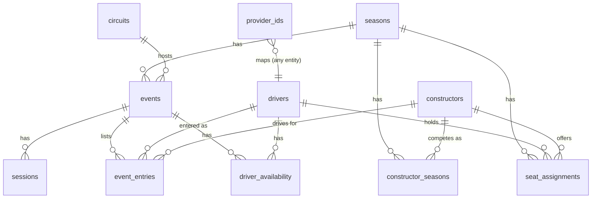
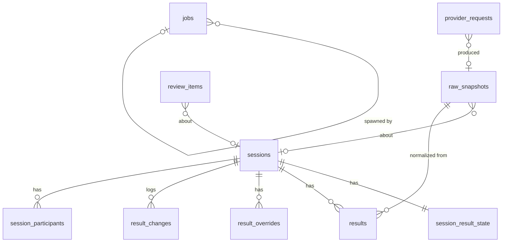

# Gridlocked — Data Model

**Status:** Phase 2 in progress. Part 0 (conventions and the checking method) and Part 1 (reference data) are drafted. Part 1 was revised on 2026-10-27 after a scenario check against the real 2026 calendar, and you approved it. Part 2 (ingestion and results) is drafted for review. Parts 3–6 come next, one at a time.
**Date:** 2026-10-27
**Builds on:** [01-high-level-design.md](01-high-level-design.md), approved 2026-10-27. Section references like "HLD §5.2" point there.

This document defines the tables, keys and constraints. It's still a design, not code: no migrations or Drizzle files are written until phase 5. Labels work as before: **Decided** (in the HLD or your answers), **Verified** (checked against a source), and **Proposed** (my recommendation, waiting for your review).

## How we'll review it

The model is split into parts that follow the HLD's modules. Each part is reviewed before the next one is written, so a change in one part doesn't ripple through drafts you haven't seen.

| Part | Covers | Status |
|---|---|---|
| 0 | Conventions used everywhere | **Drafted** |
| 1 | Reference data: seasons, events, sessions, drivers, constructors, entries, availability, provider IDs | **Drafted** |
| 2 | Ingestion and results: raw snapshots, normalized results, overrides, the review queue, the job table | **Drafted** |
| 3 | Fantasy core: games, rulesets, the pool and prices, teams, lineup versions, transfers, chips, team value | Next |
| 4 | Scoring and standings: asset score lines, team ledger, per-event totals, leagues, tiebreaks | |
| 5 | Community: categories, threads, posts, chat, votes, spoiler state, moderation, notifications | |
| 6 | Identity, admin and audit: Better Auth tables, profiles, roles, trust levels, the audit log | |

---

## Part 0. Conventions (proposed)

### 0.1 Naming
- **Tables are plural snake_case** (`events`, `sessions`), and columns are snake_case. Foreign keys are named `<thing>_id`.
- **Better Auth's tables are renamed** through its model-name settings, so they don't collide with ours or with Postgres reserved words:
  - `user` → `users`, because `user` is reserved in Postgres;
  - `session` → `auth_sessions`, because `sessions` means race sessions here;
  - `account` → `auth_accounts`;
  - `verification` → `auth_verifications`.

  Phase 4 will confirm this renaming works with the admin plugin.

### 0.2 Keys
- **Primary keys are UUIDv7, generated by the app** (proposed).
  - **Why:**
    - They're safe to show in URLs; a sequential ID would leak counts of users and posts.
    - Seeding and the 2026 replay harness can create rows offline without colliding.
    - UUIDv7 is time-ordered, so indexes stay compact, unlike random UUIDv4.
    - We don't depend on Postgres 18's built-in `uuidv7()`.
  - **Alternative:** `bigint` identity keys. They're smaller and faster to join, but they'd need a separate public ID for URLs.
  - **Better Auth** is set to generate UUIDs too, so `users.id` matches everything else.
- **Natural keys get unique constraints** even though they're not the primary key. Examples: `(season_id, round)` on events and `(event_id, kind)` on sessions.
- **Slugs** (`max-verstappen`, `2027-monaco`) are unique and used in URLs. They're never used as foreign keys, so they can be changed.

### 0.3 Types
| Kind of value | Type | Notes |
|---|---|---|
| Timestamps | `timestamptz`, stored in UTC | Displayed in the user's timezone. Event pages can also show circuit local time |
| Calendar dates (e.g. date of birth) | `date` | |
| Status and kind fields | `text` plus a `CHECK` constraint listing allowed values | Easier to change than Postgres enums. Drizzle's `text({ enum })` gives the TypeScript type |
| Money (prices, budget, bank) | `integer`, in **units of $0.1M** | $23.4M is stored as `234`; the $100M cap is `1000`. Exact arithmetic and no floats. Every official price is a multiple of $0.1M (verify in Part 3) |
| Fantasy points | `integer` | Official scoring has no fractional points; multipliers are stored as integer deltas |
| Flexible parameters | `jsonb`, validated by a Zod schema in the app | Only for versioned config such as rule parameters. Never for data we query by |

### 0.4 Row history and deletes
- **Mutable tables have `created_at` and `updated_at`.**
- **Nothing is soft-deleted with an `is_deleted` flag.** Things that can be withdrawn get a real status instead, such as a post being `removed` or an event being `cancelled`, so queries say what they mean.
- **Hard deletes are only for privacy requests** (GDPR/CCPA, HLD §13.6) and for data with a retention policy, such as chat (Part 5).
- **Versioned things are append-only:** lineup versions, ruleset versions, price history and raw snapshots. A version row is never updated after the moment it takes effect.
- **Admin changes are written to `audit_log`** (Part 6) in the same transaction as the change.

### 0.5 Layers never mix (decided, HLD §3.3)
- Reference (Part 1), results (Part 2) and game data (Parts 3–4) live in separate tables.
- Foreign keys only point **down** the stack: game → results → reference. Results never hold points, and game tables never edit results.
- **Spoiler scoping:** every row that reveals a session's outcome carries a `session_id` or `event_id`, so spoiler filtering is a join, not guesswork (HLD §7.3).

### 0.6 How each part is checked
Every part ends with the same three checks before it comes to you for review:

1. **A scenario table.** Each real situation the part must survive is listed, with how the model handles it. Real cases come from F1 history, plus anything we can verify in the 2026 data. A scenario that *isn't* handled is listed as a known limit with what fixing it later would cost; it isn't left out. Part 1's table is in 1.14.
2. **A scale table.** Row counts at three sizes, plus the hot queries and the indexes that serve them:
   - beta: about 500 users and 1,000 teams;
   - established: about 10k users and 25k teams;
   - big: about 100k users and 250k teams.

   The free tier only has to carry the beta. The larger sizes have to work without a redesign, though they may need paid plans.
3. **A change test.** For the changes we can foresee, the part says what kind of change each would be:
   - **config only:** a row in a versioned config table;
   - **additive migration:** a new column or table, with nothing rewritten;
   - **redesign:** existing data has to be reshaped.

   Redesigns are what the model is built to avoid. Each one that remains is called out with a reason.

### 0.7 Sturdiness rules (apply everywhere)
- **The database enforces the rules that matter, not just the app.** That means foreign keys, `CHECK` constraints, unique and exclusion constraints, and the lock trigger in Part 3. A bug in one API route then can't corrupt the data.
- **Foreign keys default to `ON DELETE RESTRICT`.** Cascades are used only for true children, such as a lineup version's picks. Accidentally deleting a parent fails loudly instead of silently taking history with it.
- **Admin edits use optimistic concurrency.** Editable rows carry a `version` integer, and a save that started from a stale version is rejected. Two admins resolving the same queue item can't overwrite each other.
- **Writes from jobs are idempotent.** They use natural unique keys and `INSERT … ON CONFLICT`, plus a scoring run ID for replace-style writes (HLD §3.3).
- **Migrations are expand-then-contract.** Add the new column or table, backfill, switch reads, and only drop the old one in a later release. No migration needs downtime or a big rewrite under load.
- **Big tables are planned for partitioning from day one.** The team ledger, chat and raw snapshots get keys that let them be partitioned by season or month later without changing queries. Partitioning itself waits until a table is big enough to need it.
- **Derived data can always be rebuilt from source.** Standings, totals and caches are materialized for speed, but each one has a rebuild path from the ledger and results. A bad cache is a re-run, not a data repair.

### 0.8 Deliberately not flexible (so the model stays simple)
Being flexible everywhere makes everything harder. These limits are chosen on purpose, with the cost of changing them later:

| Limit | Why | Cost to change later |
|---|---|---|
| One series (F1). There's no `series` column | Jolpica is F1-only, and the product is F1-only | Additive: add a `series` table, a column on `seasons` and a changed unique key. Everything else hangs off seasons |
| One scoring ruleset per game, shared by every league. **No per-league scoring (decided 2026-10-27, yours)** | Lets asset scores be computed once and shared by all teams (HLD §5.6), which is what keeps scoring cheap at scale | **Redesign** of the ledger; accepted |
| ~~One game~~ **Kept open (decided 2026-10-27, yours).** Teams, leagues and the ledger belong to a `games` row (season + game type + ruleset + budget), not directly to a season. Launch has one game type, `season_fantasy` | A second game, such as a weekly prediction game, becomes new tables for its own mechanics, not a reshape of existing ones | Designed in Part 3 |
| No multi-tenancy (one site) | | Not planned |

### 0.9 Storage budget (free tier)
Neon's free plan allows 1 GB per project (HLD §11.4). The rough sizes below will be checked against measured row sizes in Part 4.
- Reference and results data is tiny: a season is a few thousand rows.
- The big tables will be the team ledger (Part 4), posts and chat (Part 5), and raw snapshots (Part 2).
- Each of those parts states its expected size and its retention rule.

---

## Part 1. Reference data (proposed)

This is the real-world calendar and line-up: facts about the sport, with no game logic in them. Sync jobs and admins write it; everything else reads it.

### 1.1 `seasons`
| Column | Type | Notes |
|---|---|---|
| id | uuid PK | |
| year | integer, unique | 2026, 2027 |
| status | text: `upcoming`, `active`, `completed` | Drives which season the app shows by default |

The fantasy ruleset, budget and pool are attached in Part 3, so this table stays a pure fact table.

### 1.2 `circuits`
| Column | Type | Notes |
|---|---|---|
| id | uuid PK | |
| slug | text, unique | `monaco` |
| name | text | "Circuit de Monaco" |
| locality, country | text | From Jolpica |
| latitude, longitude | numeric(9,6) | From Jolpica |
| timezone | text (IANA), not null | e.g. `Europe/Monaco`. Jolpica doesn't provide it, so it's seeded once per circuit, by an admin or derived from coordinates |

### 1.3 `events` (a race weekend)
| Column | Type | Notes |
|---|---|---|
| id | uuid PK | |
| season_id | uuid FK → seasons | |
| round | integer | Unique with `season_id`, and the constraint is **deferrable** so a whole calendar can be renumbered in one transaction. It's display order only: nothing else references an event by round (see below) |
| slug | text, unique | Built from the season and the event **name**, not the circuit: `2026-bahrain-grand-prix-in-malaysia`. A season can visit one circuit twice (2020 had two races each at the Red Bull Ring, Silverstone and Bahrain) |
| name | text | "Monaco Grand Prix". Facts used descriptively (HLD §13.4) |
| circuit_id | uuid FK → circuits | |
| format | text: `standard`, `sprint` | Sets which sessions are created by default. New formats are a new allowed value plus a session template in config |
| status | text: `scheduled`, `cancelled`, `completed` | `completed` is set by the finalizer (HLD §4.4) |
| lock_session_id | uuid FK → sessions, nullable | The session whose start locks the game: Qualifying, or Sprint Qualifying on sprint weekends. It's stored explicitly rather than inferred from `format`, so a new format can't silently move the lock |
| lock_at | timestamptz, not null | **The fantasy lock** (HLD §5.2). Defaults to `lock_session_id`'s scheduled start and follows it when that session moves, until an admin overrides it (audited) |
| lock_at_source | text: `default`, `admin` | Tells the sync job not to overwrite an admin's change |

Why `lock_at` is here and not in the game tables: it's a time the whole site uses, including thread modes, reminders and the scheduler's due-times file (HLD §4.5). Enforcement still happens in the game layer (Part 3).

**Cancelled, moved and renumbered events (verified with 2026 data).** Jolpica's 2026 calendar now has 23 rounds. The April races in Bahrain and Saudi Arabia are **gone from the feed entirely**. Every later round was **renumbered**: Miami is now round 4. A "Bahrain Grand Prix in Malaysia" runs at **Sepang** in October. So:
- **An event's identity is its row ID.** It isn't the round, the name or the circuit, since all three can change.
- **A cancelled event keeps its row**, with `status = cancelled`. It's never deleted, so threads, notifications and history that point at it stay valid.
- **The sync job never deletes.** An event that disappears from the provider goes to the admin queue as "missing from provider", and an admin marks it cancelled. A new or relocated event is matched by date and name first; when the match is uncertain, an admin confirms it.
- **Round renumbering changes only `round`.** Nothing else stores round numbers (see seats, 1.8).

What a cancellation does in the game (whether transfers are counted and whether chips are refunded) is settled in Part 3.

### 1.4 `sessions`
| Column | Type | Notes |
|---|---|---|
| id | uuid PK | |
| event_id | uuid FK → events | |
| kind | text: `fp1`, `fp2`, `fp3`, `sprint_qualifying`, `sprint`, `qualifying`, `race` | |
| sequence | smallint, default 1 | Unique `(event_id, kind, sequence)`. This allows a format with two sessions of the same kind, such as a two-race weekend, without changing the schema |
| scheduled_start | timestamptz, not null | From Jolpica (verified: Jolpica gives a start time per session) |
| start_confirmed | boolean | False while only a date is known (early calendars). The UI shows "TBC", and the lock isn't announced until it's true |
| scheduled_end | timestamptz, not null | **Jolpica gives no end time** (verified in the samples). It defaults to start + a per-kind duration from config (e.g. race 2 h; proposed values in Part 2), and an admin can edit it |
| time_source | text: `provider`, `admin` | Same rule as `lock_at_source` |
| status | text: `scheduled`, `live`, `suspended`, `completed`, `abandoned`, `cancelled` | `live` and `completed` come from the clock plus results arriving; the rest are admin-set. `suspended` covers a red flag that runs past the scheduled end, so chat stays in live mode. `abandoned` means the session started but didn't finish normally (e.g. Spa 2021: results taken from an early lap). How the game scores an abandoned session is a ruleset question (Part 3). A session moved to another day (e.g. Suzuka 2019 qualifying moved to Sunday) just gets new times |

Whether a session is scored is decided by the ruleset (Part 3), not stored here.

### 1.5 `drivers` (follows the person; decided)
| Column | Type | Notes |
|---|---|---|
| id | uuid PK | |
| slug | text, unique | `max-verstappen`. A suffix is added on a clash, since historical drivers can share names |
| given_name, family_name | text | As the provider gives them |
| display_name | text, nullable | Overrides the shown name where convention differs, e.g. family-name-first names, or a driver known by a middle name (Andrea Kimi Antonelli is shown as "Kimi Antonelli") |
| code | text, nullable | `VER`. **Not unique**, since codes are reused across eras |
| permanent_number | integer, nullable | Not unique across history. A season's race number lives on the seat (1.8) |
| nationality | text | |
| date_of_birth | date, nullable | |

A driver is one row for life, whatever team they're with. That's why driver points follow the person.

### 1.6 `constructors`
| Column | Type | Notes |
|---|---|---|
| id | uuid PK | |
| slug | text, unique | `red-bull` |
| name | text | Base name |
| nationality | text | |

### 1.7 `constructor_seasons` (how a constructor appears in one season)
| Column | Type | Notes |
|---|---|---|
| constructor_id | uuid FK | Composite PK with `season_id` |
| season_id | uuid FK | |
| display_name | text | The season's entry name, which can change with sponsors |
| short_name | text | For tight mobile layouts |
| color | text, `#RRGGBB` | An accent color only; no logos (HLD §13.4) |

**Rebrands:** a rename keeps the same constructor row with a new `display_name`. A genuinely new entrant gets a new constructor row. We follow how Jolpica draws the line by default, and an admin can merge or split rows through the provider ID map (1.11). Linking a team's whole lineage (Toleman → Benetton → Renault → Alpine) is left for later; nothing in the game depends on it.

### 1.8 `seat_assignments` (the expected line-up over a date range)
| Column | Type | Notes |
|---|---|---|
| id | uuid PK | |
| season_id | uuid FK | |
| driver_id | uuid FK | |
| constructor_id | uuid FK | |
| car_number | integer | The number for that season |
| role | text: `race`, `reserve` | |
| valid_from | date | First day this seat applies |
| valid_to | date, nullable | Null means until further notice |

This is the "who drives for whom" list for the season. A mid-season swap **closes one range and opens another**; it never edits history.

**Ranges are dates, not rounds** (changed after checking the 2026 data). Round numbers move when the calendar changes, and in 2026 they did, after the seats were set. A date range keeps meaning the same thing when events are cancelled, added or renumbered. The admin UI still lets you pick "from the Dutch GP onwards" and stores that event's start date.

For the 2026 swap (HLD §8.1), effective from the Dutch GP (round 12, 2026-08-21):
- Lawson's `rb` seat closes, and a `red_bull` seat opens.
- Tsunoda's seat moves to `rb`.
- Hadjar's `race` seat closes.

**Constraint:** a driver can't hold two `race` seats in overlapping ranges. This is enforced with an exclusion constraint on `(driver_id, daterange(valid_from, valid_to))` for race seats. That needs the `btree_gist` extension, which Neon supports. A second exclusion constraint stops two race seats from using the same `car_number` at the same time.

### 1.9 `event_entries` (who is expected at this event)
| Column | Type | Notes |
|---|---|---|
| event_id | uuid FK | Composite PK with `driver_id` |
| driver_id | uuid FK | |
| constructor_id | uuid FK | |
| car_number | integer | |
| source | text: `seat`, `admin`, `results` | `seat`: copied from seat assignments when the event is created. `admin`: changed by an admin. `results`: seen in a session's results |

**Refinement of HLD §5.6 (proposed): event entries are the expected line-up, while scoring uses each result row's constructor.** The HLD says a constructor scores "whoever drove its cars at that event (from `entry` rows)". But substitutions can happen **mid-weekend**: a driver can fall ill after the sprint, or a reserve can start from FP3. Each result row from Jolpica already says which constructor the driver drove for **in that session** (verified in the samples). So:
- **Scoring:** a constructor's points come from the result rows that name it, session by session (Part 2).
- **Event entries** drive the team builder's warnings, the roster checker and the validator. A result row whose driver–constructor pair isn't in `event_entries` is a roster surprise, and it holds scoring for admin review (HLD §8.2).
- FP1 young-driver runs don't affect either, because practice isn't scored. The roster checker treats FP1 as a weak signal (HLD §8.2).
- **A mid-weekend substitution** (e.g. Bearman replacing Sainz from FP3 at Jeddah 2024): both drivers have entries for that event with the same constructor. The validator checks car counts **per session** against the results, not per event, so three drivers sharing two cars over a weekend is valid.

### 1.10 `driver_availability` (per-event status of pool drivers; decided, HLD §8.1)
| Column | Type | Notes |
|---|---|---|
| event_id | uuid FK | Composite PK with `driver_id` |
| driver_id | uuid FK | |
| status | text: `available`, `doubtful`, `unavailable`, `reserve` | |
| reason | text, nullable | Shown in the team builder, e.g. "Injured (wrist)" |
| source | text: `default`, `roster_check`, `admin` | |
| updated_at | timestamptz | |

Every pool driver gets a row for every event, created with `available`.

**This status is for people, not for scoring.** It drives the team-builder warning and the notifications. Scoring doesn't read it: a pool driver missing from a scored session's results gets the NC or no-time penalty because they're missing (HLD §6), whatever this table says. That keeps a stale status from ever changing points. "Who is in the pool" is a game fact, so the pool itself is in Part 3. This table holds only the real-world status.

### 1.11 `provider_ids` (only adapters read it; decided, HLD §3.3)
| Column | Type | Notes |
|---|---|---|
| provider | text: `jolpica`, `openf1`, … | |
| entity_type | text: `circuit`, `event`, `session`, `driver`, `constructor` | |
| provider_key | text | `max_verstappen`, `red_bull`, an OpenF1 `session_key`, or for Jolpica events `season/round` |
| entity_id | uuid | Our ID |

- **Constraints:** unique `(provider, entity_type, provider_key)`, and unique `(provider, entity_type, entity_id)`.
- **This is a deliberate exception to "every relationship is a foreign key":** `entity_id` points at a different table depending on `entity_type`. The adapter code checks it, and a nightly integrity job reports orphans.
- **Jolpica event keys aren't stable**, because rounds get renumbered (1.3). The adapter re-matches events on every sync by season, date and name, and updates the key. A key that would move to a different event of ours goes to the admin queue instead of being applied.
- **Switching to another provider** (e.g. Sportradar) means adding rows here, not changing other tables.

### 1.12 What writes reference data
| Writer | Writes |
|---|---|
| Calendar sync (Jolpica) | circuits, events, sessions (times only where `*_source` is still the default), drivers, constructors, provider IDs |
| Admin seeding (2027 pre-season, HLD §2) | Everything above while Jolpica has no 2027 data, plus seat assignments, circuit timezones and constructor colors |
| Roster checker and admins (HLD §8.2) | Event entries and driver availability, through the review queue |
| Finalizer | `events.status = completed` |

### 1.13 Indexes beyond keys
- `sessions (scheduled_start)`: the scheduler and the "what's on now" lookup.
- `events (season_id, lock_at)`: the next lock.
- `seat_assignments (season_id, constructor_id)`: listing a team's drivers.
- Exclusion constraints (1.8) come with their own GiST indexes.

### 1.14 Scenario check
| Scenario | Real example | How it's handled |
|---|---|---|
| Event cancelled before the weekend | Bahrain and Saudi Arabia 2026 (verified: removed from Jolpica) | Row kept as `cancelled`; the sync flags it, never deletes it (1.3) |
| Calendar renumbered mid-season | 2026: Miami is now round 4 (verified). It was round 6 on the original calendar (from memory) | Only `round` changes. Seats use dates, and provider keys are re-matched (1.3, 1.8, 1.11) |
| Event relocated, keeping its name | "Bahrain Grand Prix in Malaysia" at Sepang, 2026 (verified) | Identity is the row; the circuit is just a column. The admin confirms the uncertain match |
| Two events at one circuit in a season | 2020: Red Bull Ring, Silverstone and Bahrain twice each | No unique key on circuit; slugs come from event names (1.3) |
| Session moved to another day | Suzuka 2019: qualifying moved to Sunday | New times; `lock_at` follows its session unless an admin overrode it (1.3, 1.4) |
| Long red flag | Many races; the 2021 Belgian GP never really started | `suspended` keeps live chat open; `abandoned` hands the scoring question to the ruleset (1.4) |
| Calendar published before session times | 2027 seeding | `start_confirmed = false`, shown as TBC (1.4) |
| New weekend format | Sprint formats changed in 2021, 2023 and 2024 | New `format` value plus a session template, and `sequence` allows repeated session kinds. The lock session is explicit (1.3, 1.4) |
| New team joins | Cadillac, 2026 (11 teams) | New constructor and its seats; grid size is never fixed |
| Team renamed | Sauber → Audi; AlphaTauri → RB | New `display_name` per season, or a new constructor if it's a new entrant (1.7) |
| Mid-season driver swap | Lawson/Tsunoda/Hadjar 2026 (verified) | One seat range closes and another opens (1.8) |
| Mid-weekend substitute | Bearman for Sainz, Jeddah 2024 | Both have entries; cars are counted per session; scoring uses result rows (1.9) |
| Injured pool driver | Any | Availability is for warnings only; missing from results means the penalty applies (1.10) |
| Driver known by another name | Kimi Antonelli; family-name-first names | `display_name` (1.5) |
| Car number reused or changed | A champion running #1, then going back to their own number | The number lives on the seat, and two race seats can't share it at once (1.8) |
| Historical seasons for hub pages | 1950 onwards from Jolpica | The same tables work for any year. About 1,100 races × about 25 rows is tiny |
| A third car per team | Proposed in the past, never adopted | Nothing assumes two cars; the validator's car count is config |

**Known limit:** a constructor renamed **during** a season, which hasn't happened in modern F1, would show one name for the whole season. Fixing it would be additive: give `constructor_seasons` date ranges like seats have.

### 1.15 Scale
Reference data is tiny at every size: a season is about 24 events, 150 sessions, 30 drivers, 11 teams and about 600 availability rows. History back to 1950 adds tens of thousands of rows. User numbers don't change any of it, so its indexes are about query shape, not volume (1.13).

---

## Part 2. Ingestion and results (proposed)

This part covers how provider data comes in, becomes trusted per-session facts, and gets corrected. It holds **facts only, never points** (0.5). It also defines the job table that every background task uses, and the admin review queue that the validator and roster checker feed.

**How it flows:**
1. A job calls a provider through the shared HTTP client, and the call is logged (`provider_requests`).
2. A response with new content becomes an immutable `raw_snapshot`.
3. The normalizer turns the newest snapshot for a session into `results` rows, and logs what changed since the previous snapshot (`result_changes`).
4. `effective_results` is a view: provider rows with admin overrides applied. **Scoring, results pages and results posts all read the view.** Nothing reads `results` directly.
5. The validator checks the effective results. A problem opens a `review_item` and holds the session's status at `under_review`.

### 2.1 `provider_requests` (the HTTP call log)
| Column | Type | Notes |
|---|---|---|
| id | uuid PK | |
| provider | text | `jolpica`, `openf1`, … |
| endpoint | text | e.g. `/2026/18/qualifying` |
| params | jsonb | Normalized query parameters |
| requested_at | timestamptz | |
| status_code | integer, nullable | Null on a network error |
| duration_ms | integer | |
| outcome | text: `new_snapshot`, `unchanged`, `error`, `rate_limited` | |
| snapshot_id | uuid FK → raw_snapshots, nullable | The snapshot this call produced or matched |
| error | text, nullable | |
| job_id | uuid FK → jobs, nullable | Which job made the call |

- **What it's for:** monitoring ("is the poller stuck?"), rate-limit accounting, and debugging.
- **Retention:** 30 days, then pruned. It's operational data, not history.

### 2.2 `raw_snapshots` (exactly what a provider said; append-only)
| Column | Type | Notes |
|---|---|---|
| id | uuid PK | |
| provider | text | |
| endpoint | text | |
| params_hash | text | Hash of `(provider, endpoint, params)`: "the same question" |
| content_hash | text | SHA-256 of the response body after canonical JSON formatting, so key order doesn't count as a change |
| body | jsonb | The provider's response, unchanged. Stored with lz4 TOAST compression (confirm Neon supports it in phase 4) |
| body_bytes | integer | For the storage dashboard |
| first_fetched_at | timestamptz | |
| last_seen_at | timestamptz | Updated when the same content is fetched again |
| season_id, event_id, session_id | uuid FKs, nullable | What the snapshot is about, when the adapter knows. Calendar and driver-list snapshots have only `season_id` |

- **Unique `(params_hash, content_hash)`.** The same answer to the same question is stored once. A refetch with unchanged content only bumps `last_seen_at` and logs an `unchanged` request.
- **Change detection comes free:** a new `content_hash` for the same `params_hash` means the provider changed something, such as a stewards' penalty (HLD §4.2).
- **The replay harness** (HLD §12) reads snapshots in `first_fetched_at` order under a simulated clock.
- **Retention:** kept permanently for the current and previous season, since they're the audit trail for points. Snapshots from bulk history imports (hub pages, 1950 onwards) can be dropped once normalized, because nothing scores them.
- **If it grows:** bodies can move to Neon Object Storage (5 GB free), leaving a `body_key` column. That's an additive change (2.11).

### 2.3 `session_result_state` (one row per session: where its results stand)
| Column | Type | Notes |
|---|---|---|
| session_id | uuid PK, FK → sessions | |
| status | text: `awaiting`, `provisional`, `under_review`, `final` | `awaiting`: no results yet. The HLD's per-row status lives here, since rows always share their session's state |
| source | text: `provider`, `manual` | Where the current provider rows came from. `manual` means an admin entered the whole session (2.6) |
| current_snapshot_id | uuid FK, nullable | The snapshot the current `results` rows were normalized from |
| poll_attempts | integer | For backoff |
| next_poll_at | timestamptz, nullable | Also published to the scheduler's due-times file (HLD §4.5) |
| gave_up_at | timestamptz, nullable | Set when the poll window (proposed: 24 h) runs out; it raises an admin alert |
| finalized_at | timestamptz, nullable | |
| reopened_count | integer | Reopening a final session is audited (HLD §4.4) |
| version | integer | Optimistic concurrency (0.7) |

### 2.4 `results` (normalized provider facts; one row per driver per session)
| Column | Type | Notes |
|---|---|---|
| session_id | uuid FK | Composite PK with `driver_id` |
| driver_id | uuid FK | |
| constructor_id | uuid FK | **The car driven in this session.** Constructor points follow this (1.9) |
| snapshot_id | uuid FK → raw_snapshots | Provenance |
| car_number | integer | |
| position | integer, nullable | The classified or finishing order as the provider gives it. In qualifying it's the official qualifying order, **never** derived from lap times (HLD §2) |
| classification | text: `classified`, `not_classified`, `disqualified`, `did_not_start`, `did_not_qualify`, `excluded` | Our canonical outcome (mapping below) |
| provider_status | text | Kept as given: `Finished`, `Lapped`, `Retired`, `Did not start`, … |
| provider_position_text | text | `1`, `R`, `W`, `D`, … |
| grid | integer, nullable | Sprint and race only. Null for a pit-lane start, with the flag below |
| pit_lane_start | boolean | Jolpica reports it as `grid = 0`. Scoring treats it as last on the grid (HLD §5.6) |
| laps | integer, nullable | |
| time_ms | bigint, nullable | Race or sprint time for the winner and classified finishers |
| fastest_lap_rank | integer, nullable | |
| fastest_lap_ms | integer, nullable | |
| q1_ms, q2_ms, q3_ms | integer, nullable | Qualifying and sprint qualifying. **No time is null**, whether the provider sends `""` or leaves the key out (verified: both happen) |
| official_points | numeric(4,1), nullable | Championship points, for hub pages. Never used in fantasy scoring |

**Why one table rather than one per session type:** the scoring engine wants one shape ("give me this session's effective results"), and the fields barely differ. `CHECK` constraints keep session-specific fields where they belong, for example no `grid` on qualifying rows. Those checks need the session kind, so a trigger copies `sessions.kind` into the row on insert.

**Classification mapping (proposed; checked against 2026 data):**

| Provider says | `classification` | Note |
|---|---|---|
| numeric `positionText` (any status, including `Retired`) | `classified` | 7 drivers in the 2026 samples were `Retired` but still classified, because they'd completed enough distance |
| `R` or `N` | `not_classified` | |
| `D` | `disqualified` | |
| `E` | `excluded` | Rare. The ruleset decides whether it scores like a DSQ |
| `W` (status `Did not start`) | `did_not_start` | 7 such rows in the 2026 samples |
| `F` | `did_not_qualify` | Historical (107% rule) |
| Qualifying: driver listed with no times | `classified` with all Q times null | "No time set" is **derived** from `q1_ms is null`, not stored |

An unknown `positionText` value fails normalization and opens a review item. We don't guess.

**On a new snapshot,** the normalizer replaces the session's `results` rows in one transaction: it deletes them, inserts the new set, and updates `current_snapshot_id`. Earlier versions survive as snapshots and as `result_changes` rows.

### 2.5 `result_changes` (what changed between snapshots)
| Column | Type | Notes |
|---|---|---|
| id | uuid PK | |
| session_id | uuid FK | |
| driver_id | uuid FK | |
| field | text | e.g. `position`, `classification`, `time_ms` |
| old_value, new_value | text | |
| from_snapshot_id, to_snapshot_id | uuid FKs | |
| detected_at | timestamptz | |

This powers "Why did my score change?": for example "Stewards: +5 s, P6 → P8". It also powers spoiler-safe correction notices, and lets admins see at a glance what a re-fetch changed. It's written by the normalizer at the same time as the rows, and is small: a few rows per correction.

### 2.6 `result_overrides` (the admin layer; decided, HLD §4.3)
| Column | Type | Notes |
|---|---|---|
| id | uuid PK | |
| session_id | uuid FK | |
| driver_id | uuid FK | |
| kind | text: `patch`, `insert`, `suppress` | `patch`: replace some fields of the provider row. `insert`: a row the provider doesn't have, used for manual entry. `suppress`: ignore a bogus provider row |
| fields | jsonb | For `patch` and `insert`: only the fields being set, using `results`' column names. Validated by a Zod schema |
| reason | text, not null | Shown in the audit log, and in the score explanation when it affects points |
| created_by | uuid FK → users | |
| created_at | timestamptz | |
| revoked_at, revoked_by | nullable | Revoking reverts cleanly to the provider value |
| version | integer | |

- **At most one active override per `(session_id, driver_id)`**, enforced by a partial unique index `WHERE revoked_at IS NULL`. Editing one revokes it and creates the replacement, so history stays readable.
- **Why `jsonb` here, against rule 0.3:** an override sets an arbitrary subset of fields, and we never query by those fields. The Zod schema is generated from the `results` columns, so the two can't drift apart.
- **Manual entry of a whole session** (provider down, HLD §4.4) is a set of `insert` overrides, with `session_result_state.source = manual`. **If provider data arrives later,** the normalizer stores it as normal but **doesn't** remove the manual rows. It opens a review item instead ("provider data arrived; compare and choose"), and the admin either revokes the inserts or keeps them. Nothing changes silently.

### 2.7 `effective_results` (a view; what everything reads)
- Provider rows with any active `patch` applied field by field, plus active `insert` rows, minus rows with an active `suppress`.
- Each row says whether it was overridden, so the UI and score explanations can show "corrected by admin: reason".
- **A plain view, not materialized.** A session is about 22 rows, so the join is trivial. Scoring snapshots what it read into its own run (Part 4), so a later override can't change a past run's explanation without a re-score.

### 2.8 `session_participants` (who took part in practice; the roster signal)
| Column | Type | Notes |
|---|---|---|
| session_id | uuid FK | Composite PK with `driver_id` |
| driver_id | uuid FK | |
| constructor_id | uuid FK | |
| provider | text | OpenF1 by default (HLD §4.1) |
| snapshot_id | uuid FK | |

This is kept apart from `results`, because practice isn't scored and its data comes from a different provider with different coverage. The roster checker compares FP2 and FP3 participants with `event_entries` (HLD §8.2).

### 2.9 `review_items` (the admin queue for every "a human must decide")
| Column | Type | Notes |
|---|---|---|
| id | uuid PK | |
| kind | text | e.g. `validation_failed`, `unknown_driver`, `team_change`, `missing_driver`, `event_missing_from_provider`, `uncertain_event_match`, `provider_after_manual`, `unknown_classification`, `provider_mismatch` |
| severity | text: `blocking`, `warning` | `blocking` holds scoring for the linked session; `warning` doesn't |
| season_id, event_id, session_id, driver_id | uuid FKs, nullable | What it's about. Spoiler-scoped by `session_id` |
| details | jsonb | What was found, shaped per `kind` |
| status | text: `open`, `resolved`, `dismissed` | |
| resolution | text, nullable | What the admin decided |
| resolved_by, resolved_at | nullable | |
| dedupe_key | text | Unique while open, so a repeated check doesn't pile up duplicates |
| version | integer | Two admins can't both resolve it (0.7) |
| created_at | timestamptz | |

**Rule:** a session's status can't become `provisional` or `final` while it has an open `blocking` item. The status change is made in the same transaction as the check.

### 2.10 `jobs` (one table for all background work)
| Column | Type | Notes |
|---|---|---|
| id | uuid PK | |
| kind | text | e.g. `poll_session`, `normalize`, `validate`, `score_session`, `finalize_check`, `roster_check`, `open_threads`, `send_notifications`, `price_update`, `sync_calendar` |
| dedupe_key | text | Unique with `kind`. Built so the *same* work can't be queued twice, e.g. `poll:<session_id>:<attempt>` or `open_threads:<event_id>` |
| payload | jsonb | Small; per-kind Zod schema |
| run_at | timestamptz | When it becomes due |
| status | text: `pending`, `running`, `succeeded`, `failed`, `dead` | `failed` is retried with backoff. After `max_attempts` it becomes `dead` and alerts admins |
| attempts, max_attempts | integer | |
| locked_until | timestamptz, nullable | A lease. If a worker dies mid-job, the lease runs out and another worker picks it up |
| last_error | text, nullable | |
| parent_job_id | uuid FK → jobs, nullable | For fan-out (below) |
| created_at, started_at, finished_at | timestamptz | |

- **How a job is claimed:** `UPDATE … WHERE id = (SELECT … WHERE status='pending' AND run_at <= now() ORDER BY run_at FOR UPDATE SKIP LOCKED LIMIT 1)`. Two workers, or two overlapping ticks, can never take the same job.
- **Calendar-driven work is planned ahead.** When an event is created or its times change, its jobs are written as `pending` rows with future `run_at`: open threads, flip chat modes, lock reminders, start polling, finalizer checks. A time change **updates `run_at`** of the matching pending job through its `dedupe_key`; nothing is deleted and recreated. The scheduler's due-times file is just "the next few `run_at` values" (HLD §4.5).
- **Fan-out is batched.** "Notify everyone in league X" or "score is final for 250k teams" is a parent job that spawns child jobs, each handling about 1,000 users or teams. No single job grows with the user count, and a failed batch retries alone.
- **Retention:** `succeeded` jobs are pruned after 30 days. `dead` jobs are kept until an admin clears them.

### 2.11 Configuration used by this part
These sit in a small `settings` table (key, Zod-validated value, `updated_by`, `updated_at`) and are audited:
- **Session durations** for defaulting `scheduled_end` (1.4). Proposed: practice 60 min, sprint qualifying 45 min, qualifying 60 min, sprint 45 min, race 120 min. An overrun is handled by `suspended` and by polling, not by the default.
- **The poll schedule:** start at scheduled end, then backoff 5 → 15 → 60 min, and give up after 24 h (HLD §4.4).
- **Finalizer checks:** +2 h, +6 h, +24 h and +48 h after the race (HLD §4.4).
- **Provider rate limits,** set below each provider's published limits (HLD §4.1).
- **Validator thresholds,** such as expected cars per constructor.

### 2.12 Indexes beyond keys
- `jobs (run_at) WHERE status = 'pending'`: the claim query and the due-times file.
- `jobs (status, finished_at)`: pruning and the admin "stuck or dead jobs" view.
- `raw_snapshots (params_hash, first_fetched_at DESC)`: "latest snapshot for this question".
- `raw_snapshots (session_id)`.
- `result_overrides (session_id) WHERE revoked_at IS NULL`: the effective view.
- `review_items (status, severity, created_at) WHERE status = 'open'`: the admin queue.
- `review_items (session_id) WHERE status = 'open' AND severity = 'blocking'`: the status-change guard.
- `provider_requests (requested_at)`: pruning and monitoring.

### 2.13 Scenario check
| Scenario | Real example | How it's handled |
|---|---|---|
| Time penalty after the race changes the order | Common; e.g. Alonso, Saudi Arabia 2023: penalised after the race, then reinstated the same night | A finalizer re-fetch gives a new content hash, so new rows and a `result_changes` log, then a re-score. The reversal is just another snapshot |
| Disqualification hours after the race | Hamilton and Leclerc both DSQ, China 2025; Russell, Belgium 2024 | Same path. `classification = disqualified`, and other drivers' positions move up |
| Change after the session is final | Appeals and right-of-review cases, days or weeks later | Admin reopens the session (audited) and triggers a re-fetch, or adds an override. Then a re-score |
| Provider data is wrong | A typo or a missing driver | The validator opens a `blocking` review item, and the admin fixes it with a `patch`/`insert`/`suppress` override with a reason |
| Provider down or late | Any | Poller backoff, give up after 24 h, then an admin alert and manual entry as `insert` overrides (2.6) |
| Provider data arrives after manual entry | Follows from the case above | Stored, but a review item asks the admin to choose. No silent swap (2.6) |
| Results published in stages | Partial classification while uploads finish | The validator treats "fewer drivers than entries" as **not yet complete** and keeps polling. It escalates to review only when the poll window ends |
| Q3 driver with no Q3 time | Round 18 2026: 9 Q3 times, 10 Q3 drivers (verified) | `position` is authoritative and `q3_ms` is null. Stage reached comes from position plus the ruleset's cut-offs (Part 3) |
| No time set in Q1, still allowed to start | Common after a crash in Q1 | Classified with null times; "no time set" is derived (2.4) |
| Excluded from qualifying, starts from the back | Hamilton, Brazil 2021 | Qualifying row is `disqualified`/`excluded`. The race row's `grid` is the real starting slot |
| Grid penalty | Common | `grid` is the actual starting grid, which is what positions gained/lost uses (HLD §5.6) |
| Pit-lane start | None in 2026 yet (verified) | `pit_lane_start = true`, `grid` null; synthetic test case |
| Retired but classified | 7 cases in the 2026 samples (verified) | Numeric `positionText` means `classified`, whatever the status says |
| Did not start | 7 `W` rows in the 2026 samples (verified) | `did_not_start`; the ruleset decides the penalty |
| Race abandoned, results from an early lap | Belgium 2021 | Session `abandoned` (1.4). Results stored normally; whether and how it scores is a ruleset rule (Part 3) |
| Substitute in the results | Bearman 2024 | Constructor taken from the row. A pair missing from `event_entries` opens an `unknown_driver` or `team_change` review item (HLD §8.2) |
| Provider renames an ID | Possible on any provider update | An unknown ID opens a review item; the admin maps it in `provider_ids` |
| Jolpica and OpenF1 disagree | Possible | Jolpica is primary. A disagreement opens a `provider_mismatch` warning, not a block |
| Same data fetched again | Every finalizer check | No new snapshot; `last_seen_at` and the request log only |
| Duplicate ticks or two workers | Any cron platform can double-fire | `SKIP LOCKED` claim plus unique `dedupe_key` (2.10) |
| Worker dies mid-job | Function timeout or deploy | The lease runs out and the job is retried. Normalizing and scoring are replace-style, so re-running is safe |
| Session times change after jobs were planned | Delays and rescheduling | Pending jobs' `run_at` is updated through `dedupe_key` (2.10) |
| Switching provider mid-season | e.g. Sportradar | A new adapter writes snapshots under its own `provider`. `results` doesn't care where facts came from; `snapshot_id` records it |
| Replaying 2026 for tests | HLD §12 | Snapshots in fetch order plus the simulated clock drive the same pipeline |

**Known limits:**
- If a provider silently changes its JSON shape, the normalizer fails, and the failure is surfaced as a review item and an alert. Only the adapter changes.
- `official_points` is display-only. A rare half-points race comes from the provider as given and doesn't affect fantasy.

### 2.14 Scale
This part barely grows with users, which is the point: provider data is the same whether 50 or 250k people play.

| Table | Beta | Established | Big | Notes |
|---|---|---|---|---|
| results | ~1.5k rows/season | same | same | Plus about 40k rows of history back to 1950, if hub pages import it |
| raw_snapshots | ~3–5 MB/season | same | same | About 13 KB per race result body (measured); a few versions per session |
| result_changes / overrides | tens to hundreds of rows/season | same | same | |
| provider_requests | a few thousand rows over the 30-day window | same | same | Capped by the providers' rate limits, not by users |
| jobs | ~hundreds per weekend | ~low thousands | ~tens of thousands | Fan-out children grow with users: 250k teams in batches of 1,000 is about 250 children per fan-out. Pruned after 30 days |
| review_items | a handful per weekend | same | same | |

**Hot queries:** the job claim (partial index), effective results per session (about 22 rows), and latest snapshot per question. None of them scans more than a few hundred rows at any size.

### 2.15 Change test
| Foreseeable change | Kind of change |
|---|---|
| A new provider (e.g. Sportradar) | Code only: a new adapter plus `provider_ids` rows |
| A new result fact we'd score later (e.g. pit stop times or overtakes, if paid data arrives) | Additive: a new table such as `pit_stops (session_id, driver_id, …)`, with its own override support. `results` doesn't change |
| Lap-by-lap data (OpenF1 laps) | Additive: a `laps` table, about 32k rows/season |
| A new classification value from a provider | Config and code: a mapping row; the `CHECK` list grows |
| Move snapshot bodies to object storage | Additive: a `body_key` column, a backfill, then drop the old `body` (expand-then-contract, 0.7) |
| Partition snapshots or jobs | Additive; keys already allow it (0.7) |
| New validation rule | Code only |
| New job kind | Code only: a new `kind` value and payload schema |

No foreseeable change here is a redesign.

---

## Open items carried forward
- **Part 2 (resolved here, for your review):** default session durations (2.11); snapshot retention (2.2).
- **Part 3:** the official game's sell-price rule for team value, to be verified before modelling the bank; what a cancelled event does in the game; confirm every official price is a multiple of $0.1M.
- **Part 5:** what happens to a deleted user's posts; how long chat is kept (free-tier storage). These are your calls and will be asked when we get there.
